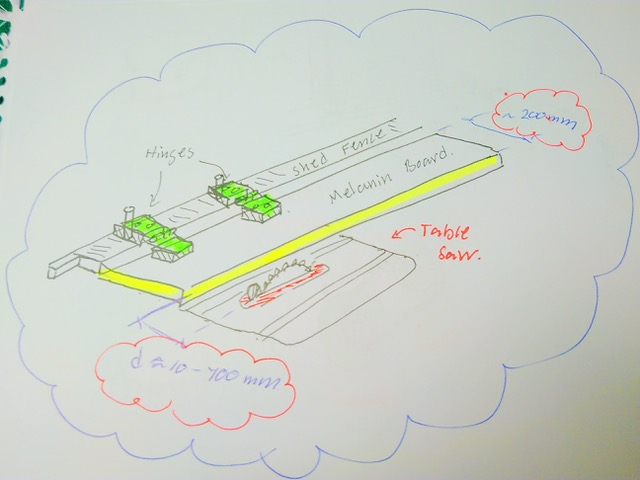
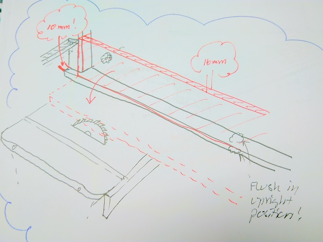

# Todo: Consider to extend indoor shed fence with 300 mm melanin board to enable table saw rip cut material in the 0...210 mm width range?

```#c2fb8021``` *As of 2019-01-01 17:52*

[mail plain/text](mail.txt)


What can I design and build to be able to rip cut material in width below the current lower level of 210 mm?

==&gt; Also see “[Todo: Consider to understand and remember the distinction between Melamine (hard plastic) and Melanin (natural skin pigment)](../27a03fac/chime.md)"

1) Consider a design where I can flip down a 200 or 300 mm Melamine board to rest against current fence and in effect get a new fence with a distance to the blade as low as 10 mm?



NOTE: It shall be **Melamine Board** (Melanin is a skin pigment in living organisms)…

==&gt; Consider to use plain hinges mounted on raisers to allow the Melamine fence extension to be folded up out of the way of the indoor shed fence?

==&gt; Consider to enable the melamine fence to act as a raised fence in upright position (fitting between wall studs) and as extension on folded down position?



==&gt; Consider the should go for a design where the Melamine fence extension can be mounted so that it extends past the blade all the way out of the shed (rest on to op shed slot bottom)?

==&gt; Consider we can have a raised fence also on the folded down extension (L-shaped fold down) with a raised part of 50 mm to be able to fit in the indoor shed wall in upright position?

==&gt; OR, consider we can mount the Makita track in the Melamine fence in folded down position to enable rip-cutting with the Makita circular saw (using a foam support under cut material and the track mounted on sufficient height to allow for thickness of cut material?

NOTE: We need to be able to adjust the distance between the Melamine fence and the track to enable rip cutting of different width?

==&gt; Consider to design a Makita crucial saw attachment to Melamine fence (or indoor shed fence) to mount the saw for rip cuts where we move the material under the saw though the shed?

...

2) Consider what melamine boards I can buy and to what price?

==&gt; Consider 300 mm Melamine board from K-rauta (<https://beta.k-rauta.se/produkt/hyllplan-vit-melamin-18x300x1800mm/7040435202597>)?


NOTE: It seems K-rauta does NOT sell melamine boards with width less than 300 mm?

==&gt; Consider Bauhaus 250 mm melamine boards (<https://www.bauhaus.se/vita-hyllplan-16x250x2035mm.html>)?


Q: Consider to check that at least one long side rim has melamine cheating (to act as the fence surface)?

==&gt; Consider Bauhaus 200 mm Melamine boards (<https://www.bauhaus.se/vita-hyllplan-16x200x2035mm.html?refSrc=15396&nosto=nosto-related-products>)?



