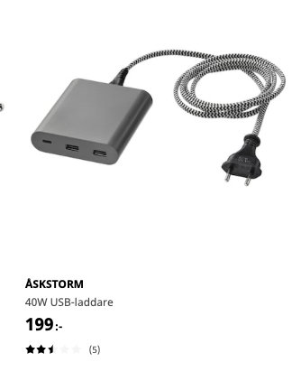
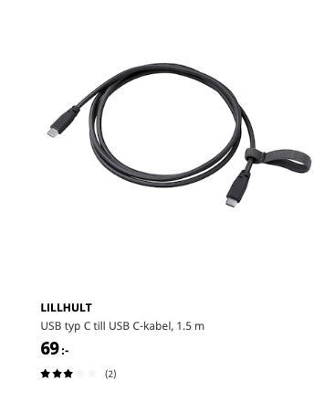
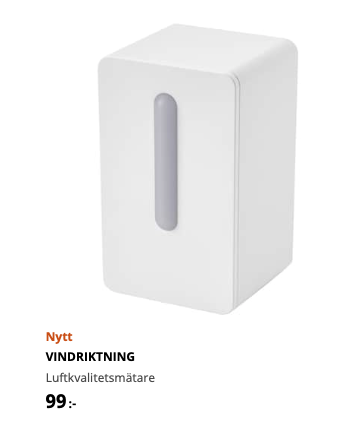
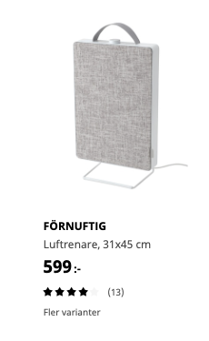
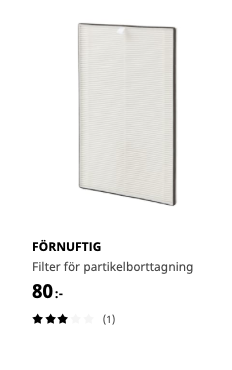
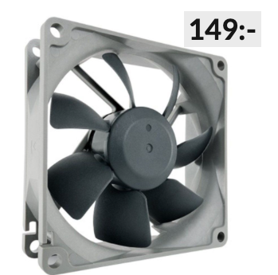
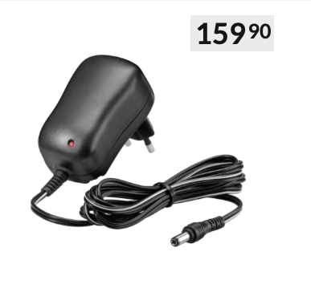
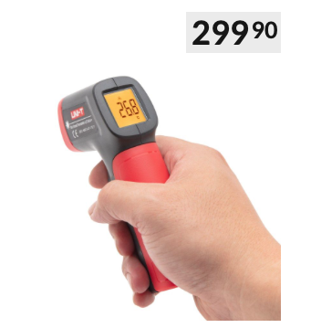
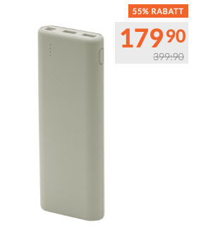
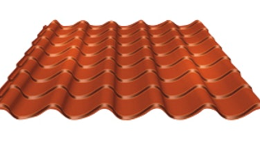

# Todo: Consider to build an heat exchange evaporating cooler "AC" from roofing sheet, plywood and CPU cooling fans with exhaust into chimney?

```#c2ff577a``` *As of 2021-07-15 23:33*

[mail plain/text](mail.txt)


-1) Also buy IKEA USB-C charger and cable?





<https://www.ikea.com/se/sv/p/lillhult-usb-typ-c-till-usb-c-kabel-moerkgra-50491543/>



<https://www.ikea.com/se/sv/p/vindriktning-luftkvalitetsmaetare-70498242/>

 

1) Consider wikipedia "Evaporative cooler" (<https://en.wikipedia.org/wiki/Evaporative_cooler> )?

2) Consider CPU Fan, cables and 12V power adapter?



<https://www.kjell.com/se/produkter/dator/datorkomponenter/kylning/chassiflaktar/noctua-nf-r8-redux-chassiflakt-p61500>

==&gt; Kabel?



<https://www.kjell.com/se/produkter/el-verktyg/stromforsorjning/natadaptrar/acdc-natadaptrar/fast-utspanning/switchad-natadapter-12-v-dc-12-w-p44382>



<https://www.kjell.com/se/produkter/hem-fritid/termometrar-hygrometrar/proffstermometrar/uni-t-ut300a-ir-termometer-p40724>



<https://www.kjell.com/se/produkter/el-verktyg/laddare/mobilladdare/powerbank/linocell-powerbank-15600-mah-gra-p99165>

3) Consider Roofing sheet, Plywood and a wet towel?

174,90 kr

<https://www.k-rauta.se/produkt/takprofil-lindab-torekov-hlpa-1000mm-svart/7319661314627>

...


