# Todo: Consider to document how to assemble my Andrew Klein "Twin Turbo Vise" and prepare to put them into use?

```#c3cf6a6a``` *As of 2022-08-01 00:15*

[mail plain/text](mail.txt)


I consider to use the smaller of my Andrew Klein "Twin Vise" in my indoor sliding wall compact living workplace.

0) It seems the allen key sizes I need are IMPERIAL??

> *Basically, the larger bolts are for allen keys and a 5 mm almost fits, but actually DOES NOT.*

> *I conclude I need a 1/4" (25,4 / 4 = 6,35 mm)...*

> *It seems Jula seels a set for 129 SEK (*[*https://www.jula.se/catalog/verktyg-och-maskiner/handverktyg/verktygsnycklar/insexnycklar/insexnyckelsats-013279/](https://www.jula.se/catalog/verktyg-och-maskiner/handverktyg/verktygsnycklar/insexnycklar/insexnyckelsats-013279/) )?*

> *"**Produktinfo*  
> *Insexnyckelsats med extra långa nycklar.

> Meec Tools insexnycklar är extra långa och kommer i storlekarna 1/16”, 5/64”, 3/32”, 1/8”, 5/32”, 3/16”,1/4”, 5/16”, 3/8”. **"*

> *It seems Clas Ohlsson sells an imperial set of allen keys (<https://www.clasohlson.com/se/Nyckelsats-tum-Cocraft,-9-delar/p/40-7492> )?*

> *"**Medföljande nycklar 1/16, 5/64, 3/32, 1/8, 5/32, 3/16, 1/4, 5/16, 3/8" "*

1) Consider the Youtube video "Twin Turbo Vise Assembly and Installation" (<https://youtu.be/iB1DaLbNRac> )?

==&gt; Put the retainer pin on the center shaft

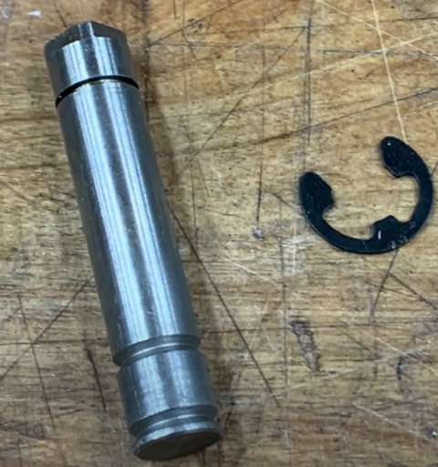

==&gt; Put the five small screws with washers into the gear with five spokes.

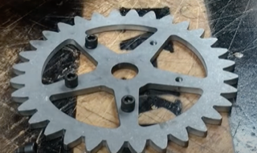

==&gt; Mount one of the five brass bushings on the opposite of the small-screw-side of the five spoke gear and thread the shaft through and mount it to the center threaded hole.

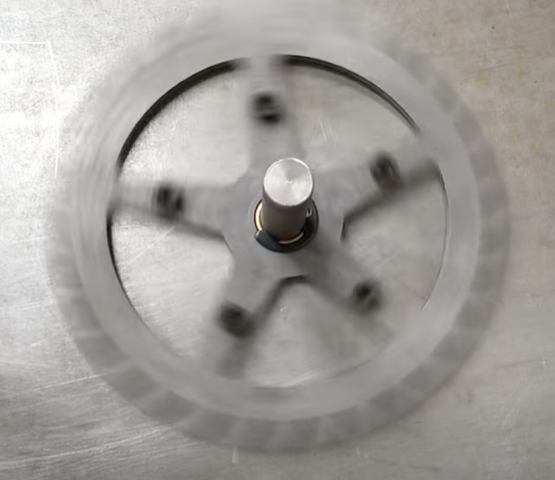

*The center gear should spin freely when assembled correctly*

==&gt; Mount two pairs of four spoke gears (small + large) with four spacers and four screws each.

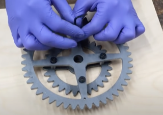

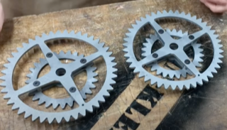

==&gt; Mount the the four remaining brass bushings on the left and right tubes on the metal front plate and slide the works screws through

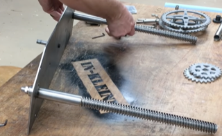

==&gt; Use the end of the vise drive handle to push a retaining ring onto the front of each work screw using the "strange looking" mounting tool

**NOTE: It can be hard and require a special tool to get these retaining rings off again!**

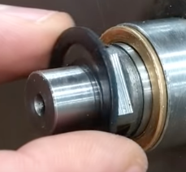

*First a washer...*

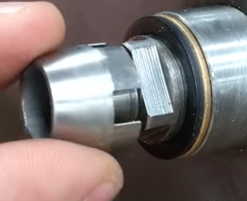

*Then the retaining ring mounting tool...*

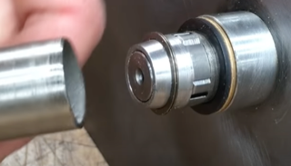

*Then use the open end of the vise drive handle to mount the retaining washers using the mounting tool (NOTE - use first the smaller ending)*

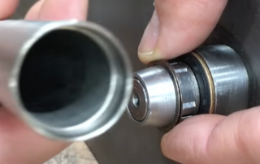

*Then use the end with the larger opening to push the retaining ring all the way onto the work screw shaft*

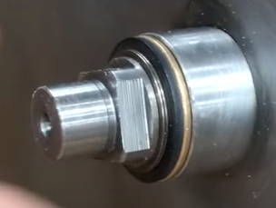

*Final correct position of the retaining ring*

*==&gt; Mount a brass sleeve bushing to each side of the gear-assembly pairs with a steel busing between and place them on the inside of the front metal plate*

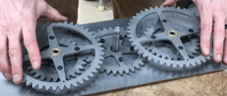

*Ensure the large gears are aligned with the "little hole" at the same location on the circumference*

**I AM HERE...**

What remains to do is to mount the screw and busing for the worm screw to run though on the fixed side of the bench...

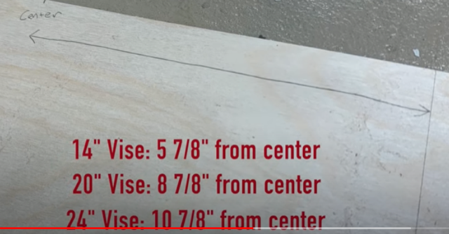

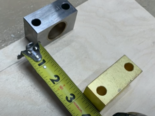

*Place the bushing and the screw roughly 3" (7,5 cm) apart (The screw further away from the bench front)*

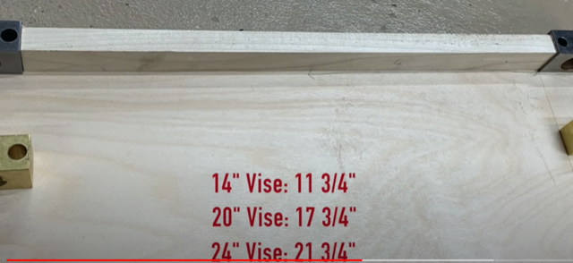

*Use a cut piece of wood as a guide to ensure the second pair of busing and screw gets mounted on exactly the same distance from the first pair*

==&gt; Mount the two remaining driving gears once we ensured the vise threads into the fixed part in perfect parallel

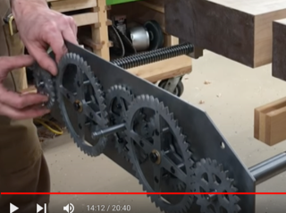

NOTE: This concludes my smaller vise is the 14" vise (It is 30 cm or 11 3/4")

==&gt; Mount the two remaining brass sleeves on the end of the drive shafts and place the plexiglass front cover on

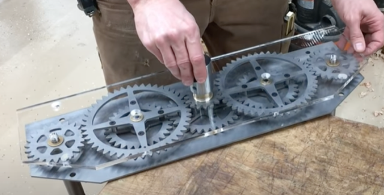

2) Consider my process of assembling my smaller (14") "Twin Turbo Vise"?

==&gt; It seems my smaller vise is 46 cm deep (the worm screw), 44 cm wide times 13,5 cm high (front plate)?

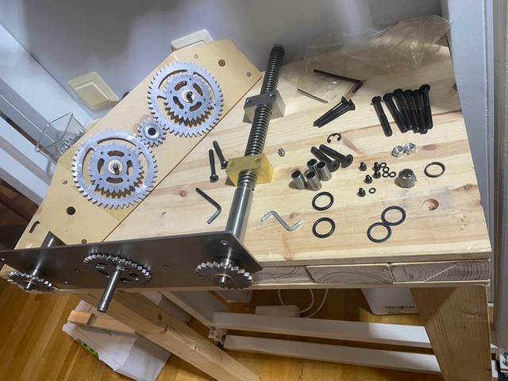

*Let's face it - I could not figure it our on my own...*

==&gt; It seems I need a Jaw-plate of at least 18 mm thickness to cover the protruding screws on the inside of the moving jaw?

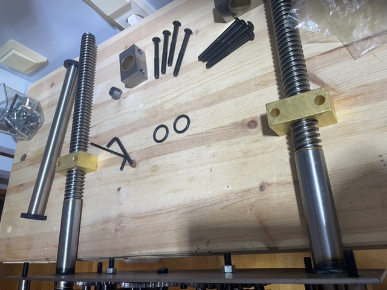

...


