# Todo: Consider to study  Microsoft developer Sy Brand take on interfacing FFmpeg with C++ using coroutines?

```#c423258f``` *As of 2022-01-28 19:23*

[mail plain/text](mail.txt)


==&gt; Also see "[Todo: Consider youtube video "LIVESTREAM: Setting up FFmpeg and OpenGL in C++ for real-time video processing" to follow to setup a C++ cross platform FFMPeg video player and and OpenGL video viewer basics](../4c0da55c/chime.md)"

1) Consider the youtube video "C++ GUIs with coroutines, WinUI3, C++/WinRT and FFMPEG" with this part showing a seemingly nice C++ wrapping of the FFmpeg C API (<https://youtu.be/OSYXGyMw9GE?t=1636> )?

==&gt; For his purpose to capture random shots from a video file and store as png he uses three ffmpeg libraries?

> 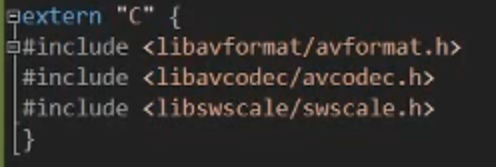

==&gt; It seems he encapsulates all ffmpeg operation into a class Shottaker?

> 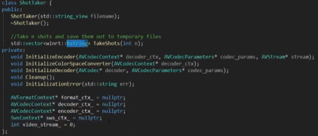

==&gt; He seems to have another include from FFmep in the cpp file?

> 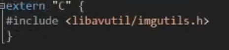

==&gt; This seems to be the ShotTaker constructor?

> 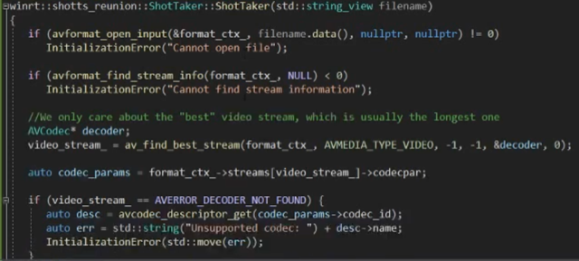

> 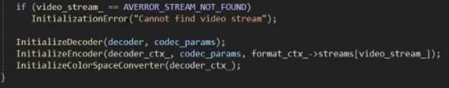

==&gt; This seems to be the InitializeDecoder method?

> 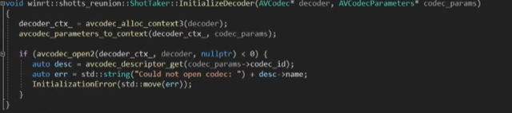

==&gt; This seems to be the InitializeEncoder method?

> 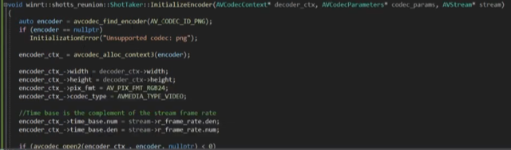  
> 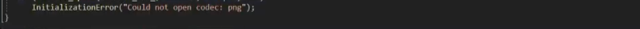

==&gt; This seems to be the InitializeColorSpaceConverter?

> 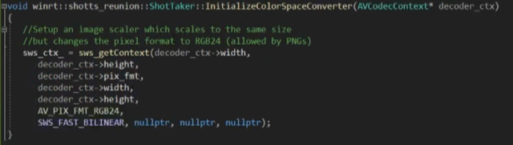

==&gt; This seems to be the InitaiizationError and the destructor?

> 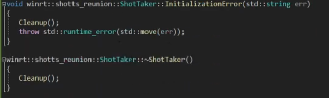

==&gt; This seems to be the Cleanup method?

> 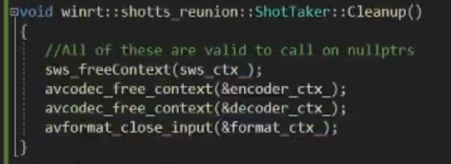

==&gt; This seems to be the TakeShots method?

> 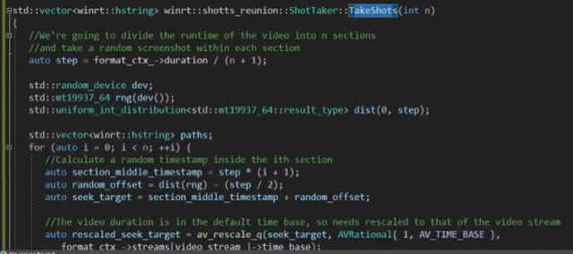  
> 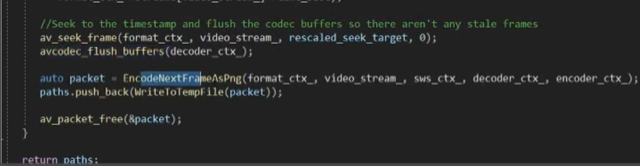

==&gt; This seems to be the free function EncodeNextFrameAsPng

> 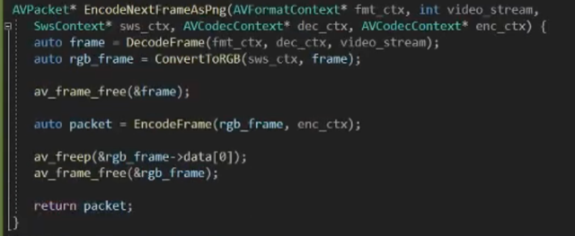

==&gt; And these seems to be the free fucntions called from EncodeNextFrameAsPng?

> 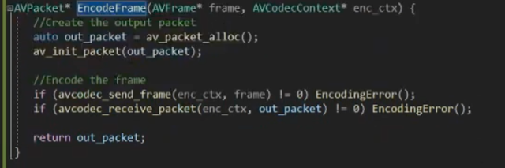

> 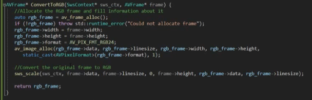

> 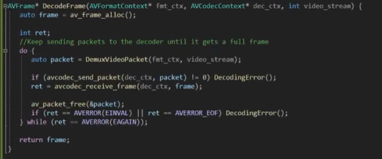

==&gt; This seems to be the DemuxVideoPacket

> 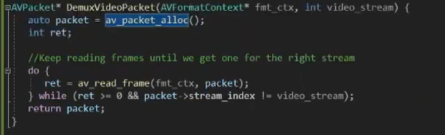

2) Consider to re.implement hsi ShotTaker class as a way to learn his way of interfacing ffmpeg C API from C++?

==&gt; I Created Github project ShotTAker (<https://github.com/kjelloh/ShotTaker> )

...


