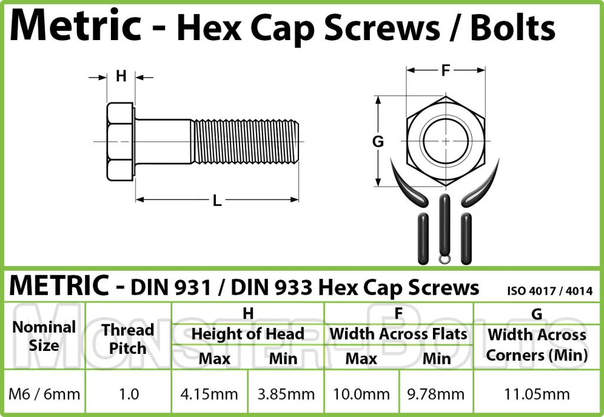
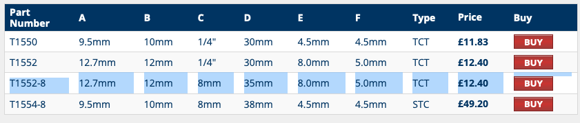
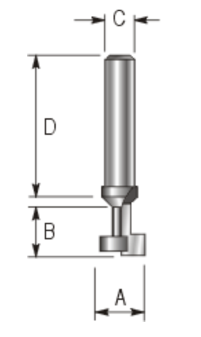
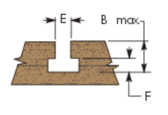

# Todo: Consider a T-slot 10mm wide, 5mm deep with 6mm groove would fit a "standard" M6 hex bolt head or nut?

```#c4df6861``` *As of 2019-09-07 18:24*

[mail plain/text](mail.txt)


It seems a "standard" M6 hex bolt will fit in a 10mm wide, 5mm deep T-slot with 6mm groove for the threaded shaft?

1) Consider the measurements of a "standard" M6 bolt and nut?

>   
> *Measurements taken from a "standard" M6 bolt and nut with proposed T-slot to fit*

2) It seems an M6 bolt

>   
> *It seems an M6 bolt head is 3.85..4,14 mm "thick" and at least 9,78 and 11,05 mm wide (flats and across)*

3) Consider if there are any T-slot router cutters to make grooves that fits "standard" M6 bolt heads?

==&gt; Consider the T1552-8 keyhole cutter that seems to cut a 12,7 mm wide and 5mm deep T.slot with a 8mm groove (<https://www.wealdentool.com/acatalog/Online_Catalogue_Keyhole_253.html> )?

>   
> *T1552-8 keyhole cutter that seems to cut a 12,7 mm wide (A) and 5mm deep (F) T.slot with a 8mm groove*

>   
> *The groove made by a keyhole cutter*

...


