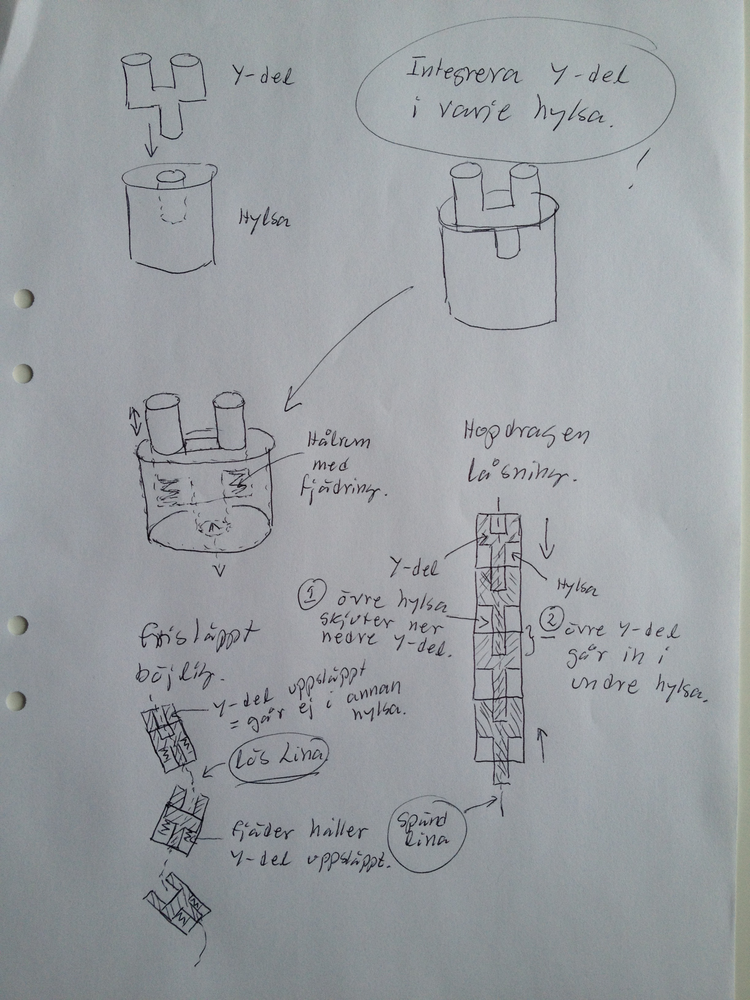

# Todo: Överväg att testa olika design av själv-låsande tält-bågar?

```#c5046118``` *As of 2016-03-08 11:42*

[mail plain/text](mail.txt)


Överväg att testa denna design av självlysande tält-bågar sim bygger på hylsor med fjädrande “Y-del” som när de pressas mot varandra skuter i Y-delarna i hylsorna och på så sätt skapar en stel tält-båge?

1) Varje del består av en hylsa och en Y-del som träs på en dragstyv lina.

2) Y-delen fjädrar i hylsan och när dess “Y-del" trycks ner av hylsan ovanför förs dess “pinn-del” in i hylsan under.

3) När en lång rad hylsor med Y-delar träs på en tråd som kan dras åt så hylsorna trycks mot varandra så skapas en stel båge.

==&gt; När tråden släpps så skjuter hylsorna isär och tråd med hylsor blir böjlig igen.

4) Ett tält med dessa självskapade tält-bågar kan resas genom att bara dra åt den tråd på vilken hylsorna är trädda?

==&gt; Med riktigt fiffig konstruktion räcker det med att spänna en enda tråd för att hela tältet skall resa sig?

…

Överväg att tänka vidare på denna idé och eventuellt be någon bygga en prototyp för att testa idén?




