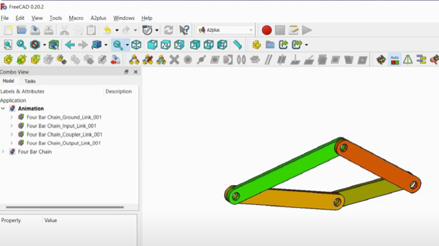
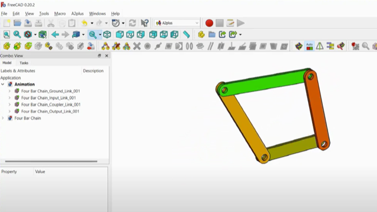

# Todo: Consider youtube video "🎬 Animation: Parametric Four-Bar Chain Mechanism in FreeCAD with A2plus Workbench 🚀" to study and learn a way to model 4-link-mekanism and animation in FreeCad?

```#c5a3a1d8``` *As of 2023-11-21 17:06*

[mail plain/text](mail.txt)


I would like to simulate mechanisms in FreeCad.

1) Consider youtube video "🎬 Animation: Parametric Four-Bar Chain Mechanism in FreeCAD with A2plus Workbench 🚀" (<https://youtu.be/azLxATMufc0> )?





2) Consider to document what I learned from follow along with the youtube video "🎬 Animation: Parametric Four-Bar Chain Mechanism in FreeCAD with A2plus Workbench 🚀" (<https://youtu.be/azLxATMufc0> )?

...


