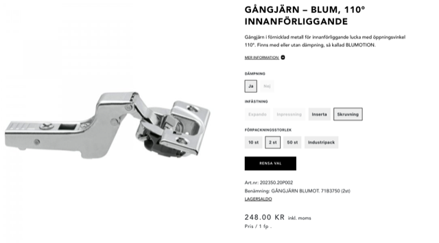
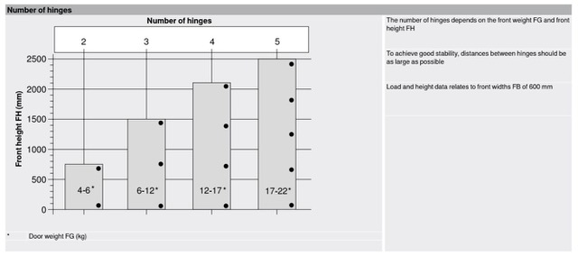

# Todo: Consider the Peter Millard youtube video on Blum concealed 35 mm hinges?

```#c5e7ad98``` *As of 2024-03-27 22:16*

[mail plain/text](mail.txt)


==&gt; Also see "[Todo: Consider to understand European concealed hinges - how to mount and where to buy?](../17a052c1/chime.md)"

==&gt; Also see "[Todo: Consider to buy Blüm (IKEA compatible) hinges from Swedish web shop Theofilis?](../9e3bde05/chime.md)"

0) It seems Blum is atcually NOT spelled with the german 'ü'!!

1) Consider the youtube video "How to fit concealed (Euro-style) hinges for overlay & inset cabinet doors &#91;video # 348&#93;" (<https://youtu.be/-Y6MEQlFEhQ> )?

==&gt; He seems to state he uses basically one overlay Blum 71B3550 and one inset variant 71B3750 of the Blum concealed hinges?


<https://youtu.be/-Y6MEQlFEhQ?t=260>


<https://youtu.be/-Y6MEQlFEhQ?t=381>

2) Consider where I can buy Blum 71B3750 inset 100 degree concealed hinges?

==&gt; It seems Theofilis sell two for nearly 300 SEK (<https://www.theofils.se/gangjarn/blum-dolda-gangjarn-35-mm/gangjarn-blum-dampade-110-innanforliggande-47026/?attribute_pa_dampning=ja&attribute_pa_infastning=skruvning&attribute_pa_forpackningsstorlek=industripack> )?



==&gt; It seems Swedish amazon sells one for 80 SEK?


3) Consider the weight considerations for using Blum concealed 35 mm hinges (<https://www.theofils.se/wp-content/uploads/2023/03/112684.jpg> )?



==&gt; It seems my IKEA 11,9 kg three hinges 1940 mm high mirror door is in fact a little to large and heavy?

> *I weighed my IKEA Åheim mirror door and it weighs 11,9 kg. It is 495 mm wide and around 1940 mm high. So, according to the diagram Blum recommends using four hinges for this door. Now, IKEA has only fitted this door with three hinges. So there is not much I can do about that. At least, the three hinges option sems to be able to handle the weight 12 kg ok? Also, my IKEA door is only 495 mm wide while the diagram states the data is for a 600 mm wide door. So again, I may be on the safe side after all?*

...


