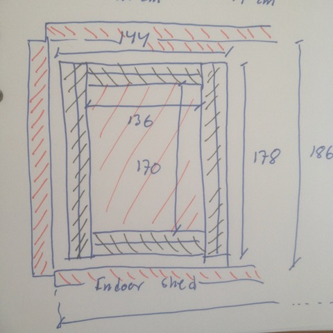
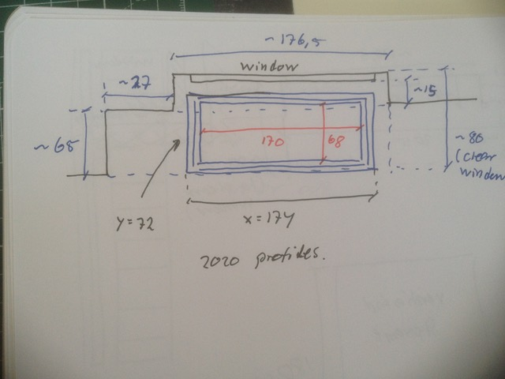
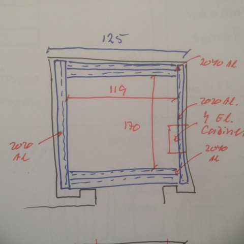
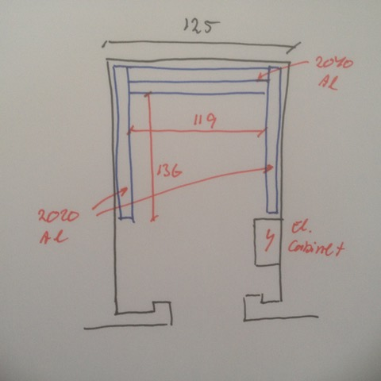
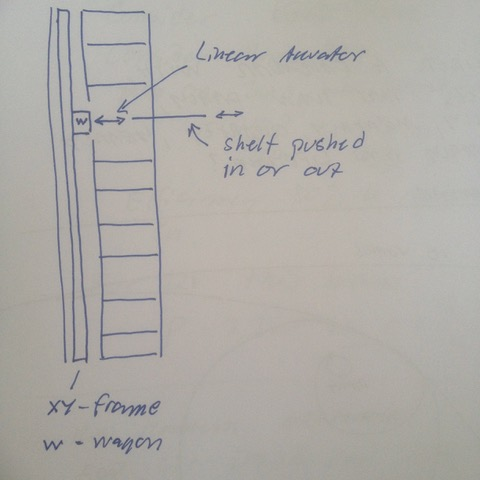

# Todo: Makerspace Automation - Consider to have all my workspaces (indoor shed, ventilated storage and window desktop) to have xyz automation possibilities?

```#c5f44444``` *As of 2018-04-20 14:25*

[mail plain/text](mail.txt)


Could it be a good idea to equip my workspaces with v-slot frames and xyz beams and sliders so that they may alternate as automation tools?

1) Consider how to design an xyz frame for my indoor shed?

==&gt; Consider modulo 17 cm options?

1 x 17 = 17

2 x 17 = 34

3 \* 17 = 51

4 \* 17 = 68

5 \* 17 = 85

6 \* 17 = 102

7 \* 17 = 119

8 \* 17 = 136

9 \* 17 = 153

10 \* 17 = 170

11 \* 17 = 187

==&gt; To rip-cut 1200 mm boards we need a 136 cm width?

==&gt; Max inside shed depth is 187 cm?

NO! It is actually only 186 (maybe 186,5) cm between inside of the walls.



==&gt; Consider a **170 x 136 **cm xy-frame?

==&gt; A 2020 aluminum profile frame would then be **174 x 140 cm** (outer dimensions)?

==&gt; A 2040 Aluminium profile would then be **178 x 144 cm** (outer dimensions)?

2) Consider how to design an xyz frame for my window desktop?

==&gt; Consider modulo 17 cm options also here?

1 x 17 = 17

2 x 17 = 34

3 \* 17 = 51

4 \* 17 = 68

5 \* 17 = 85

6 \* 17 = 102

7 \* 17 = 119

8 \* 17 = 136

9 \* 17 = 153

10 \* 17 = 170

11 \* 17 = 187

12 x 17 = 204

13 \* 17 = 221

==&gt; Window frame is 176,5 x 18 (or 17) cm with 30 mm height to allow for window to open.

==&gt; Outside window we have 205 x 65 cm.



==&gt; Consider a max frame of **204 x 51 cm** (fits inside 205 x 65)

==&gt; Consider a **68 x 170 cm** (that will fit into window frame)?

==&gt; A 2020 aluminium profile frame would then be **174 x 72 cm** (Outer dimensions)?

==&gt; A 2040 aluminium profile frame would then be **178 x 76 cm** (Outer dimensions)?

**NO! 2040 frame Does not fit into 176 width window frame!**

3) Consider how to design an xyz frame for my ventilated storage workspace?

==&gt; Consider modulo 17 cm options also here?

1 x 17 = 17

2 x 17 = 34

3 \* 17 = 51

4 \* 17 = 68

5 \* 17 = 85

6 \* 17 = 102

7 \* 17 = 119

8 \* 17 = 136

9 \* 17 = 153

10 \* 17 = 170

11 \* 17 = 187

12 x 17 = 204

13 \* 17 = 221

==&gt; Storage is 180 x 125 cm inside.

==&gt; Left side to door is 20 cm inside and 27 cm flush to opening

==&gt; Right side is 10 cm inside and 17 cm flush to opening.

==&gt; Consider a **119 x 170 cm** frame?



==&gt; A 2020 Aluminium profile frame would then be **174 x 123 cm** (outer dimensions)

==&gt; A 2040 Aluminium profile frame would then be **178 x 127 cm** (outer dimensions)

**NO! 2040 frame Does not fit into 125 width storage room!**

==&gt; Consider to clear electrical wall cabinet and use depth 144 cm?

==&gt; Consider a **119 x 136 cm** frame (to fit inside 125 x 144)?



==&gt; A 2020 Aluminium profile frame would then be **140 x 123 cm** (outer dimensions)

==&gt; A 2040 Aluminium profile frame would then be **144 x 127 cm** (outer dimensions)

5) Consider to somehow automate my hallway storage wall?

==&gt; Consider a slim xy-frame against the wall behind the storage with a wagon that can travel to any shelf and push it in or out?



...


