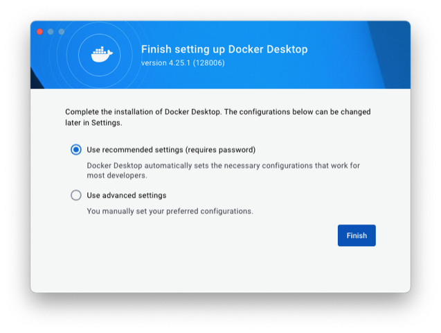
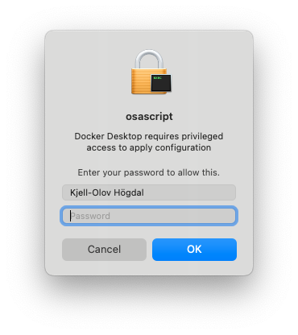
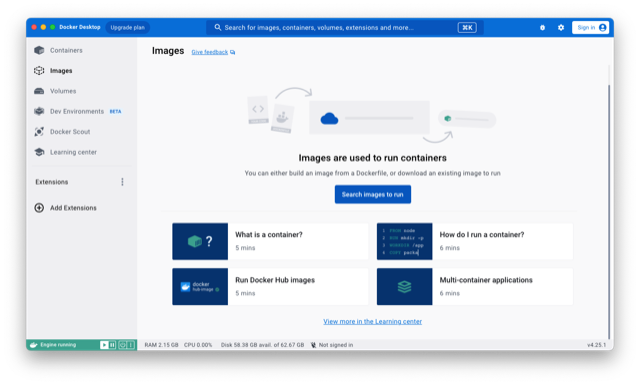
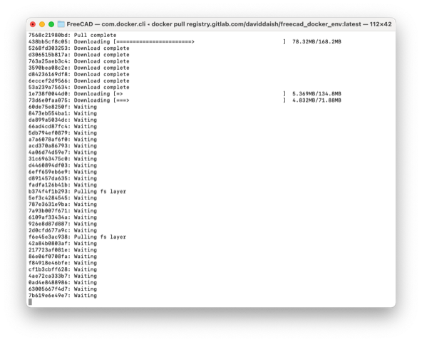
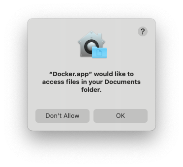
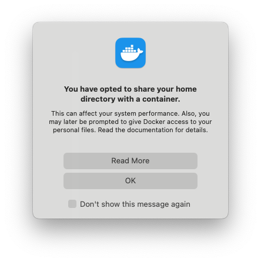
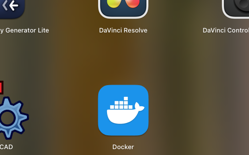
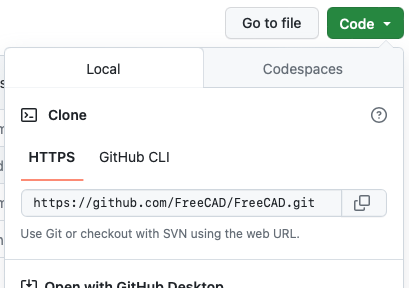

# Todo: Consider to try and build FreeCad using a Docker image on macOS?

```#c6590aaf``` *As of 2023-11-20 15:46*

[mail plain/text](mail.txt)


If I can build FreeCad I may be able to strip it down to a simple-to-use version for my own needs to 3D print and design my house?

==&gt; Also see "Todo: Consider to document how (and where) my brew upgrade gcc to gcc13 went?"

==&gt; Also see "Todo: Consider to document how I tried to build FreeCad from Github latest branch on mac OS?"

1) This seems to be the current instructions on how to build FreeCad using Docker (<https://wiki.freecad.org/Compile_on_Docker> )?

==&gt; I first installed Docker using homebrew as documented below.

==&gt; it seems cloning the FreeCad Git repository went well (after having removed an old FreeCad folder with unclear status or origin)?

> Last login: Mon Nov 20 10:44:48 on ttys000  
> kjell-olovhogdal@Kjell-Olovs-Mac-Pro Github % pwd  
> /Users/kjell-olovhogdal/Documents/Github  
> kjell-olovhogdal@Kjell-Olovs-Mac-Pro Github % git clone <https://github.com/FreeCAD/FreeCAD.git>  
> fatal: destination path 'FreeCAD' already exists and is not an empty directory.  
> kjell-olovhogdal@Kjell-Olovs-Mac-Pro Github % git update <https://github.com/FreeCAD/FreeCAD.git>  
> git: 'update' is not a git command. See 'git --help'.

> The most similar command is  
> update-ref  
> kjell-olovhogdal@Kjell-Olovs-Mac-Pro Github % cd FreeCAD  
> kjell-olovhogdal@Kjell-Olovs-Mac-Pro FreeCAD % git update  
> git: 'update' is not a git command. See 'git --help'.

> The most similar command is  
> update-ref  
> kjell-olovhogdal@Kjell-Olovs-Mac-Pro FreeCAD % git pull  
> fatal: not a git repository (or any of the parent directories): .git  
> kjell-olovhogdal@Kjell-Olovs-Mac-Pro FreeCAD % cd ..  
> kjell-olovhogdal@Kjell-Olovs-Mac-Pro Github % cd FreeCAD  
> kjell-olovhogdal@Kjell-Olovs-Mac-Pro FreeCAD % git status  
> fatal: not a git repository (or any of the parent directories): .git  
> kjell-olovhogdal@Kjell-Olovs-Mac-Pro FreeCAD % cd ..  
> kjell-olovhogdal@Kjell-Olovs-Mac-Pro Github % rm -rf FreeCAD  
> kjell-olovhogdal@Kjell-Olovs-Mac-Pro Github % **git clone <https://github.com/FreeCAD/FreeCAD.git>**  
> Cloning into 'FreeCAD'...  
> remote: Enumerating objects: 419247, done.  
> remote: Counting objects: 100% (353/353), done.  
> remote: Compressing objects: 100% (177/177), done.  
> remote: Total 419247 (delta 213), reused 277 (delta 174), pack-reused 418894  
> Receiving objects: 100% (419247/419247), 1.91 GiB | 6.56 MiB/s, done.  
> Resolving deltas: 100% (361546/361546), done.  
> Updating files: 100% (11130/11130), done.  
> kjell-olovhogdal@Kjell-Olovs-Mac-Pro Github %

==&gt; It seems I created the suggested build directory ok?

> ### Create build directory

  
> Create a directory to hold your compiled FreeCAD source.

> ```
> mkdir ~/my_code/freecad_build
> ```


> kjell-olovhogdal@Kjell-Olovs-Mac-Pro Github % **cd FreeCAD **  
> kjell-olovhogdal@Kjell-Olovs-Mac-Pro FreeCAD % **mkdir freecad_build**  
> kjell-olovhogdal@Kjell-Olovs-Mac-Pro FreeCAD % ls  
> CMakeLists.txt README.md **freecad_build** tests  
> CMakePresets.json SECURITY.md package tools  
> CODE_OF_CONDUCT.md cMake requirements.txt  
> CONTRIBUTING.md conda rpkg.macros  
> LICENSE data src  
> kjell-olovhogdal@Kjell-Olovs-Mac-Pro FreeCAD %

==&gt; It seems the instruction fails to mention I need the Docker daemon to be running to perform the "Docker pull" command?


> kjell-olovhogdal@Kjell-Olovs-Mac-Pro FreeCAD % **docker pull [registry.gitlab.com/daviddaish/freecad_docker_env:latest](http://registry.gitlab.com/daviddaish/freecad_docker_env:latest)**  
> Cannot connect to the Docker daemon at <unix:///var/run/docker.sock>. Is the docker daemon running?  
> kjell-olovhogdal@Kjell-Olovs-Mac-Pro FreeCAD %

==&gt; Maybe this is taken care of if I launch the Docker application from the LaunchPad on macOS?







==&gt; Does the "Docker pull" work now?

> YES, it sure does :)

> 

> kjell-olovhogdal@Kjell-Olovs-Mac-Pro FreeCAD % **docker pull [registry.gitlab.com/daviddaish/freecad_docker_env:latest](http://registry.gitlab.com/daviddaish/freecad_docker_env:latest)**  
> Cannot connect to the Docker daemon at <unix:///var/run/docker.sock>. Is the docker daemon running?  
> kjell-olovhogdal@Kjell-Olovs-Mac-Pro FreeCAD % docker pull [registry.gitlab.com/daviddaish/freecad_docker_env:latest](http://registry.gitlab.com/daviddaish/freecad_docker_env:latest)  
> latest: Pulling from daviddaish/freecad_docker_env  
> 7568c21980bd: Pull complete  
> 438bb5cf8c05: Pull complete  
> 5268fd303253: Pull complete  
> d306515b817a: Pull complete  
> 763a25aeb3c4: Pull complete  
> 3590bea08c2e: Pull complete  
> d84236169df8: Pull complete  
> 6eccef2d9566: Pull complete  
> 53a239a75634: Pull complete  
> 1e738f0044d0: Pull complete  
> 73d6e0faa075: Pull complete  
> 60de75e8250f: Pull complete  
> 8473eb554ba1: Pull complete  
> da899a5034dc: Pull complete  
> 66ad4cd87fc4: Pull complete  
> 5db794ef0879: Pull complete  
> a7a6078af6f0: Pull complete  
> acd370a86793: Pull complete  
> 4a06d74d59e7: Pull complete  
> 31c6963475c0: Pull complete  
> d4460894df03: Pull complete  
> 6eff659eb6e9: Pull complete  
> d891457da635: Pull complete  
> fadfa126b41b: Pull complete  
> b374f4f1b293: Pull complete  
> 5ef3c4284545: Pull complete  
> 787e3631e9ba: Pull complete  
> 7a93b007f671: Pull complete  
> 6109af33434a: Pull complete  
> 926e8d87d887: Pull complete  
> 2d0cfd677a9c: Pull complete  
> f6e45e3ac938: Pull complete  
> 42a84b0803af: Pull complete  
> 217723af081e: Pull complete  
> 86e06f0708fa: Pull complete  
> f84918e46bfe: Pull complete  
> cf1b3cbff628: Pull complete  
> 4ae72ca333b7: Pull complete  
> 0ad4e8488986: Pull complete  
> 63005667f4d7: Pull complete  
> 7b619e6e49e7: Pull complete  
> Digest: sha256:410d0f537c49ab0147406a9bcb4a9394903f5e85aba7d077442ef74331d9b8fd  
> Status: Downloaded newer image for [registry.gitlab.com/daviddaish/freecad_docker_env:latest](http://registry.gitlab.com/daviddaish/freecad_docker_env:latest)  
> [registry.gitlab.com/daviddaish/freecad_docker_env:latest](http://registry.gitlab.com/daviddaish/freecad_docker_env:latest)

> **What's Next?**  
> View a summary of image vulnerabilities and recommendations → docker scout quickview [registry.gitlab.com/daviddaish/freecad_docker_env:latest](http://registry.gitlab.com/daviddaish/freecad_docker_env:latest)  
> kjell-olovhogdal@Kjell-Olovs-Mac-Pro FreeCAD %

==&gt; It seems I succeeded to set the required environment variables?

> kjell-olovhogdal@Kjell-Olovs-Mac-Pro FreeCAD % **pwd**  
> /Users/kjell-olovhogdal/Documents/Github/FreeCAD  
> kjell-olovhogdal@Kjell-Olovs-Mac-Pro FreeCAD % cd ~  
> kjell-olovhogdal@Kjell-Olovs-Mac-Pro ~ % pwd  
> /Users/kjell-olovhogdal  
> kjell-olovhogdal@Kjell-Olovs-Mac-Pro ~ % cd Documents/Github/FreeCAD  
> kjell-olovhogdal@Kjell-Olovs-Mac-Pro FreeCAD % pwd  
> /Users/kjell-olovhogdal/Documents/Github/FreeCAD  
> kjell-olovhogdal@Kjell-Olovs-Mac-Pro FreeCAD % **fc_source=/Users/kjell-olovhogdal/Documents/Github/FreeCAD**  
> kjell-olovhogdal@Kjell-Olovs-Mac-Pro FreeCAD % **fc_build**=/Users/kjell-olovhogdal/Documents/Github/FreeCAD/**freecad_build**  
> kjell-olovhogdal@Kjell-Olovs-Mac-Pro FreeCAD % **other_files=/Users/kjell-olovhogdal**  
> kjell-olovhogdal@Kjell-Olovs-Mac-Pro FreeCAD %

==&gt; It seems I succeeded in running the Docker image for building FreeCad?

> kjell-olovhogdal@Kjell-Olovs-Mac-Pro FreeCAD % **docker run** -it --rm \\  
> -v $fc_source:/mnt/source \\  
> -v $fc_build:/mnt/build \\  
> -v $other_files:/mnt/files \\  
> -e "DISPLAY" -e "QT_X11_NO_MITSHM=1" -v /tmp/.X11-unix:/tmp/.X11-unix:ro \\  
> [registry.gitlab.com/daviddaish/freecad_docker_env:latest](http://registry.gitlab.com/daviddaish/freecad_docker_env:latest)  
> root@b853ddfdc061:~#

==&gt; It seems the Docker Application caused macOS to have me authorise Docker access to my Documents folder?





==&gt; Now the instruction on how to build FreeCad gets unclear, is the script to run in the container or in the FreeCad git repository?

> You can build FreeCAD using the installed build script, or using your preferred method.

> ```
> /root/build_script.sh
> ```


==&gt; Is seems Docker presented me with a prompt to a command line interface into the running docker image (and it is here I am to run the script)?

> YES :). BUT - The script is trying to use my macOS built in G++ compiler which is too old?

> root@b853ddfdc061:~# /root/build_script.sh  
> -- The C compiler identification is GNU 6.3.0  
> -- The CXX compiler identification is GNU 6.3.0  
> -- Check for working C compiler: /usr/bin/cc  
> -- Check for working C compiler: /usr/bin/cc -- works  
> -- Detecting C compiler ABI info  
> -- Detecting C compiler ABI info - done  
> -- Detecting C compile features  
> -- Detecting C compile features - done  
> -- Check for working CXX compiler: /usr/bin/c++  
> -- Check for working CXX compiler: **/usr/bin/c++** -- works  
> -- Detecting CXX compiler ABI info  
> -- Detecting CXX compiler ABI info - done  
> -- Detecting CXX compile features  
> -- Detecting CXX compile features - done  
> CMake Error at cMake/FreeCAD_Helpers/CompilerChecksAndSetups.cmake:39 (message):  
> FreeCAD 0.20 and later requires C++17. **G++ must be 7.3 or later**, the used  
> version is 6.3.0  
> Call Stack (most recent call first):  
> CMakeLists.txt:47 (CompilerChecksAndSetups)

> -- Configuring incomplete, errors occurred!  
> See also "/mnt/build/CMakeFiles/CMakeOutput.log".  
> root@b853ddfdc061:~#

==&gt; Try to set the g++ alias to refer to the correct g++ compiler i have on my system?

> I did this inspired by proposed solution on stackoverflow <https://stackoverflow.com/questions/50501388/how-to-update-g-compiler-on-osx> .

> I seem to have G++13 installed with brew at /usr/local/Cellar/gcc/13.1.0/bin/g++-13?

> kjell-olovhogdal@Kjell-Olovs-Mac-Pro ~ % ls /usr/local/Cellar/gcc/13.1.0/bin/g++-13  
> /usr/local/Cellar/gcc/13.1.0/bin/g++-13  
> kjell-olovhogdal@Kjell-Olovs-Mac-Pro ~ %

> What happens if I define an alias for /usr/bin/g++ to this instance in the docker container?

> NO - that did not help (it seems cmake has already cashed the previous configuration?)

> root@b853ddfdc061:~# alias gcc='gcc-13'  
> root@b853ddfdc061:~# alias g++='g++-13'  
> root@b853ddfdc061:~# /root/build_script.sh  
> CMake Error at cMake/FreeCAD_Helpers/CompilerChecksAndSetups.cmake:39 (message):  
> FreeCAD 0.20 and later requires C++17. G++ must be 7.3 or later, the used  
> version is 6.3.0  
> Call Stack (most recent call first):  
> CMakeLists.txt:47 (CompilerChecksAndSetups)

> -- Configuring incomplete, errors occurred!  
> See also "/mnt/build/CMakeFiles/CMakeOutput.log".  
> root@b853ddfdc061:~#

> ?Where is it building (I suspect somewhere on my machine)?

> AHA - of course - in "/Users/kjell-olovhogdal/Documents/Github/FreeCAD/freecad_build" (as I have been instructed to set it in environment variable "fc_build")!

> BUT - deleting the file in the build directory and running the script again from the docker container STILL is not redirected to use version 13 of gcc!

> Hm... The hole point of using a Docker container is that IT contains the required build tools (So this Container DOES NOT build current version of FreeCad)?

> **==&gt; I AM HERE &lt;== (TODO: Find a Docker Container with the Build Environment for the current Freecad version!)**

2) This seems to be a reasonably good overview of the Docker architecture (<https://docs.docker.com/get-started/overview/#docker-architecture> )?

3) It seems Docker for macOS is a GUI application and thus should be installed with the "--cask" option using Brew (<https://www.cprime.com/resources/blog/docker-for-mac-with-homebrew-a-step-by-step-tutorial/> )?

> Docker on Mac is a GUI tool, so you need to use Homebrew Cask for the installation.

==&gt; **NOTE: "brew cask install" was removed 2021 and is replaced by "brew install --cask"!**

4) It seems installing Docker using Homebrew worked just fine on my macOS?

> 🍺 freecad was successfully installed!  
> kjell-olovhogdal@Kjell-Olovs-Mac-Pro ~ % **brew install --cask docker**  
> ==&gt; **Downloading <https://formulae.brew.sh/api/cask.jws.json>**  
> ########################################################################################################################## 100.0%  
> ==&gt; **Downloading <https://raw.githubusercontent.com/Homebrew/homebrew-cask/310f4e1c719f7c810a0f8219492c5acda1562a9e/Casks/d/docker>.**  
> ########################################################################################################################## 100.0%  
> ==&gt; **Downloading <https://desktop.docker.com/mac/main/amd64/128006/Docker.dmg>**  
> ########################################################################################################################## 100.0%  
> ==&gt; **Installing Cask ****docker**  
> ==&gt; **Moving App 'Docker.app' to '/Applications/Docker.app'**  
> ==&gt; **Linking Binary 'docker' to '/usr/local/bin/docker'**  
> ==&gt; **Linking Binary 'docker-compose' to '/usr/local/bin/docker-compose'**  
> ==&gt; **Linking Binary 'docker-credential-desktop' to '/usr/local/bin/docker-credential-desktop'**  
> ==&gt; **Linking Binary 'docker-credential-ecr-login' to '/usr/local/bin/docker-credential-ecr-login'**  
> ==&gt; **Linking Binary 'docker-credential-osxkeychain' to '/usr/local/bin/docker-credential-osxkeychain'**  
> ==&gt; **Linking Binary 'docker-index' to '/usr/local/bin/docker-index'**  
> ==&gt; **Linking Binary 'hub-tool' to '/usr/local/bin/hub-tool'**  
> ==&gt; **Linking Binary 'kubectl' to '/usr/local/bin/kubectl.docker'**  
> ==&gt; **Linking Binary 'docker.bash-completion' to '/usr/local/etc/bash_completion.d/docker'**  
> ==&gt; **Linking Binary 'docker.zsh-completion' to '/usr/local/share/zsh/site-functions/_docker'**  
> ==&gt; **Linking Binary 'docker.fish-completion' to '/usr/local/share/fish/vendor_completions.d/docker.fish'**  
> ==&gt; **Linking Binary 'com.docker.hyperkit' to '/usr/local/bin/hyperkit'**  
> ==&gt; **Linking Binary 'com.docker.cli' to '/usr/local/bin/com.docker.cli'**  
> 🍺 **docker was successfully installed!**  
> kjell-olovhogdal@Kjell-Olovs-Mac-Pro ~ %

==&gt; I now seem to have a launcable Docker app in my macOS Launch Pad?



5) This seems to be the home on GitHub of the FreeCad application (<https://github.com/FreeCAD/FreeCAD> )?

==&gt; It seems the FreeCad git repository URL is "[**https://github.com/FreeCAD/FreeCAD.git](https://github.com/FreeCAD/FreeCAD.git)**"



...


