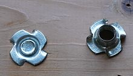

# Todo: Consider to use T-nuts (Swedish "islagsmutter" or "Islagsmuff") or  Insert Nuts (Swedish "Rampmuff") to hang stuff on the studs in my indoor shed?

```#c6619ad5``` *As of 2018-12-07 00:04*

[mail plain/text](mail.txt)


It is already obvious that my try to mount tool walls and screw racks on the walls in my indoor shed using holes and wood dowels was not a good ide. Maybe I should go for metric bolts and stud mounted T-nuts?

1) Consider the wikipedia page on T-nuts (<https://en.wikipedia.org/wiki/T-nut>)?



> “A T-nut, T nut, or tee nut (also known as a blind nut,&#91;1&#93; which can however also refer to a rivet nut or an insert nut) is a type of nut used to fasten a wood, particle or composite materials workpiece, leaving a flush surface.

> It has a long, thin body and a flange at one end, resembling a T in profile."

2) Consider the wikipedia page on Insert Nut (<https://en.wikipedia.org/wiki/Insert_nut>)?

.jpg>)

3) Consider to glue brackets with adjustment slots for metric bolts onto the stuff to hang and drive T-nuts into the studs and then mount to these with metrics bolts?

…

4) Consider what T-nuts to buy and where to buy them?

…

5) Consider how to design and attach the brackets to the stuff I want to hang?

==&gt; Consider we want to avoid furniture brackets (and instead make something from wood or 3D printer)?

...

...


