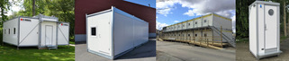
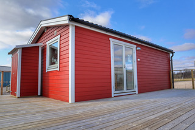
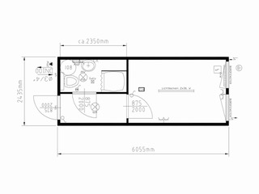

# Todo: Överväg att köpa begagnade bygg-baracker att bo och arbeta i under mitt husbygge?

```#c8112935``` *As of 2019-04-16 14:51*

[mail plain/text](mail.txt)


Kanske är det en snabb och kostandseffektiv lösning att köpa begagnade bostadsbaracker att bo och arbeta i under bygget av huset?

1) Överväg baracker och moduler från X-modul (<http://www.x-modul.com/produkter/>)?



2) Moelven verkar ha moduler för att bygga faktiska hus och lägenheter (<https://www.moelven.com/se/se/modulbyggnad/> )?

==&gt; Överväg att kontakta Moelven för att höra om de levererar till privatpersoner och vad det skulle kosta i så fall?

> ## Kontakta oss

  
> ### Hedwig Ulander

> Affärsutvecklingschef Bostad[hedwig.ulander@moelven.se](mailto:hedwig.ulander@moelven.se)[+46 10 122 59 87](<tel:+46 10 122 59 87>)

3) Överväg en villavagn från MorganNymanAB (<https://www.villavagnar.com> )?

> KONTAKTA OSS  
> Morgan Nyman AB  
> Ranstadsverket Häggum  
> 521 64 Stenstorp Kontaktuppgifter  
> Tel: 0500-44 56 00  
> Email: [info@villavagnar.com](mailto:info@villavagnar.com)

==&gt; Det verkar som om man kan få inkomplett bostad på 7,2 x 4,16 m med all interiör på hel som en “villavagn” som denna för 800 000 SEK (<https://www.villavagnar.com/villavagn/premium-studio-30> )?



  
> *"Premium Studio 30 har vuxit till 30 kvm, har en öppen planlösning där vardagsrummet har gott om plats för soffa & köksbord med fyra stolar.

> Köket är fullutrustat med diskbänk, spis & ugn, kyl & frys.  
> All inredning är från IKEA vilket gör det lätt att byta ut eller komplettera från samma serie.  
> Det ombonade sovrummet har plats för 160x200 säng för bästa komfort.  
> Badrummet känns rymligt med dusch, toalett och handfat och en kombinerad tvättmaskin med torktumlare.  
> Den trevliga exteriören med liggande träpanel i valfri kulör får Studio att smälta in i omgivningen på gården, i villaområdet eller på skärgårdsön.  
> Full isolering, treglasfönster och vattenburen golvvärme gör Studio oslagbart energieffektiv.

> Planlösningen är anpassningsbar! "*

4) Överväg Bodbörsen samverkar har både begagnade och nya bodar (<http://www.bodborsen.se/default.aspx> )?

> *“**Bodbörsen säljer och hyr ut fabriksrenoverade begagnade bodar samt modulbyggnader för alla användningsområden. Vi har alltid ett hundratal objekt i lager för leverans i hela Sverige. Bodbörsen är också Sveriges största återförsäljare av nya Containex stålmoduler / containrar.**"*

==&gt; Det verkar alltså som om Bodbörsen hyr ut bodar också?

==&gt; Den här bostadsmodulen verkar vara byggd i en frakt-container (<http://www.bodborsen.se/artikel/arbetsbodar/bostadsbodar-7/7843-beg-bostadsmodul-20-fot.aspx> )?



==&gt; Det är lite oklart vad en bod kostar eller hus man kopplar in vatten och avlopp?

...


