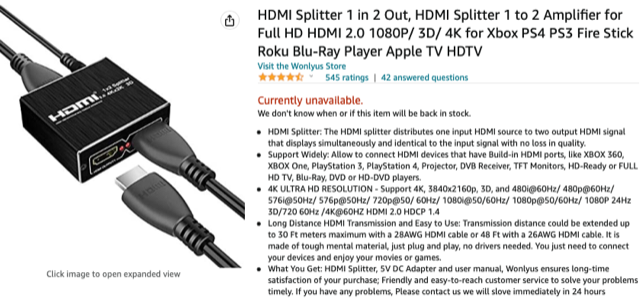
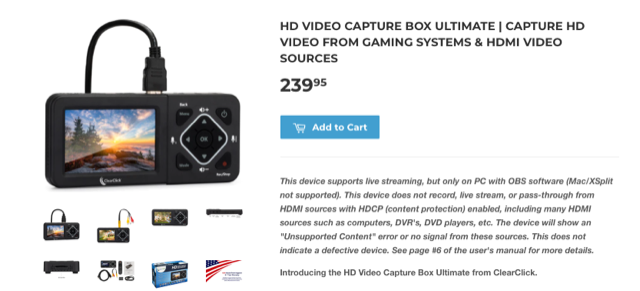
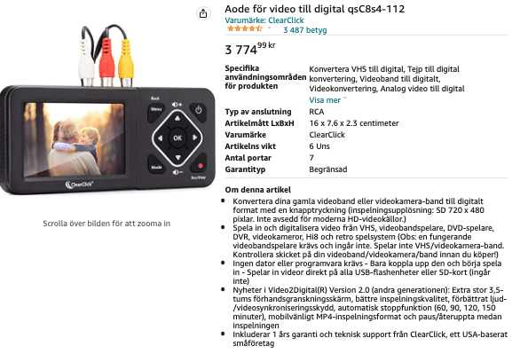
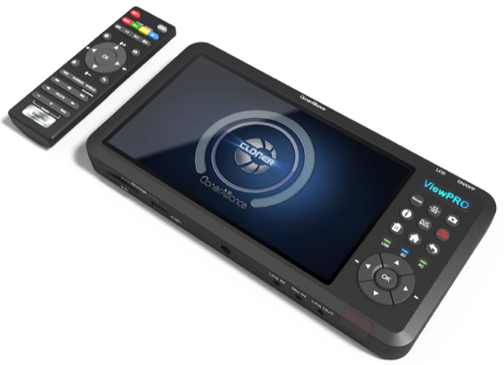

# Todo: Consider an HDMI splitter to remove HDCP with a stand alone HDMI recorder / capture device?

```#cb0b5f65``` *As of 2022-09-08 14:47*

[mail plain/text](mail.txt)


I want an easy way to record my youtube watching IRL from my Apple TV which may require I bypass any HDCP added by the Apple TV.

0) Consider to follow up my order of the "HD VIDEO CAPTURE BOX ULTIMATE"?

==&gt; I Ordered a "HD VIDEO CAPTURE BOX ULTIMATE" :) (Delivered around October 1st to October 31, 20 - 40 days?)

1) Consider the generic splitter reviewed in youtube video "How to Bypass HDCP Content Restrictions in 2021" (<https://youtu.be/4FVQCwnThls> )?

==&gt; It seems this splitter is discontinued?



2) Consider the "" as reviewed in youtube video "Stand-Alone HDMI Capture! The ClearClick HD Video Capture Box Ultimate!" (<https://youtu.be/UL0llVm_ZKg> )?

3) This seems to be the home of "HD VIDEO CAPTURE BOX ULTIMATE" (<https://www.clearclick.com/products/hd-video-capture-box-ultimate-capture-hd-video-from-gaming-systems-hdmi-video-sources> )?



==&gt; It seems $240 is 2600 SEK?


==&gt; It seems they clearly state they do NOT break any HDCP signal?

> *"* *...This device does not record, live stream, or pass-through from HDMI sources with HDCP (content protection) enabled, including many HDMI sources such as computers, DVR's, DVD players, etc...**"*

==&gt; It seems it CAN record to an USB drive?

> *"...**Records To USB Drives or SD Cards...**"*

4) The "HD VIDEO CAPTURE BOX ULTIMATE" seems to sell at Swedish Amazon ([https://www.amazon.se/Aode-video-till-digital-qsC8s4-112/dp/B07V9JNRZY/ref=sr_1_1?crid=216JRVQ3N9O44&keywords=clearclick&qid=1662554306&sprefix=clearclick%2Caps%2C94&sr=8-1](https://www.amazon.se/Aode-video-till-digital-qsC8s4-112/dp/B07V9JNRZY/ref=sr_1_1?crid=216JRVQ3N9O44&keywords=clearclick&qid=1662554306&sprefix=clearclick,aps,94&sr=8-1) )?



==&gt; Ex. VAT this seems to come down to around 3000 SEK (To be compared to 2600 + import fees)?

5) Consider the "ClonerAlliance ViewPro Standalone HDMI Video Capture and Recorder With 7" LCD Screen and Playback Instantly" (<https://www.cloner-alliance.com/cloneralliance-view-pro/> )?



...


