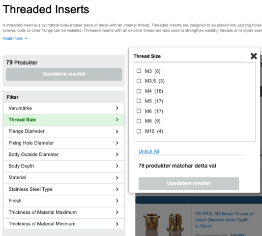
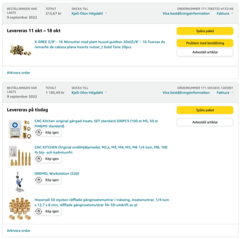

# Todo: Consider what thread inserts to buy to make 3D printed parts screw to metric and imperial bolts?

```#cb8f3dc5``` *As of 2022-09-09 11:19*

[mail plain/text](mail.txt)


I want to be able tp 3D print things like camera mounts using 1/4" or 3/8" threaded bolts to mount to tripods and such.

1) Consider the wikipedia article "Tripod (photography)" on camera mounts (<https://en.wikipedia.org/wiki/Tripod_(photography)> )?

==&gt; It seems one standard for camera mounts are 1/4-20 UNC&#91;2&#93; or 3/8-16 UNC thread?

> *"**Bolt threads&#91;edit&#93;*  
> *Per ISO 1222:2010,&#91;1&#93; the current tripod bolt thread standard for attaching the camera calls for a 1/4-20 UNC&#91;2&#93; or 3/8-16 UNC thread.&#91;3&#93; Most consumer cameras are fitted with 1/4-20 UNC threads. Larger, professional cameras and lenses may be fitted with 3/8-16 UNC threads, plus a removable 1/4-20 UNC adapter, allowing them to be mounted on a tripod using either standard.**"*

2) Consider where to buy thread inserts for 1/4-20 UNC&#91;2&#93; or 3/8-16 UNC threads?

==&gt; Consider deliver-to-sweden web shop RS-Online sells only metric thread inserts? ([https://se.rs-online.com/web/c/fasteners-fixings/sheet-metal-panel-fasteners/threaded-inserts/?cm_mmc=SE-PPC-DS3A-_-google-_-DSA_SE_EN_Fasteners%2B%2526%2BFixings_Index-_-Threaded%2BInserts-_-DYNAMIC%2BSEARCH%2BADS&matchtype=&dsa-1716664287317&gclid=Cj0KCQjwyOuYBhCGARIsAIdGQRPmqxEuXr5i7tdqcVDmLAA0E3yUzLTKEBQJ6Sg1KQ-APONxf-RGGgUaAiqFEALw_wcB&gclsrc=aw.ds](https://se.rs-online.com/web/c/fasteners-fixings/sheet-metal-panel-fasteners/threaded-inserts/?cm_mmc=SE-PPC-DS3A-_-google-_-DSA_SE_EN_Fasteners+%26+Fixings_Index-_-Threaded+Inserts-_-DYNAMIC+SEARCH+ADS&matchtype=&dsa-1716664287317&gclid=Cj0KCQjwyOuYBhCGARIsAIdGQRPmqxEuXr5i7tdqcVDmLAA0E3yUzLTKEBQJ6Sg1KQ-APONxf-RGGgUaAiqFEALw_wcB&gclsrc=aw.ds) )?



3) It seems in Sweden my "best", or at least convenient, choice is Swedish amazon?



==&gt; 1/4" thread rivets (<https://www.amazon.se/gp/product/B09FK33WN1/ref=ppx_yo_dt_b_asin_title_o00_s00?ie=UTF8&psc=1> )

==&gt; CNC Kitchen M3,M4 and M5 brass thread inserts (<https://www.amazon.se/gp/product/B09CL4KY59/ref=ppx_yo_dt_b_asin_title_o01_s00?ie=UTF8&psc=1> )

==&gt; CNC Kitchen soldering iron head kit for thread inserts M3...M8 + 1/4" (<https://www.amazon.se/gp/product/B09WPJ56JP/ref=ppx_yo_dt_b_asin_title_o01_s00?ie=UTF8&psc=1> )

==&gt; 1/4" brass thread inserts (<https://www.amazon.se/gp/product/B09PBK41ZC/ref=ppx_yo_dt_b_asin_title_o01_s00?ie=UTF8&psc=1> )

...


