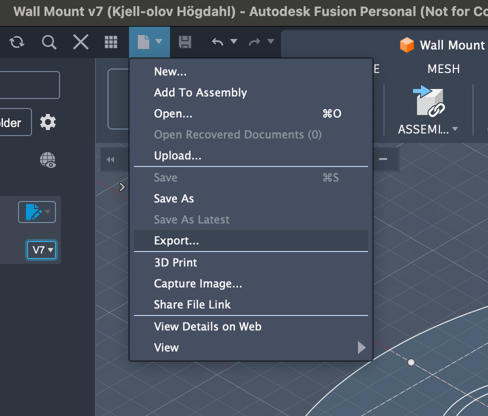
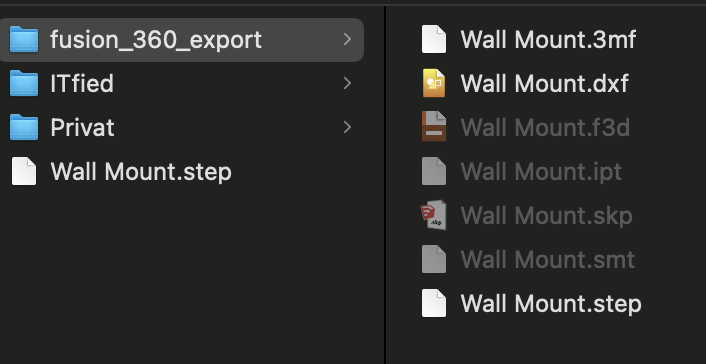
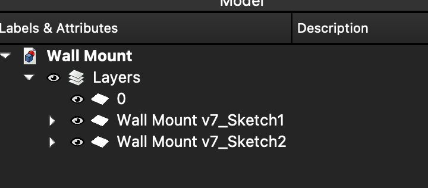
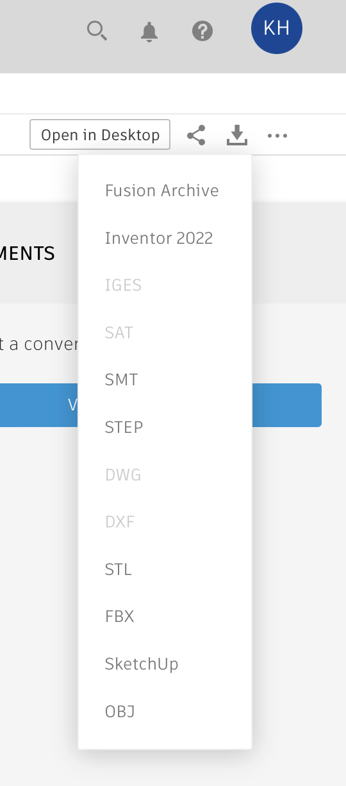

# Todo: Consider how I can export Fusion 360 models (projects, files) to backup offline and open in other CAD program?

```#cb9cd294``` *As of 2026-02-21 17:03*

[mail plain/text](mail.txt)


I don't like my Fusion 360 files are 'hidden' i Autodesk cloud and in a proprietary format.

0) Consider links that may contain valuable and relevant information regarding lokal storage and backup?

==&gt; Consider "How to locate locally cached files in Autodesk Fusion" (<https://www.autodesk.com/support/technical/article/caas/sfdcarticles/sfdcarticles/How-to-locate-locally-cached-files-in-Autodesk-Fusion-360.html> )

> *"The files can also be found on the local hard drive:*

> *On the hard drive, locally cached files are stored in the following directories*

> *Windows: C:\\Users\\\*\*\*\\AppData\\Local\\Autodesk\\Autodesk Fusion 360\\\*\*\*\\W.Login. *  
> *Having trouble finding this directory?: How to enable hidden files and folders on Windows*

> *macOS: Macintosh HD &gt; Users &gt; \*\*\* &gt; Library &gt; Application Support &gt; Autodesk &gt; Autodesk Fusion 360 &gt; \*\*\* &gt; W.Login. *  
> *Having trouble find this directory?: How to Access Hidden User Library folder on Mac OS"*

==&gt; It seems I found my files at ''/Users/kjell-olovhogdahl/Library/Application Support/Autodesk/Autodesk Fusion 360/SXMBJ9KSQDDH/W.login/F\`

> > kjell-olovhogdahl@MacBook-Pro ~/Library/Application Support/Autodesk/Autodesk Fusion 360/SXMBJ9KSQDDH/W.login/F % pwd  
> > /Users/kjell-olovhogdahl/Library/Application Support/Autodesk/Autodesk Fusion 360/SXMBJ9KSQDDH/W.login/F  
> > kjell-olovhogdahl@MacBook-Pro ~/Library/Application Support/Autodesk/Autodesk Fusion 360/SXMBJ9KSQDDH/W.login/F % ls -la  
> > total 432  
> > drwxr-xr-x@ 10 kjell-olovhogdahl staff 320 Feb 21 16:32 .  
> > drwxr-xr-x@ 8 kjell-olovhogdahl staff 256 Feb 21 15:07 ..  
> > -rw-r--r--@ 1 kjell-olovhogdahl staff 84617 Feb 21 16:32 _Inset Door Stop.caa3ff5f-cdf7-4c0c-891c-ed1404b49737.f3d  
> > -rw-r--r--@ 1 kjell-olovhogdahl staff 6820 Feb 21 16:32 _Inset Door Stop.caa3ff5f-cdf7-4c0c-891c-ed1404b49737.f3d._xx  
> > -rw-r--r--@ 1 kjell-olovhogdahl staff 87624 Feb 21 15:07 _Wall Mount.47db55ee-a49e-449d-ad89-edabdd2de73c.f3d  
> > -rw-r--r--@ 1 kjell-olovhogdahl staff 6982 Feb 21 15:07 _Wall Mount.47db55ee-a49e-449d-ad89-edabdd2de73c.f3d._xx  
> > -rw-r--r--@ 1 kjell-olovhogdahl staff 18546 Feb 21 15:07 _Wall Mount.47db55ee-a49e-449d-ad89-edabdd2de73c.png  
> > drwxr-xr-x@ 2 kjell-olovhogdahl staff 64 Feb 21 15:07 _XRef_  
> > -rw-r--r--@ 1 kjell-olovhogdahl staff 95 Feb 21 14:30 avatar._yy  
> > -rw-r--r--@ 1 kjell-olovhogdahl staff 3660 Feb 21 14:30 avatar.jpg  
> > kjell-olovhogdahl@MacBook-Pro ~/Library/Application Support/Autodesk/Autodesk Fusion 360/SXMBJ9KSQDDH/W.login/F %

==&gt; Maybe the 'SXMBJ9KSQDDH' folder is some local key for the current cache (does it change?)?

==&gt; NOTE! It seems 'non editable' files ignores the 'add to cache' silently (No file was created at path for a non editable file)

==&gt; Consider "How to save a local archive (backup) file in Fusion" (<https://www.autodesk.com/support/technical/article/caas/sfdcarticles/sfdcarticles/How-to-make-a-local-archive-back-up-file-in-Fusion-360.html> )?

==&gt; Consider "Is it possible to bulk download or backup Autodesk Fusion data without exporting individually" (<https://www.autodesk.com/support/technical/article/caas/sfdcarticles/sfdcarticles/How-to-create-a-local-backup-of-Fusion-360-data-without-exporting-each-file-individually.html> )?

==&gt; It seems there are no built in 'bulk save' files (archives)?

==&gt; But there is a 'add to cache' and then 'download cache as archive?

1) Consider youtube video "Master File Formats in Autodesk Fusion: Import, Edit & Export with Ease!" (<https://youtu.be/KTmYc112jAY> )?

2) It seems at around 16:08 the video shows different Fusion 360 export file options (<https://youtu.be/KTmYc112jAY?t=968> )?

==&gt; It seems there is a &lt;File&gt; / &lt;Export&gt; menu?

> 

3) Consider my own expreiment to export from Fusion 360 and open in Freecad?

==&gt; It seems FreeCad is very limited in its support for what Fusin 360 is able to export?

> 

> \* The 3mf-file opened as 'empty'  
> \* The step-file opened as empty

==&gt; I somehow managed to export as dxf and open in FreeCad

> *It seems by default I at least get the sketches?*

> 

> *But the sketches seems to be very 'simple' and made up of basic geoemtty only?*

> 

4) Consider my own experiments in exporting from Fusion 360?

==&gt; It seems 'on the web' I have the option to download 'archive'\`

> 

==&gt; It seems downloading an 'arhive' is the same as getting a 3df-file?

> *"*Wall Mount is being exported to f3d format...*"*

==&gt; It seems downloading an 'archive' from the Web-interface is SUPER COMPLICATED?!!

> "We will send you an email with a link to the exported file once the process is complete.  
> Note: The link will be active for a period of 7 days from the time you receive the email."

...


