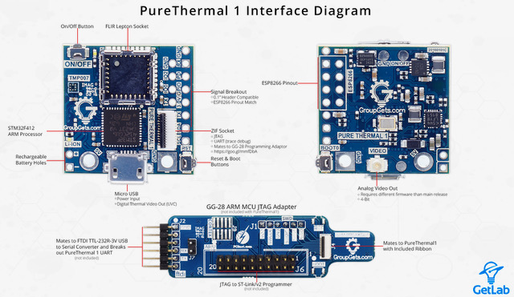

# Todo: Consider to automate chocolate tempering for truffle making (e.g., use a thermal camera for contactless temperature reading)?

```#cbb8e0e5``` *As of 2019-05-10 09:36*

[mail plain/text](mail.txt)


Based on me dreading any work with viscous substances like paint or chocolate it could be a good idea to try and automate some steps of chocolate tryffel making?

==&gt; Also see "[Todo: Choklad - Överväg att lära mig baka med choklad?](../f13d4a6b/chime.md)"

==&gt; Se även ”[Todo: köksredskap Cordon Bleu](../d6123e19/chime.md)”  
==&gt; Se även ”[Todo: Chokladfabriken Regeringsgatan 58, 111 56 Stockholm](../2839ae56/chime.md)”  
==&gt; Se även ”[Todo: Göra chokladpraliner - Chokladfabriken Sankt Eriksplan 2](../cd039dd3/chime.md)"

1) Consider youtube video "PureThermal 1 USB Camera // GroupGets" about an IR camera module (<https://www.youtube.com/watch?v=ekr0fuNEsac> )?

==&gt; She seems to show of this IR camera that works as a web-camera (<https://groupgets.com/manufacturers/getlab/products/purethermal-1-flir-lepton-smart-i-o-module> )?

> *The PureThermal 1 FLIR Lepton Smart I/O Module is a hackable thermal webcam module for the FLIR Lepton LWIR camera core. It ships pre-configured to operate as a plug-and-play UVC 1.0 USB thermal webcam that will work with standard webcam apps such as VLC Media Player on PC, Linux, Mac, and even Android.*



==&gt; It seems to be based on an actual FLIR camera module called "Lepton" (<https://www.flir.eu/products/lepton/> )?


==&gt; The FLIR LEpton modules seems to be available in different versions with different resolutions (3.5 and 3.0 160x120 and older 80x60 pixels)?


==&gt; Sparkfun seems to sell a development kit (<https://www.sparkfun.com/products/14654> )


==&gt; It seems GroupGet can provide a FLIR camera module AND a breakout board?

==&gt; Consider GroupGet FLIR Lepton Camera module (<https://groupgets.com/manufacturers/flir/products/lepton-2-0> )?


==&gt; Consider GroupGet


==&gt; It seems the FLIR Lepton breakout board had been licensed back to FLIR and is now available from several vendors?

> *"The design as since been **licensed to FLIR** and can be bought from multiple distributors worldwide, as well as in our store."*

2)


