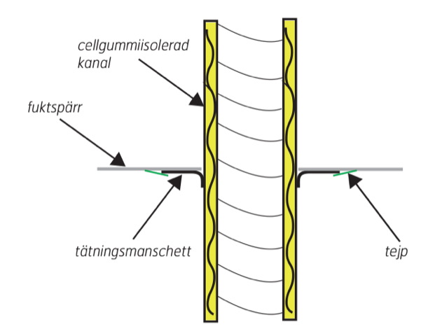

# Todo: Consider how to correctly pass through the external wall to get external air the correct way to my stove?

```#cbd32ddc``` *As of 2021-06-06 15:28*

[mail plain/text](mail.txt)


1) Consider this document "FDV - KANALSYSTEM/TILLBEHÖR. Monteringsanvisning Ventilationsanläggning med värmeåtervinning" (<https://www.flexit.no/globalassets/catalog/documents/19991_produkter-kanalerslanger-man_94007s.pdf> )?

==&gt; It seems the most important thing is to keep the moisture sealing tight?

> 

==&gt; It seems they recommend using special "sealing cuffs" when going through moister barriers?

> *"*  
> *2.2. Tätningsmanschetter, vind- och

> fuktspärrar

> Monteras när vind- och fuktspärrar har monterats av snickare. Montören måste själv täta de platser där  
> det egna arbetet med montering av ledningar bryter fukt- eller vindspärrar. Egna instruktioner medföljer våra tätningsmanschetter.*  
> *"*

==&gt; It seems they recommend fresh air intake to stoves with a 40-80 l / s capacity?

> *"...Eldstad. Lufttillförsel till e*ldstad på 40-80 l/s bör göras med friskluftskanal direkt till eldstaden. Ventilerad skorsten kan också användas.*"*

2) Consider it is only the indoor warm air that may condensate on cold intake surfaces (thus it is important to isolate the intake ducts)

> *So, the main insight here is that moisture may condensate only when warm humid air meets a cold surface?*

> *Thus, what I need to look out for is to have warm indoor air condensate when it meets could outside air or surfaces.*

> *I imagine this can happen in two cases.*

> *1) When warm indoor air meets a cold surface of the inlet ducting?*  
> *2) When warm air gets sucked into the stove and be back-drawn out the inlet.*

> *Now, the first situation I must mitigate by isolating all the ducting. AND use a damper to close of the inlet air when the stove is not in use.*

> *The second situation I can not image ever happen? The house ventilation sucks air out of my apartment so how would then warm air get sucked into the stove and out the inlet?*

> *I mean, I can imagine strong winds causing a pressure difference to push air down the chimney and out the inlet (when damper i open). But then still no warm air from the apartment will enter the stove or inlet ducting?*

...


