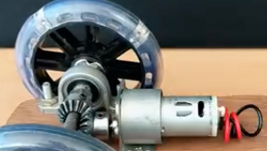

# Todo: Power Feeder - Consider to use a cycloidal gear box and multicopter brushless motor for high torque robotic actuators to drive wood through a table saw?

```#cc8427d2``` *As of 2019-05-15 09:53*

[mail plain/text](mail.txt)


Can we use the design of a cycloidal gear box based brushless motor driven robotic actuator to build a power feeder?

==&gt; Also see "[Todo: Consider to understand high torque and speed robotic leg actuator designs and available DIY build options (e.g., cycloidal drives and the OpenTorque actuator designs)?](../3187c1e1/chime.md)"

==&gt; Also see "[Todo: Power Feeder - Consider to use electric inline wheel drive components?](../b6dbfa19/chime.md)"

==&gt; Also see "[Todo: Consider the requirements on a motor for my Table Saw power feeder?](../d93391cf/chime.md)"

==&gt; Also see "[Todo: Power Feeder - Consider a reciprocating (alternating) push feeder?](../7087a2b1/chime.md)"

==&gt; Also see "[Todo: DIY Power Feeder - Consider a caterpillar drive using available drive chains and sprockets for e.g., bicycles or robots or RC model?](../8b376ef3/chime.md)"

==&gt; Also see "[Todo: Power Feeder - Consuder to base a power feeder design on wheels from casters?](../52436c2e/chime.md)"

==&gt; Also see "[Todo: Table Saw Power Feeder - Consider to design a Power Feeder from self balancing electric skateboard or cycle wheel?](../ec2c8971/chime.md)"

==&gt; Also see "[Todo: Table Saw Power Feeder - Consider to design a Power Feeder from Conrad web-shop parts?](../9001ef5d/chime.md)"

==&gt; Also see "[Todo: Table Saw Power Feeder + Table Saw Rip Fence - Consider Adafruit CNC and Robot parts?](../4cabff46/chime.md)"

==&gt; Also see "[Todo: Table Saw Power Feeder - Consider to design a Power Feeder from CNC parts (from Accu web shop)?](../872a6397/chime.md)"

==&gt; Also see "[Todo: Table Saw Power Feeder - Consider to design a Power Feeder from CNC parts (from ratRig provider)?](../65915dfb/chime.md)"

==&gt; Also see "[Todo: DIY - Consider to build a power feeder for my table saw module?](../10c92e8a/chime.md)"

1) Consider in what way we can use a cycloidal gear box driven by a brushless motor to create a power feeder?

==&gt; Consider Hobbyking €54 Multistar Elite 5008-330KV Multi-Rotor Motor (<https://hobbyking.com/en_us/multistar-elite-5008-330kv-multi-rotor-motor.html?___store=en_us> )?

==&gt; Consider to base the design on this Cycloidal Drive for a robotic leg (<https://www.thingiverse.com/thing:3167952> )?


==&gt; Consider a design where we use a power drill to drive the feeder?



From *"Todo: Power Feeder - Consider to use electric inline wheel drive components?"*

...


