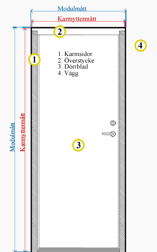
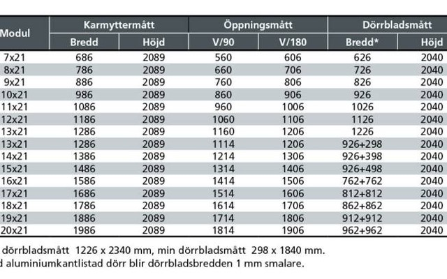

# Todo: House Build - Consider to understand Swedish Door standard based on "module" specifications?

```#cc9bc9aa``` *As of 2019-09-30 15:45*

[mail plain/text](mail.txt)


I started to sketch on a hexagonal based house sections design and discovered I need to understand door sizes.

1) It seems the door module size specifies the actual opening in the wall to fit a door frame for a door of that size (<https://www.mindorr.se/mattinformation> )?

==&gt; It seems the door frame is usually 1 cm smaller in width and height to allow for adjustment in the wall (module) opening?

> "Modulmåttet är själva hålet i väggen.  
> Modulmått 10x21 = 1000 mm x 2100 mm  
> Karmens yttermått är 10 mm mindre på bredd och höjd,  
> detta för att kunna justera och dreva (isolera) karmen."



*The "Module" size defines the wall opening in 10 cm enumerations (10x21 specifies a 100 x 210 cm wall opening to fit the door frame)*

1) Consider this Swedish site where they seem to define doors in openings specified by standard "module" sizes (<http://arkitektradgivaren.se/faq/de-5-viktigaste-sakerna-att-komma-ihag-nar-man-foreskriver-dorrar/> )?

==&gt; It seems doors are defined in "M" for Module which specifies the size in 10 cm enumerations?

> *"Vanligaste storleken för till exempel bostadsinnerdörrar är 9M och för massivdörrar 10M, men vid krav på extra god tillgänglighet kan det behövas större storlekar. M står för modul, vilket räknas i intervall om 10 cm. 10M betyder alltså ca 1 meter. Dörrar har dock lite andra mått, så en massivdörr i 10M är 986 mm bred, och hålet dörren ska monteras i brukar vara 1010 mm brett, men man säger ändå att båda är 10M."*



*Some standard Swedish "module" sizes for doors*

NOTE: The door sizes in this table shows the frame width is 14 mm smaller and hight is 11 mm smaller than the module wall opening size?

==&gt; It seems in my current apartment I have module 9x21 doors and a 10x21 entry door?

> *My door blades are all around 82,5 cm wide and roughly 2.04 m high which suggests I have 9x21 module doors. My entry door is 94,3 cm wide and also 2.04 high which suggests it is a 10x21 module door.*

2) Consider the measurements to consider for the module sizes of the doors in my apartment (9x21 and 10x21 doors)?

==&gt; Consider how each "module" is 10 cm apart in measurements?

> *By studying the table for door modules it seems the 9x and 10x modules are 10 cm apart in wall opening width. And the same goes for all the first module index. From the 7x21 door to the 20x21 door the wall opening (Swedish "Karmyttermått") width goes up from 686 mm to 1986 mm in steps of 10 cm.*

==&gt; Consider "Karmyttermått" 886 x 2089 mm is smaller than the opening in the wall to fit a 9x21 module (900 x 2100)?

==&gt; Consider "Karmyttermått" 986 x 2089 mm is smaller than the opening in the wall to fit a 10x21 module (1000 x 2100)?

...


