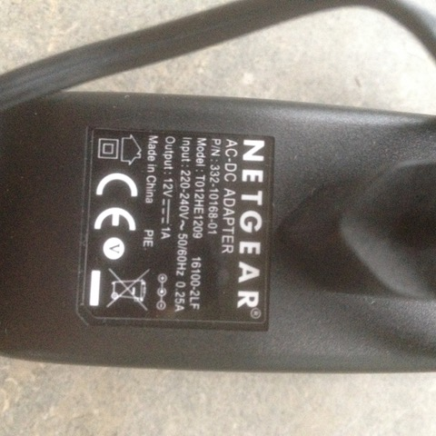
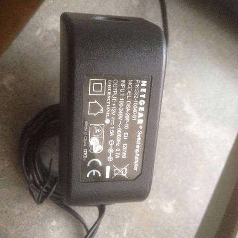
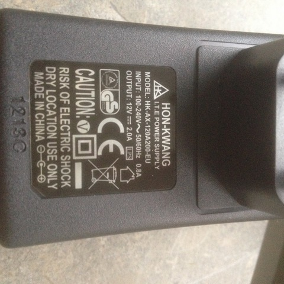
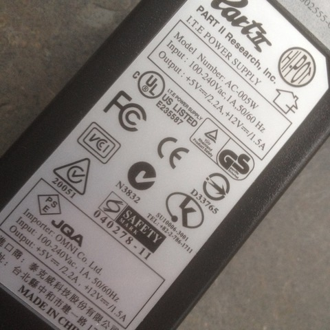
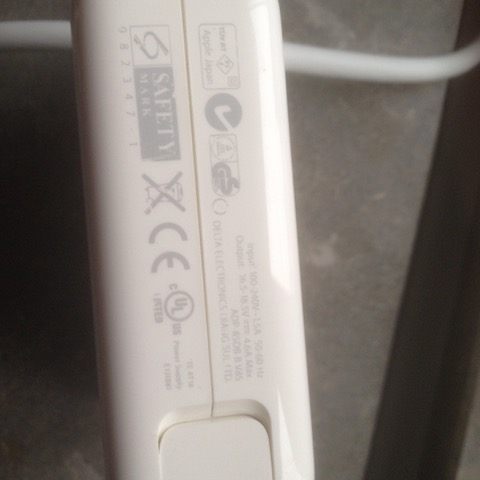
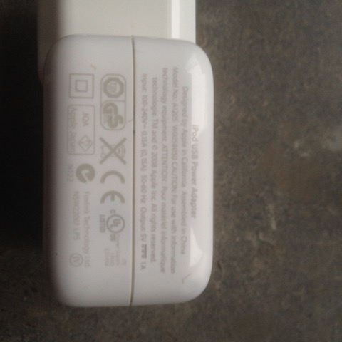
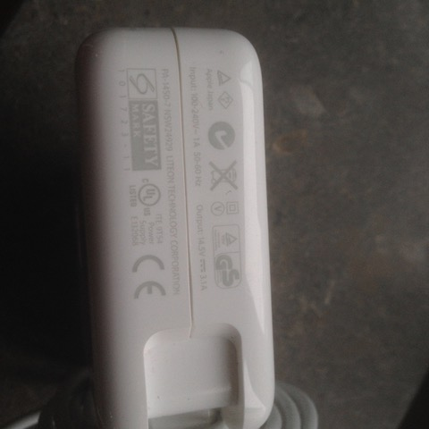
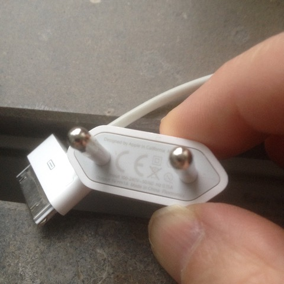

# Todo: Electronics Lab - Consider to document all my AC power adapters for their ability to power stuff in my lab (e.g., my TS100 soldering iron or as power supply through a  DC-DC module from Rui Deng)?

```#ccb207de``` *As of 2019-07-27 12:40*

[mail plain/text](mail.txt)


It seems I could benefit from actually document my "inventory" of different Ac power adapters that outputs DC I can use to power stuff in my electronics lab (or else where)?

==&gt; Also see "[Todo: Consider to record the data for my TS100 soldering iron so I can DIY power supply and other accessories for it?](../864b9dc4/chime.md)"

1) Consider my low power Apple and other small device power adaptors?

TODO: What are the DC output connector of each power adaptor?



2) Consider my lap top AC power adaptors?

==&gt; Also see "[Todo: Consider to record the data for my TS100 soldering iron so I can DIY power supply and other accessories for it?](../864b9dc4/chime.md)"

TODO: What are the DC output connector of each power adaptor?

...


