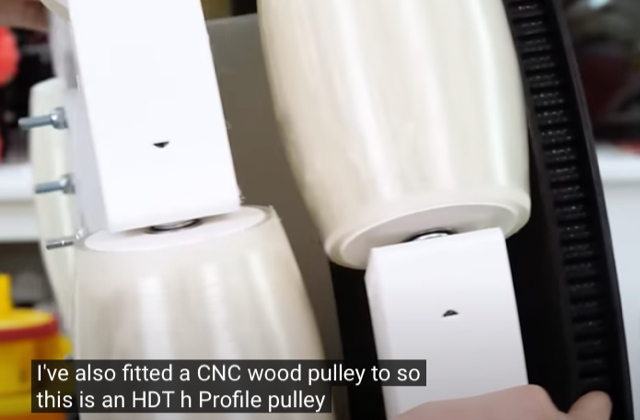
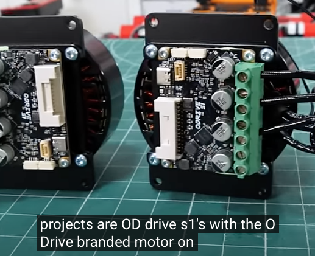
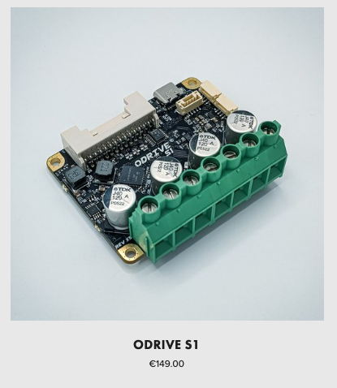
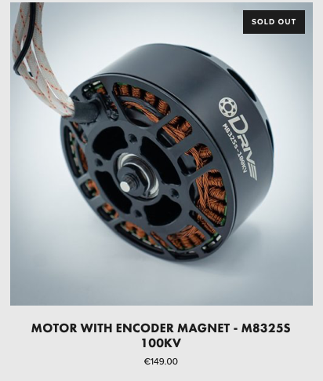
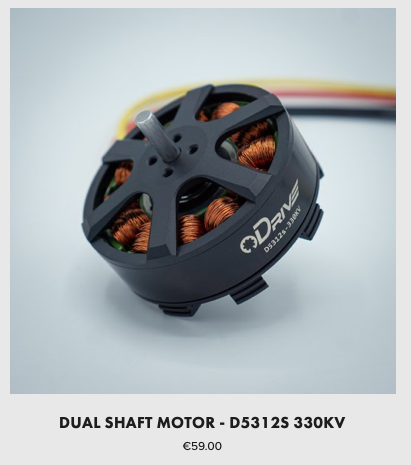
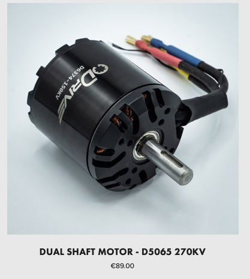
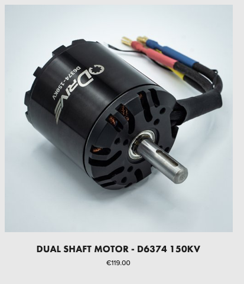
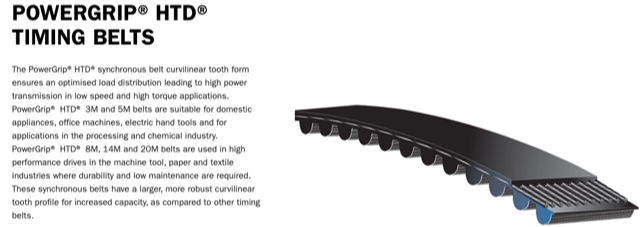

# Todo: Consider the electronics, mechanical and motor / servo parts and drivers used by James Burton for his large tentacle robot 11 June 2024?

```#ccd1d7ed``` *As of 2024-06-12 15:35*

[mail plain/text](mail.txt)


I need to know about available and recommended parts to build tools that moves.

1) Consider youtube video "I Built a GIANT TENTACLE ROBOT" (<https://youtu.be/FVoqf73ZLZo> )?

==&gt; At around 16:45 He seems to show how he has used a CNC to route a HTD (High torque drive) tooth in an H-profile around a playwood 'pulley' (<https://youtu.be/FVoqf73ZLZo?t=1005> )?



2) Consider the ODrive driver and motor combination shown at around 17:27 (<https://youtu.be/FVoqf73ZLZo?t=1047> )?



3) Consider the ODRIVE S1 single axis (one motor) driver and controller (<https://odriverobotics.com/shop/odrive-s1> )?



4) Consider the motors available through the ODrive EU Web-shop (<https://eu.odriverobotics.com> )?

 

 

5) Consider that HTD timing belts is a Gates company brand (<https://www.gates.com/gb/en/search.p.9293-000000-000000.html> )?



6) Consider it seems that it is Gates that produce the timing belt on Pinion gearbox driven bikes (<https://www.gatescarbondrive.com> )?


...


