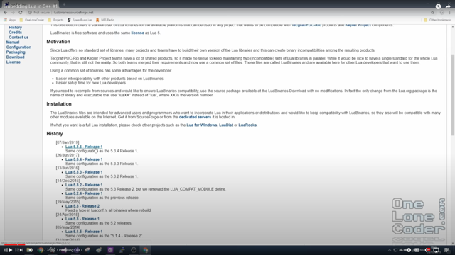
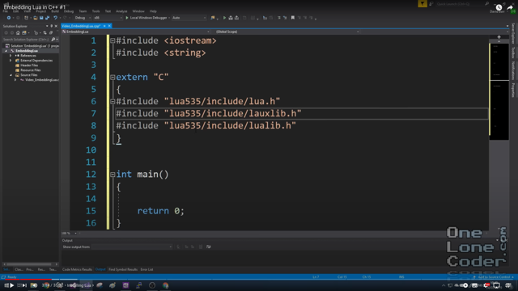

# Todo: Consider to try out Lua binding to C++ console application on macOS?

```#cd93e050``` *As of 2023-11-30 14:14*

[mail plain/text](mail.txt)


I want to know more about how to integrate a lua repl into a C++ console application.

==&gt; Also see "Todo: Consider to add Lua scripting to my open source Cratchit application to expose run time operations on book keeping data"

==&gt; Also see "Todo: C++ scripting - Consider to document some scripting engines we may integrate with C++ applications (e.g., Lua, Chaiscript...)?"

1) Consider to install lua with brew to see what we get?

==&gt; The brew lua install seems to have gone well on my macOS?

> kjell-olovhogdal@Kjell-Olovs-Mac-Pro cratchit % brew install lua  
> ==&gt; **Downloading <https://formulae.brew.sh/api/formula.jws.json>**  
> ######################################################################################################################################################################################################################################################### 100.0%  
> ==&gt; **Downloading <https://formulae.brew.sh/api/cask.jws.json>**  
> ######################################################################################################################################################################################################################################################### 100.0%  
> ==&gt; **Downloading <https://ghcr.io/v2/homebrew/core/lua/manifests/5.4.6>**  
> #=#=- # # #=O#- # # ######################################################################################################################################################################################################################################################### 100.0%  
> ==&gt; **Fetching ****lua**  
> ==&gt; **Downloading <https://ghcr.io/v2/homebrew/core/lua/blobs/sha256:d3f55cd3b4122bfa85992aab125205041379f99879d90740d62f054498cba97d>**  
> #=#=- # # #=O#- # # ######################################################################################################################################################################################################################################################### 100.0%  
> ==&gt; **Pouring lua--5.4.6.monterey.bottle.tar.gz**  
> ==&gt; **Caveats**  
> You may also want luarocks:  
> brew install luarocks  
> ==&gt; **Summary**  
> 🍺 /usr/local/Cellar/lua/5.4.6: 29 files, 712KB  
> ==&gt; **Running \`brew cleanup lua\`...**  
> Disable this behaviour by setting HOMEBREW_NO_INSTALL_CLEANUP.  
> Hide these hints with HOMEBREW_NO_ENV_HINTS (see \`man brew\`).  
> Warning: Formula freecad/freecad/python3.9 was renamed to python3.9.  
> kjell-olovhogdal@Kjell-Olovs-Mac-Pro cratchit %

2) I seem to fail to find any downloadable binaries for Mac on the official lua binaries web site ([https://sourceforge.net/projects/luabinaries/files/5.4.2/Other%20Libraries/](<https://sourceforge.net/projects/luabinaries/files/5.4.2/Other Libraries/>) )?

> *"No matter how I follow links around none seem to lead to a lua binary for macOS? *

==&gt; AHA - there are lua binaries for macOS BUT - only up to version 5.1.5 (<https://luabinaries.sourceforge.net/download.html> )?

> [LuaBinaries 5.2.4 - Release 1](https://sourceforge.net/projects/luabinaries/files/5.2.4/)

> > [lua-5.2.4_Sources.tar.gz](https://sourceforge.net/projects/luabinaries/files/5.2.4/Docs%20and%20Sources/lua-5.2.4_Sources.tar.gz/download)Source Code, Makefiles and IDE Projects[lua-5.2.4_Sources.zip](https://sourceforge.net/projects/luabinaries/files/5.2.4/Docs%20and%20Sources/lua-5.2.4_Sources.zip/download)Source Code, Makefiles and IDE Projects[lua-5.2.4_Win32_bin.zip](https://sourceforge.net/projects/luabinaries/files/5.2.4/Tools%20Executables/lua-5.2.4_Win32_bin.zip/download)Windows x86 Executables[lua-5.2.4_Win32_dllw6_lib.zip](https://sourceforge.net/projects/luabinaries/files/5.2.4/Windows%20Libraries/Dynamic/lua-5.2.4_Win32_dllw6_lib.zip/download)Windows x86 DLL and Includes  
> > (MingW 4 Built)[lua-5.2.4_Win64_bin.zip](https://sourceforge.net/projects/luabinaries/files/5.2.4/Tools%20Executables/lua-5.2.4_Win64_bin.zip/download)Windows x64 Executables [lua-5.2.4_Win64_dllw6_lib.zip](https://sourceforge.net/projects/luabinaries/files/5.2.4/Windows%20Libraries/Dynamic/lua-5.2.4_Win64_dllw6_lib.zip/download)Windows x64 DLL and Includes  
> > (MingW 4 Built)[lua-5.2.4_MacOS1011_bin.tar.gz](https://sourceforge.net/projects/luabinaries/files/5.2.4/Tools%20Executables/lua-5.2.4_MacOS1011_bin.tar.gz/download)MacOS X Intel Executables[lua-5.2.4_MacOS1011_lib.tar.gz](https://sourceforge.net/projects/luabinaries/files/5.2.4/Other%20Libraries/lua-5.2.4_MacOS1011_lib.tar.gz/download)MacOS X Intel Library and Includes[lua-5.2.4_Linux319_64_bin.tar.gz](https://sourceforge.net/projects/luabinaries/files/5.2.4/Tools%20Executables/lua-5.2.4_Linux319_64_bin.tar.gz/download)Linux x64 Executables[lua-5.2.4_Linux319_64_lib.tar.gz](https://sourceforge.net/projects/luabinaries/files/5.2.4/Linux%20Libraries/lua-5.2.4_Linux319_64_lib.tar.gz/download)Linux x64 Library and Includes


3) Consider youtube video "Embedding Lua in C++ #1" (<https://youtu.be/4l5HdmPoynw> )?

==&gt; It seems he downloads the raw binaries for windows directly to place in his project (<https://youtu.be/4l5HdmPoynw?t=97> )?



==&gt; I downloaded the "lua-5.2.4_MacOS1011_lib.tar" file for macOS where he does it for Windows (<https://luabinaries.sourceforge.net/download.html> ).

> *The binaries for macOS seems to contain a dynamic and a static library as well as the include C-files?*

> kjell-olovhogdal@Kjell-Olovs-Mac-Pro lua-5.2.4_MacOS1011_lib % pwd  
> /Users/kjell-olovhogdal/Downloads/lua-5.2.4_MacOS1011_lib  
> kjell-olovhogdal@Kjell-Olovs-Mac-Pro lua-5.2.4_MacOS1011_lib % tree  
> .  
> ├── include  
> │ ├── lauxlib.h  
> │ ├── lua.h  
> │ ├── lua.hpp  
> │ ├── luaconf.h  
> │ └── lualib.h  
> ├── liblua52.a  
> └── liblua52.dylib

> 1 directory, 7 files  
> kjell-olovhogdal@Kjell-Olovs-Mac-Pro lua-5.2.4_MacOS1011_lib %

==&gt; I simply copied the whole downloaded content into my "cratchit" app filder structure under subfolder lib/macos.

==&gt; At around 3:14 he seems to add include directives to include the lua headers into his c++ file (<https://youtu.be/4l5HdmPoynw?t=194> )?



==&gt; It seems I should read up on Gnu linker arguments to come up with a good way to tell the compiler how to link with the required lua binaries (<https://ftp.gnu.org/old-gnu/Manuals/ld-2.9.1/html_node/ld_3.html> )?

> `

> ```
> ld -o output /lib/crt0.o hello.o -lc

> ```

> This tells `ld` to produce a file called output as the result of linking the file `/lib/crt0.o` with `hello.o` and the library `libc.a`, which will come from the standard search directories. (See the discussion of the \`-l' option below.)

> ``-rpath dir`Add a directory to the runtime library search path. This is used when linking an ELF executable with shared objects.

> `-static`Do not link against shared libraries.

==&gt; It seems I should read up on gcc command line arguments to understand how to affect how linking is done (<https://gcc.gnu.org/onlinedocs/gcc-3.1.1/gcc/Invoking-GCC.html> )?

> *Linker Options*See [Options for Linking](https://gcc.gnu.org/onlinedocs/gcc-3.1.1/gcc/Link-Options.html#Link%20Options).

> ```
>           object-file-name  -llibrary
>           -nostartfiles  -nodefaultlibs  -nostdlib
>           -s  -static  -static-libgcc  -shared  -shared-libgcc  -symbolic
>           -Wl,option  -Xlinker option
>           -u symbol
> ```

  
==&gt; It seems I can instruct the compiler to tell the linker to link with a specific object file by just providing a path to it on the command line (object-file-name is stated as part of the argument list) ?

> {  
> "version": "2.0.0",  
> "tasks": &#91;  
> {  
> "type": "cppbuild",  
> "label": "macOS C/C++: Brew installed g++-13.2.0 build cratchit",  
> "command": "/usr/local/Cellar/gcc/13.2.0/bin/g++-13",  
> "args": &#91;  
> "--sysroot=/Library/Developer/CommandLineTools/SDKs/MacOSX.sdk",  
> "-fdiagnostics-color=always",  
> "-std=c++20",  
> "-g",  
> **"../lib/macos/lua-5.2.4_MacOS1011_lib/liblua52.a",**  
> "${file}",  
> "-o",  
> "${workspaceFolder}/cratchit.out"  
> &#93;,  
> "options": {  
> "cwd": "${fileDirname}"  
> },  
> "problemMatcher": &#91;  
> "$gcc"  
> &#93;,  
> "group": "build",  
> "detail": "compiler: /usr/local/Cellar/gcc/13.2.0/bin/g++-13"  
> },  
> {  
> "type": "cppbuild",  
> "label": "macOS C/C++: macPorts installed g++-12 build cratchit",  
> "command": "/opt/local/bin/g++-mp-12",  
> "args": &#91;  
> "--sysroot=/Library/Developer/CommandLineTools/SDKs/MacOSX.sdk",  
> "-fdiagnostics-color=always",  
> "-std=c++20",  
> "-g",  
> **"../lib/macos/lua-5.2.4_MacOS1011_lib/liblua52.a",**  
> "${file}",  
> "-o",  
> "${workspaceFolder}/cratchit.out"  
> &#93;,  
> "options": {  
> "cwd": "${fileDirname}"  
> },  
> "problemMatcher": &#91;  
> "$gcc"  
> &#93;,  
> "group": "build",  
> "detail": "compiler: /opt/local/bin/g++-mp-12"  
> },  
> {  
> "type": "cppbuild",  
> "label": "macOS C/C++: Brew installed clang-17.0.5 build cratchit",  
> "command": "/usr/local/Cellar/llvm/17.0.5/bin/clang++",  
> "args": &#91;  
> "-fdiagnostics-color=always",  
> "-Wl,-rpath,/usr/local/Cellar/llvm/17.0.5/lib/c++",  
> "-std=c++20",  
> "-g",  
> "${file}",  
> **"../lib/macos/lua-5.2.4_MacOS1011_lib/liblua52.a",**  
> "-o",  
> "${workspaceFolder}/cratchit.out"  
> &#93;,  
> "options": {  
> "cwd": "${fileDirname}"  
> },  
> "problemMatcher": &#91;  
> "$gcc"  
> &#93;,  
> "group": "build",  
> "detail": "compiler: /usr/local/Cellar/llvm/17.0.5/bin/clang++"  
> },  
> {  
> "type": "cppbuild",  
> "label": "macOS C/C++: macPorts installed clang-15 build cratchit",  
> "command": "/opt/local/libexec/llvm-15/bin/clang++",  
> "args": &#91;  
> "--sysroot=/Library/Developer/CommandLineTools/SDKs/MacOSX.sdk",  
> "-fexperimental-library",  
> "-L/opt/local/libexec/llvm-15/lib/",  
> "-fdiagnostics-color=always",  
> "-std=c++20",  
> "-g",  
> **"../lib/macos/lua-5.2.4_MacOS1011_lib/liblua52.a",**  
> "${file}",  
> "-o",  
> "${workspaceFolder}/cratchit.out"  
> &#93;,  
> "options": {  
> "cwd": "${fileDirname}"  
> },  
> "problemMatcher": &#91;  
> "$gcc"  
> &#93;,  
> "group": "build",  
> "detail": "compiler: /opt/local/libexec/llvm-15/bin/clang++"  
> }  
> &#93;  
> }

==&gt; It seems in VSCode running the task "macOS C/C++: Brew installed clang-17.0.5 build cratchit" results in the following call to the compiler?

> Executing task: macOS C/C++: Brew installed clang-17.0.5 build cratchit

> Starting build...  
> **/usr/local/Cellar/llvm/17.0.5/bin/clang++** -std=gnu++14 -fdiagnostics-color=always -Wl,-rpath,/usr/local/Cellar/llvm/17.0.5/lib/c++ -std=c++20 -g /Users/kjell-olovhogdal/Documents/Github/cratchit/src/main.cpp ../lib/macos/lua-5.2.4_MacOS1011_lib/liblua52.a -o /Users/kjell-olovhogdal/Documents/Github/cratchit/cratchit.out

> Build finished successfully.  
> \* Terminal will be reused by tasks, press any key to close it.

**NOTE: WHERE does the extra "-std=gnu++14" option come from??!**

==&gt; Consider the gcc command line options for linking ([https://gcc.gnu.org/onlinedocs/gcc-3.1.1/gcc/Link-Options.html#Link%20Options](<https://gcc.gnu.org/onlinedocs/gcc-3.1.1/gcc/Link-Options.html#Link Options>) )?

> ``-static`On systems that support dynamic linking, this prevents linking with the shared libraries. On other systems, this option has no effect.

> ``-Wl,`option``Pass option as an option to the linker. If option contains commas, it is split into multiple options at the commas

...


