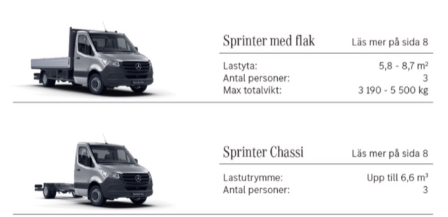

# Todo: Consider to buy an electrical light truck and build a camper attachment to put on the bed to live in?

```#cd9ced32``` *As of 2023-01-28 14:46*

[mail plain/text](mail.txt)


I need a way to travel and live when I sell my apartment but before I have a new place to build my house.

1) It seems I am allowed to drive a class II "light truck" (Swedish Rules "personbil class II") that weigh 4250 kg on my pre-1996 B drivers license (<https://www.transportstyrelsen.se/sv/vagtrafik/Fordon/Fordonsregler/Personbil/> )?

> *Personbil klass II (husbil eller lastbil)  
> Personbil klass II är permanent försedd med ett karosseri som är inrättat som bostadsutrymme och utrustat med åtminstone:

> *  
> *• fast monterade sittplatser,  
> *  
> *• fast monterade sovplatser som kan utgöras av sittplatser som kan omvandlas till sovplatser,  
> *  
> *• fast monterad utrustning för matlagning och lagring och  
> *  
> *• bord.  
> *

> *En personbil klass II kallas ofta för husbil men en husbil kan också vara en lastbil. Om husbilen är registrerad som lastbil, finns det andra krav på förarens behörighet, fordonets utrustning samt skatter och avgifter.*

> *Den som har en **utökad B-behörighet (kod 96) får köra en fordonskombination som väger 4 250 kg**. Personbilens vikt dock inte överstiga 3,5 ton.*

2) Consider brands of electrical "light trucks" (Swedish rules "personbil klass II") that can be of interest to me?

==&gt; Consider Mercedes "Sprinter" model 7,06m length?

> *It seems the Mercedes Sprinter comes in three lengths, where the longest is 7,06 m? On the other hand, listing the models on lengths there are much more options, like 7,06, 6,95, 6,86, ... 5,32m?*

> *Anyhow, I can figure that out by visting a dealer?*

> 

...


