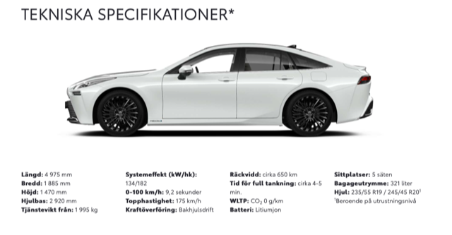
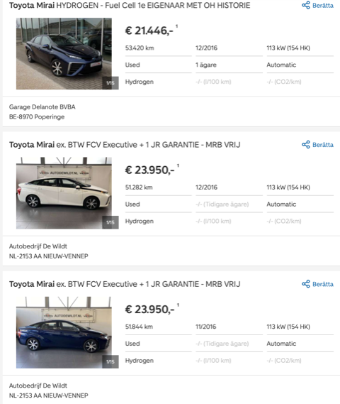

# Todo: Consider to try and buy a Toyota Mirai to get hold of the Fuel cell to use to power my off-grid house?

```#d02087ce``` *As of 2021-06-24 22:51*

[mail plain/text](mail.txt)


==&gt; Also see "[Todo: Consider to check out Fuel Cells from Swedish Manufacturer PowerCellution?](../1e08969a/chime.md)"

==&gt; Also see "[Todo: House Build - Consider to delve into the Hydrogen Energy Storage based portable electric car charging stations for leads into available Hydrogen Energy Storage solutions for my house build?](../2f3e179e/chime.md)"

==&gt; Also see "[Todo: House Build - Consider to use the Hydrogen energy storage system RE8760 developed by "Nilsson Energy AB"?](../2efef0d7/chime.md)"

==&gt; Also see "[Todo: Consider what energy storage and retrieval efficiency we can expect from hydrogen production, high pressure storage and fuel cell electrical generation?](../4eed46ad/chime.md)"

==&gt; Also see "[Todo: Consider if I use Hydrogen Fuel Cells I can actually use the resulting water for drinking and other household applications?](../1f7d473a/chime.md)"

==&gt; Also see "[Todo: Consider to store solar energy in the summer in the form of compressed hydrogen gas?](../d1775369/chime.md)"

1) It seems the Toyota Mirai comes to sweden mid 2021 (<https://www.toyota.se/nya-bilar/mirai/index.json?gclid=Cj0KCQjw2tCGBhCLARIsABJGmZ7ZZi_PLETjtklaeTc5weJRNz7ez-cnFHgmfuRft8AKMyJ-OkajbwgaAkAMEALw_wcB&gclsrc=aw.ds> )?



2) Consider how to use the Toyota fuel cell to generate electricity for my off-grid house?

==&gt; Also see "[Todo: Consider to check out Fuel Cells from Swedish Manufacturer PowerCellution?](../1e08969a/chime.md)"

> *So, the basic idea is to find a small hydrogen fuel cell to turn hydrogen into electricty.*

> *In the summer we use solar panels to generate electricity and use Electrolysis to turn water into hydrogen.*

> *Then we try to find a way to store hydrogen in solid state form (or simply in pressurised gas tubes)*

> *In the cold dark winter we use use the Toyota fule cell to generate energy to heat and electrify my house.*

> *Now, 130-180 kW may in fact be a to large fuel cell for only house powering?*

> *Hm... maybe this is overkill for this purpose? *

3) It seems I can buy a used Toyota Mirai for around 22 000 € in Europe ([https://www.autoscout24.se/lst/toyota/mirai?sort=standard&desc=0&offer=U&ustate=N%2CU&size=20&page=1&atype=C&](https://www.autoscout24.se/lst/toyota/mirai?sort=standard&desc=0&offer=U&ustate=N,U&size=20&page=1&atype=C&) )?



...


