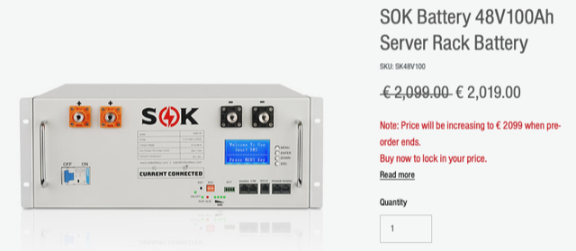
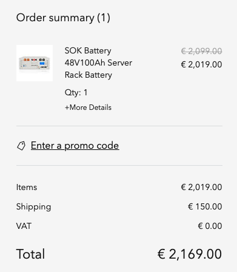

# Todo: Consider to follow SOK "power wall" Battery modules for future off-grid electrical system?

```#d063e166``` *As of 2022-07-19 00:01*

[mail plain/text](mail.txt)


I need some trusted way to design and build an electrical power storage system.

==&gt; Also see "Todo: Consider to follow Jakiper (Orient Power) "power wall" Battery modules for future off-grid electrical system?"

1) It seems SOK batteries are available from European vendor at this site (<https://www.europe.sokbattery.com/product-page/sok-battery-100ah-48v-server-rack-battery> )?





==&gt; It seems the 48V module ships to Sweden for 150€?

...


