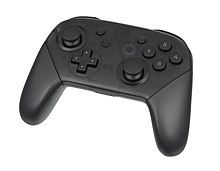
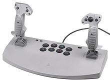
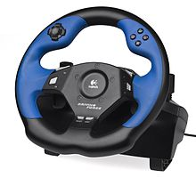
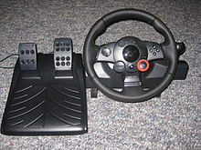

# Todo: Consider to design my own C++ Source Code programming mechanical keyboard for faster, correct and non-obtrusive input?

```#d08aa8d8``` *As of 2019-01-31 11:26*

[mail plain/text](mail.txt)


It seems I have some intuitive feeling that I may be able to design and build a special keyboard for source code input?

==&gt; Also see “Todo: Consider to build the DIY ibm-like old-style tactile switches keyboard as indicated by Snazzy Lab youtube video?”

1) Consider a multiple-key-press “Piano Chord” approach to enter source code?

==&gt; Consider to enter a matched parenthesis “{ … }” with some finger-pinch keyboard press?

==&gt; Consider to leverage the four-layer Tha model of C++ to enter keywords with a combination of layer + first character pinch?

==&gt; Consider “int” = 2 + ‘i’

==&gt; Consider “struct” = 3 + ’s’

==&gt; Consider “class” = 3 + ‘c’

==&gt; Consider “union” = 3 + ‘u’

==&gt; Consider “template” = 4 + ’t’

…

2) Consider to study game controllers for inspiration to a grip-based source-code input device (<https://en.wikipedia.org/wiki/Game_controller>)?



A common two hand game controller



A dual joy stick game controller



A steering wheel game controller



A game controller with both foot pedals and steering wheel

3) Consider to study different text input keyboard designs?


The Kinesis Freestyle 2 ergonomic keyboard

==&gt; Consider this Braille Keyboard for a user interface for blind people for using the web and a PC (<https://www.youtube.com/watch?v=ytS_NtjHew4>)?


...

Consider to continue to imagine faster and less error prone ways to enter source code for computer programming?


