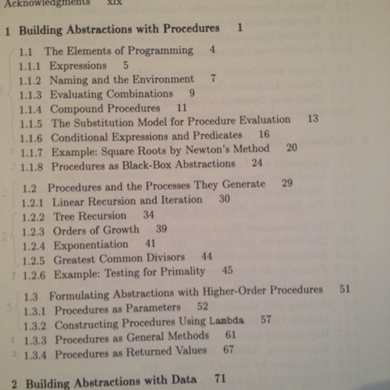
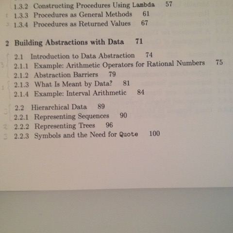
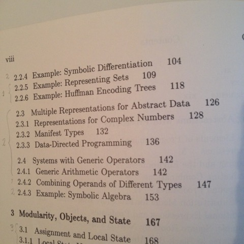
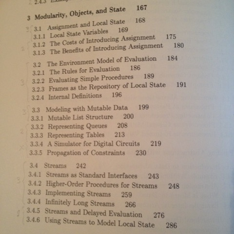

# Todo: C++ Teaching - Consider to structure a C++ code isomorphic to the one in the book "Structure and Interpretation of Computer Programs"?

```#d0e50d22``` *As of 2017-02-17 19:15*

[mail plain/text](mail.txt)


Could it be a good idea to try out a C++ teaching path using the same order of concepts as in the book "Structure and Interpretation of Computer Programs” (where they do not introduce mutation and variables until chapter 3, page 167 of 500)?

==&gt; Also see “[Todo: Programming - Consider to record my own C++ training course?](../670ea9db/chime.md)”

1) Consider in this way we can teach C++ starting of not having to bother with pointers, state or other stuff we like to postpone as “advanced” stuff?

2) Consider how C++ concepts can be paired with the ones in chapter 1 and 2 of the book?

==&gt; Consider how to map chapter 1 to C++ concepts?



==&gt; Consider how to map Chapter 2 to C++ concepts?





==&gt; Consider how to map chapter 3 to C++ concepts?



2) Consider what fun we can do with only the Chapter 1 and 2 concepts (not mutation) if we use Persistent data Structures (“functional programming") in our C++ exercises?

==&gt; Consider if this makes teaching more or less complicated for beginners to programming?

==&gt; Can we do Console input and output without mutation?

==&gt; Can we do 2D UI examples without mutation?

==&gt; Can we do 3D games without mutation?

…

3) Consider how this idea for teaching C++ rimes with the thinking of Kate Gregory (e.g. in cppcast episode <http://cppcast.com/2015/10/kate-gregory/>)?

==&gt; Also see Kate Gregory Cppcon 2015 talk (<https://www.youtube.com/watch?v=YnWhqhNdYyk>)?

...

4) Consider to see if the C++ Core Guidelines may be ordered by how they relate to concepts in the book?

==&gt; Consider to what extent the C++ Core Guidelines are about "Structure and Interpretation of Computer Programs”?

...

…

Consider to elaborate on this idea to teach C++ by providing concepts in the same order as the book "Structure and Interpretation of Computer Programs"


