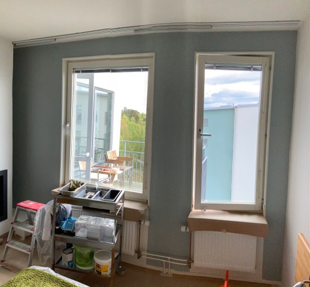
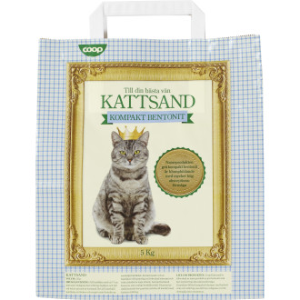
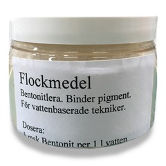
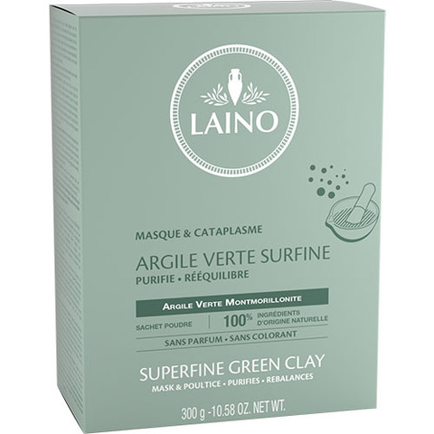

# Todo: Consider to research how to flocculate water based wall paint to separate paint from waste water (e.g., using bentonite clay or other effective flocculants)?

```#d288e4a7``` *As of 2019-05-30 14:20*

[mail plain/text](mail.txt)


Seems I now have the opportunity to research flocculant methods on the waste water I have produced after having painted the wall in my bedroom?

==&gt; Also see "Todo: Rena Penselvatten - Överväg sätt att hemma kunna rena vatten från färgrester efter penseltvätt?"

==&gt; Also see "Todo: Consider possible waste water logistic solutions for my paint wash up station?"

==&gt; Also see "Todo: Consider tp design and build a prototype of a Micro and Electro Flocculation Rinse Laundring Machine?"

==&gt; Also see "Todo: Consider if it is possible to flocculate french brew coffee (to separate the coffee grinding from the coffee drink)?"

1) Consider to speculate on what I can do to separate out the paint from the waste water I currently have?



2) Consider clarifying "Finings" used to remove inpurities from wine and beer (<https://en.wikipedia.org/wiki/Finings> )?

> *"Substances such as finings include egg whites, blood, milk, isinglass, and Irish moss. These are still used by some producers, but more modern substances have also been introduced and are more widely used, including bentonite, gelatin, casein, carrageenan, alginate, diatomaceous earth, pectinase, pectolyase, PVPP, kieselsol (colloidal silica), copper sulfate, dried albumen, hydrated yeast, and activated carbon.&#91;citation needed*&#93;*"*

==&gt; Consider this product listing of finings for beer and vine (<https://shop.humle.se/tillsatser/klarningsmedel/> )?


*Finings products from <https://shop.humle.se/tillsatser/klarningsmedel/>*

==&gt; It seems Chitosan is a poly saccharide extracted from shells of sea creatures (<https://shop.humle.se/tillsatser/klarningsmedel/chitosan-75-ml> )?

> *"Chitosan är en polysackarid som utvinns av skal från skaldjur och fungerar som klarningsmedel. Ingår ofta i vinsatser av högre kvalitet."*

==&gt; It seems Carrageenan (active substance in "Irish Moss") is a gelatine like substance (<https://en.wikipedia.org/wiki/Carrageenan> )?

> "*Gelatinous extracts of the Chondrus crispus (Irish moss) seaweed have been used as food additives since approximately the fifteenth century.&#91;1&#93; Carrageenan is a vegetarian and veganalternative to gelatin in some applications or m*ay be used to replace gelatin in confectionery."

> "• Beer: clarifier to remove haze-causing proteins"

==&gt; It seems Isinglass is made from the bladder of a fish (<https://en.wikipedia.org/wiki/Isinglass> )?

> "*Isinglass (/ˈaɪzɪŋɡlæs, -ɡlɑːs/) is a substance obtained from the dried swim bladders of fish. It is a form of collagen used mainly for the clarification or fining of some beer and wine. It can also be cooked into a paste for specialised gluing purpo*ses."

3) Consider the lab equipment I have ordered to perform flocculation experiments?

> # Orderbekräftelse - 15280

> 

> Tack för din order!

> **Orderdatum:**2019-05-13 13:18**Handlat som:**Företagskund**Ordernummer:**15280**Betalsätt:**Faktura för skolor och företag**Leveranssätt:**DHL Företagspaket

> ArtikelnummerBenämningAntalÀ-prisSummaAL7**Nivåbord - kvalitetsbord**1 st320 kr320 krKE30**Magnetomrörare - Hanna Instruments**1 st1 490 kr1 490 krAL1H**H-fot**1 st150 kr150 krAL3b**Stativstav**1 st48 kr48 krAL4a**Dubbelmuff - större**2 st39 kr78 krAL5b**Klämmare - rund**2 st38 kr76 krKE24g**E-kolv - 250 ml, 12 st**1 st155 kr155 krSumma varor2 317 krFrakt100 krSumma, exklusive moms2 417 krMoms tillkommer604,25 krTotalt, att betala inkl moms3 021,25 k

4) Consider to try using Bentonite clay as a flocculant?

==&gt; Consider wikipedia article on Bentonite (<https://en.wikipedia.org/wiki/Bentonite> )?

> *"Bentonite (/ˈbɛntənʌɪt/)&#91;1&#93; is an absorbent aluminium phyllosilicate clay consisting **mostly of montmorillonite**. It was named by Wilbur C. Knight in 1898 after the Cretaceous Benton Shale near Rock River, Wyoming.&#91;2&#93;&#91;3*&#93;*"*

> *"**The different types of bentonite are each named after the respective dominant element, such as potassium (K), sodium (Na), calcium (Ca), and aluminium (Al).**"*

> *"**two main classes of bentonite exist: sodium and calcium bentonite.**"*

> *"**Bentonite is used in a variety of pet care items such as **cat litter** to absorb the odor and surround the feces. It is also used to absorb oils and grease.**"*

==&gt; Consider to **buy some cat litter** (with bentonite clay) to tray as paint waste water flocculant?

==&gt; Consider Coop cat litter "Kattströ" (<https://www.coop.se/handla-online/varor/djur/katt/kattstro/26477180-kattsand-gra-5-kg/> )?



*Coop Bentonite based cat litter*

==&gt; It seems Bentonite Clay is also sold as "Indian Healing Clay" or "Aztek Healing Clay"?

==&gt; Consider 170g "Flockmedel" from Stockholm Shop Konstnärernas (<https://konstnarernas.se/product.html/flockmedel> )?

> *"Flockmedel består av bentonitlera i pulverform. Man använder flockmedel för att binda till sig giftiga pigment såsom kadmium ur vatten, exempelvis vid penselrengöring. Inlämnas därefter till miljöstation. Doseras 1 msk flockmedel per 1L vatten. *

> *Flockmedel kan endast användas till vattenlösliga färger som akvarell, akryl och liknande.

> *  
> *• Användes för att binda till sig giftiga pigment ur vatten  
> *  
> *• Flockmedel består av bentonitlera i pulverform  
> *  
> *• Kommer i plastburk om ca 170g"*



*Flockmedel består av bentonitlera i pulverform. *

==&gt; Consider Bentonite mineral products from UK based MKM (<http://www.mkm.co.uk/categories/bentonites/?gclid=CjwKCAjwq-TmBRBdEiwAaO1en77jWJ3qgXeLW-uXquZjl2wBOvKl_R6_Gk1lT4AjtDYN6EjrBDKLdBoCx_8QAvD_BwE> )?


5) Consider Montmorillonite is basically the same as Bentonite Clay (<https://en.wikipedia.org/wiki/Montmorillonite> )?

> "  
> Category[Phyllosilicates](https://en.wikipedia.org/wiki/Phyllosilicate)  
> [Smectite](https://en.wikipedia.org/wiki/Smectite) group[Formula](https://en.wikipedia.org/wiki/Chemical_formula)  
> (repeating unit)(Na,Ca)0.33(Al,Mg)2(Si4O10)(OH)2·*n*H2O

> "  
> "*Montmorillonite is a very soft phyllosilicate group of minerals that form when they precipitate from water solution as microscopic crystals, known as clay. It is named after Montmorillon in France. Montmorillonite, a member of the smectite group, is a 2:1 clay, meaning that it has two tetrahedral sheets of silica sandwiching a central octahedralsheet of* alumina."

==&gt; Consider to buy Montmorillonite from this chemistry (<https://www.apoteket.se/produkt/laino-superfine-green-clay-300-g-651026/?gclid=CjwKCAjwq-TmBRBdEiwAaO1enysgWKhi4sBvtVHNldn3eabodKywCsfUgJ9PenEZq9HzHTz1zbpJ2xoCMQwQAvD_BwE&gclsrc=aw.ds> )?



*Laino Superfine Green Clay är en naturprodukt bestående av 100% Montmorillonitelera.*

==&gt; Consider to compare with Rhassoul clay used for cosmetic purposes (<https://en.wikipedia.org/wiki/Rhassoul> )?

> *"Rhassoul contains silica, iron, magnesium, potassium, sodium, lithium and trace elements.&#91;1*&#93;*"*

6) Consider this article "Industrial Wastewater Treatment Using Clay-Based Flocculants" that states Sodium or Kalcium Bentonite clays are used for waste water treatment using flocculation (<https://wilsonemi.com/industrial-wastewater-treatment-using-clay-based-flocculants/> )?

> *"Clay-based flocculants are sodium bentonite clays or calcium bentonite clays that are premixed with various polymers and chemical coagulants. Manufacturers of the clay-based flocculants offer several off the shelf blends for treating industrial wastewater."*

...


