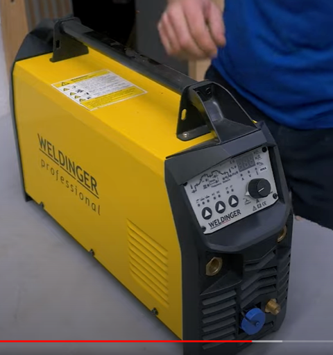

# Todo: Consider the TIG welder "WELDINGER WIG-Schweißinverter WE 219P AC/DC pro profitauglich" used by youtuber Marius Hornberger?

```#d2f6d72e``` *As of 2023-11-21 10:19*

[mail plain/text](mail.txt)


I want to some day be able to weld and thought I should take note on what welder Marius Hornberger used to make his wall mount clothe hanger.

1) Consider youtube video "I tried to Save Money with my own Furniture" where he seems to show the welder "WELDINGER WIG-Schweißinverter WE 219P AC/DC pro profitauglich" (<https://youtu.be/462E0yIehsA?t=751> )?



2) It seems he is showing off the welder "WELDINGER WIG-Schweißinverter WE 219P AC/DC pro profitauglich" (<https://weldinger.de/WELDINGER-WIG-Schweissinverter-WE-219P-AC-DC-pro-profitauglich> )?


...


