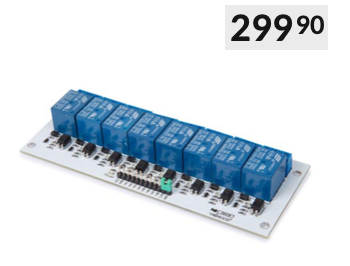
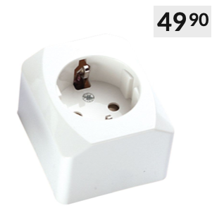
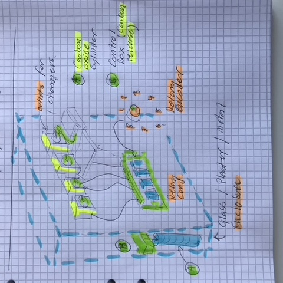

# Todo: Consider a "Battery Charging Station" with on off controlled outlets possibly based on a 12V Arduino relay card?

```#d30ee891``` *As of 2020-11-05 13:09*

[mail plain/text](mail.txt)


I built my first charging station for my indoor shed and now I need one again to organise my charging requirements in my apartment.

1) Consider the Arduino 8x 12V relay card for 220V 10A switch abilities?

==&gt; Consider Kjell & Company "Reläkort för Arduino. Drivs och styrs från Arduino med 5 V. " (<https://www.kjell.com/se/produkter/el-verktyg/arduino/moduler/relamodul-for-arduino-8x-p87034> )?

>   
> *Reläkort för Arduino. Drivs och styrs från Arduino med 5 V. *

==&gt; Consider Kjell & Company single 220V wall outlets (<https://www.kjell.com/se/produkter/el-verktyg/el-produkter/starkstrom/vagguttag/malmbergs-nova-jordat-vagguttag-1-vags-utanpaliggande-p37580?gclid=CjwKCAiA4o79BRBvEiwAjteoYDK1PEqr_ImVa8ufmbo_JIRx5r1N8htdxuIth54KoCn51qnOwwLMvBoCIpQQAvD_BwE&gclsrc=aw.ds> )?

>   
> *Example of Single 220V wall outlet*

2) Consider the "Dream Charger Station" with built in carbon oxide fire protection and low power controlled 220V outlets and compartments for a range of house hold chargers?

>   
> *A DIY Charging Station with electronically controlled outlets and Carbon Oxide fire protection in a glass, plaster or metal enclosure*

==&gt; Consider to use a Carbon Oxide Cylinder like those for a SodaStrem (<https://sodastream.com/products/60l-spare-cylinder-single> )?

>   
> *The SodaStrem Carbon Oxide Cylinder*

...


