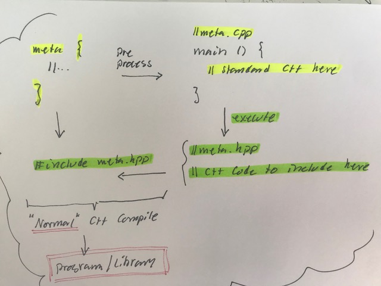
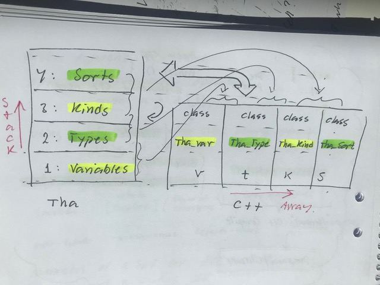

# Todo: C++ Tha - Consider what I can do with pre-processing meta-scopes into C++ executables that generates actual standard C++ code and includes it into the scope location?

```#d421250a``` *As of 2019-06-18 11:43*

[mail plain/text](mail.txt)


The idea is to transform each meta-scope into standard C++ code by executing a C++ program compiled from interpreting the scope as Tha C++.

==&gt; Also see "[Todo: C++ Tha - Consider the meta agnostic operators and semantics?](../6c925413/chime.md)"

1) Consider how we can interpret a meta-scope as a C++ program that generates standard C++ code?

> *So the idea here is to somehow transform a meta-scope into standard C++ code.*

> *meta {*  
> *// Tha C++ code here*  
> *}*

> *Is transformed into*

> *#include "tha_cpp_abcdefg.hpp"*

> *Where the included file is generated by an executable program compiled from C++ code.*



*The idea for the Tha C++ pre-processor round trip (meta -&gt; cpp -&gt; hpp -&gt; include -&gt; standard compile)*

2) Consider how we may transform a meta-scope so that we get C++ value semantics on types?

> *The main idea here is to get value semantics on types in a meta scope. So at a basic level we should aim at transforming a meta-scope into C++ code that treats types as variables?*

> *Lets begin with how to declare types in a meta-scope. *

> *First we can observe that all built in C++ types are now accessible variables (actually immutable constants). So we need a way to model C++ built in types as variables with value semantics.*


*C++ built in (pre defined) types*

> *Secondly we can observe that struct, class and union now have "type semantics" meaning we can use them as "types" of "variables" we can declare. Now &lt;type_name&gt; &lt;variable_name&gt; &lt;initialisation_arguments&gt; can be re-used to define new types in the meta scope. Thus this meta-scope code:*

> *meta {*  
> *struct A {int x; bool b;}*  
> *}*

> *Becomes this C++ code in variable semantics:*

> *kind_struct A {type_int x; type_bool b;}*

> *Where in this context "kind_struct" is in fact modelled as a C++ type and "type_int" and "type_bool" are modelled as C++ variables. The name "A" is now a variable of type "kind_struct".*

> *But what are "x" and "b" in this context. It is obvious that this is not valid C++ syntax yet! "A" being an instance of the type kind_struct means its constructor must somehow be able to accept both the now "values" type_int and type_bool as well as their names "x" and "b". Consider we can imagine the type kind_struct like:*

> *using kind_struct = std::map&lt;std::string, std::variant&lt; possible types&gt; &gt;;*

> *Now we can model the struct A as:*

> *kind_struct A { {"x",type_int}, {"b", type_bool} };*

> *...*

3) Consider the observation that when we transform meta-scopes into standard C++ we have to flatten the meta-stacked-scopes into variable-type relations?

==&gt; It seems it is inevitable that each tier of the meta-stack must become its own variable-type-class manifestation in C++ code representation?



*The meta-stack tiers becomes C++ variables to enable run-time execution of the stack*

==&gt; But also consider we can represent all tiers with a meta-defacto relation between C++ variables representing interfacing tiers?

> *What it we focus on firstly the meta-defacto relationship between interfacing tiers of the meta stack. And then on the observation that instances of "things" on each tier is a name-object relationship. The we should be able to model the whole meta-stack with only meta-defacto bindings by name and name-lookup of meta-stack tier member instances?*

> *Consider a minimal assembly of structures we require to model a type system?*

> *SORTs 4: EXTENSION, GENERIC // \*Actually just 3,2,1 shifted one meta-tier up? *  
> *KINDs 3: PRODUCT, SUM, FUNCTION*  
> *TYPEs 2: SET*  
> *VALUEs 1: INDIVID*

> *On the lowest "level" we have individs as in named representations of one "value". These individs are categorised to be member of some SET, which we in type theory call Types. From thge SET defined by a Type we can "select" members to be value cabdidates of variables holding values from that SET. The next level up is about combinations where we can arrange different SET into PRODUCT or SUM combinations. Where we recognise the PRODUCT as the structure where all members are present at the same time which in C++ are "structs" and "classes". Here we also find the notion of FUNCTION as a mapping of members from one SET to another SET. The next tier is about EXTENSION and GENERICs. With EXTENSION we can create structures that "adds" stuff to existing structures. In C++ we know EXTENSION as inheritance or specialisation. GENERICs can be thought of as FUNCTION taking anything from lower tiers and use them as arguments to build GENERIC structures.*

==&gt; Consider if tier 4 is in fact just tiers 1...3 shifted one tier up?

> *I am a little unsatisfied with the model of tier 4. If we thing of each meta-tier as being about constructors of "things" on tiers below, then C++ template is in fact "just" a function that creates KINDs from arguments being VALUEs, TYPEs or KINDs?*

> *template &lt;template F&lt;typename&gt;, typename T, int I&gt;*  
> *class A_KIND { F&lt;T&gt; x; T y; const i = I;};*

> *A_KIND&lt;std::vector, std::string, 4&gt; A { {"hej", "på", "dig"}, "!"}*

> *Can be though of as meta-scope code using the lambda syntax to define the same "function".*

> *meta { meta { meta {*  
> *// Value semantics on SORTs*  
> *auto A_KIND = &#91;&#93;(TYPE F(TYPE x), TYPE T, int I) {return class ... /\* syntax ??\*/;}*  
> *}}}*

> *meta {*  
> *auto A = A_KIND(std::vector, int,4);*  
> *}*

> *Now, I have not figured out exactly what syntax that may be appropriate in the meta-scope code. The goal is to re-use meta-scope agnostic C++ syntax. But what exactly does that mean in our case?*

==&gt; Consider the syntax we can imagine by focusing on each tier only using value-semantics on its own members and type-semantics on it meta-tier?

> *Lets focus on each meta-scope using value-semantics on its own members and type-semantics on its "parent" meta-scope.*

> *meta { meta { meta {*  
> *// Value semantics on SORTs*  
> *auto A_KIND = &#91;&#93;(TYPE F(TYPE x), TYPE T, int I) -&gt; KIND {return class ... /\* syntax ??\*/;}*  
> *}}}*

> *We now notice that we need a way to "talk about" the "types" of the arguments and the return "type" of the SORT scope lambda function A_FIND. Now we must stay very focused to get all the meta-relations correct! In the classic C++ code we have A_KIND to be function on the KIND level. This is so because when we "call" this lambda as in instantiate it, we get a type back (in this case a class type). So notice the distinction that in C++ the keyword "class" is in fact a constructor in the KIND scope that when provided with arguments instantiates a named TYPE. So the C++ keyword "template" refers to a constructor in the SORT scope that when provided with its arguments instantiates a KIND as in a new member of the KIND scope in parallel with the pre-defined "class".*

> *The tricky part is the lambda on the SORT scope level. How can it be a "variable" (value holder) on the SORT scope level but be defined to return a KIND?*

4) Consider the difficulties of using a language that works to talk about the meta scope members and their relationships?

> *It is easy to say "KIND instance" to mean an instance of a member on the KIND scope level. But this is NOT correct. A "KIND instance" is a TYPE in the same way as a int instance is a variable. That is, because each member of a meta-scope are implicitly constructors of members of the meta-scope below them (the defacto-scope) the semantics of "instance" will refer to the returned item of the constructor, NOT an instance of the constructor itself. *

> *But there is room for a lot of confusion here. In C++ we can easily say "a class instance" and mean an instance of the variable being of a type constructed as a C++ class type. So because C++ has been around for so long without the notion of the meta-defacto relationship we are trying to introduce, talking about class-instances has been clear as water.*

> *But now we need a way to distinguish between "instantiating" a member of a meta-scope and instantiating a member of a defacto-scope using a meta-scope constructor call. **How can we decide on a language so that we can clearly distinguish between meta-scope member instantiation and defacto-scope-instantiations with meta-scope constructor calls?***

5) Consider the design of a Tha C++ pre-processor that transforms meta-scopes into include directives of generated standard C++ code?

==&gt; It seems we should transform ALL meta-scopes into one single cpp-file so that scopes can share the same view of the types system?

> *As a first approach we will be unable to operate on members of the type system declared outside meta-scopes as we have no easy way to model these members in a way accessible to Tha C++ semantics. But we would like to be able to operate on a type in one meta-scope that has been declared in another scope. They are both part of the same type system instance as defined by at least each translation unit?*

> *And the "easiest" way to accomplish this is to first transform ALL meta-scopes into one single executable program that models the content of ALL meta-scopes of the translation unit?*

...


