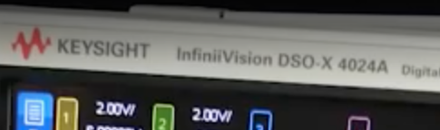
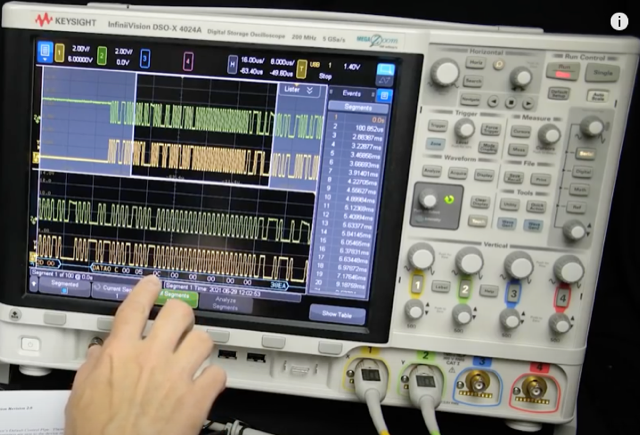
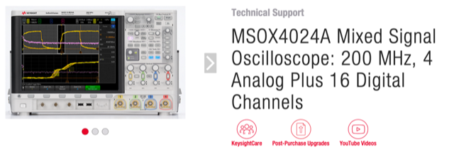
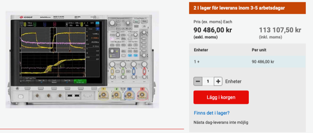

# Todo: Oscilloscope - Consider the KeySight MSOX4024A Mixed Signal Oscilloscope: 200 MHz, 4 Analog Plus 16 Digital Channels?

```#d663bdcf``` *As of 2021-07-11 12:35*

[mail plain/text](mail.txt)


1) Consider the youtube video "How does USB device discovery work?" (<https://youtu.be/N0O5Uwc3C0o>)?

==&gt; He seems to be using the Keysight InfiniVision DSO-X 4024A?

> 

> 

2) This seems to be the Keysight web page for the "MSOX4024A Mixed Signal Oscilloscope: 200 MHz, 4 Analog Plus 16 Digital Channels" (<https://www.keysight.com/se/en/support/MSOX4024A/mixed-signal-oscilloscope-200-mhz-4-analog-16-digital-channels.html> )?

> 

3) It seems to cost aroung 100 00 SEK ([https://se.rs-online.com/web/p/oscilloscopes/1953399/?cm_mmc=SE-PPC-DS3A-_-google-_-3_SE_SE_Test+%26+Measurement_Oscilloscopes_BMM-_-Keysight+Technologies+-+1953399+-+MSOX4024A-_-%2Bmsox4024a&matchtype=b&kwd-390084618903&gclid=Cj0KCQjwraqHBhDsARIsAKuGZeEWqqhxrPhPHpb4IDdrDqbQ4LINMQNoEuWNykkfnFy7V2KWIoeG0CgaAnseEALw_wcB&gclsrc=aw.ds](https://se.rs-online.com/web/p/oscilloscopes/1953399/?cm_mmc=SE-PPC-DS3A-_-google-_-3_SE_SE_Test+&+Measurement_Oscilloscopes_BMM-_-Keysight+Technologies+-+1953399+-+MSOX4024A-_-+msox4024a&matchtype=b&kwd-390084618903&gclid=Cj0KCQjwraqHBhDsARIsAKuGZeEWqqhxrPhPHpb4IDdrDqbQ4LINMQNoEuWNykkfnFy7V2KWIoeG0CgaAnseEALw_wcB&gclsrc=aw.ds) )?

> 

...


