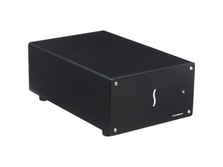
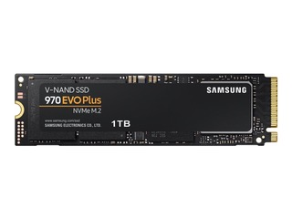
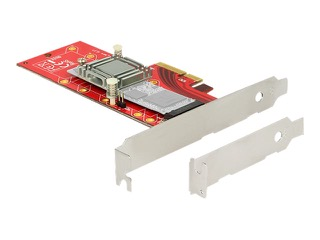

# Todo: Consider an external PCIe enclosure over Thunderbolt 3 to create an external M.2 NVMe SSD storage?

```#d695139e``` *As of 2019-05-26 12:27*

[mail plain/text](mail.txt)


It seems I may be best of going for an external PCIe over Thunderbolt 3 enclosure and mount one or more M.2 NVMe SSDs in there?

1) Consider this youtube video "Unboxing the Netstor NA622TB3 4-Bay NVMe Thunderbolt 3 Box" (<https://www.youtube.com/watch?v=O7o-uyAriA4> )?

==&gt; It seems the Netstor NVMe SSD enclosures relies on OS RAID (as these are JBOD as in "Just a bunch of disks")?

NOTE: UK based [span.com](http://span.com) seems to **ship to Sweden**?!


*The Netstor NA622TB3 4 bay external thunderbolt 3 NVMe drive "just a bunch of disks" (JBOD) enclosure*


*The Netstor NA611TB3 2 bay external thunderbolt 3 NVMe drive "just a bunch of disks" (JBOD) enclosure*

==&gt; It seems UK based [span.com](http://span.com) actually **ship to Sweden** (<https://www.span.com/product/NetStor-2-Bay-Thunderbolt3-NVMe-JBOD-NA611TB3-Enclosure-for-2x-NVMe-SSD-JBOD-60W~62886/spanstor=69118> )?


*Netstor £423 (ex. VAT) 2 x 500 GB external NVMe SSD "Just a bunch of disks" (JBOD) *

2) Consider this youtube video “DIY Thunderbolt 3 SSD” showing a DIY external SSD solution (<https://www.youtube.com/watch?v=OZTSZTnoVE8> )?

3) Consider what constrains I must consider when building my DIY external PCIe over Thunderbolt 3 with NVMe M.2 SSD inside)?

==&gt; It seems I must ensure the M.2 I choose actually fits the external PCIe enclosure?

==&gt; Consider the M.2 device code defines the width and length of the M.2 device (<https://en.wikipedia.org/wiki/M.2> )?

> “*M.2 module codes contain both the width and length of a particular module; for example, 2242 as a module code means that the module is 22 mm wide and 42 mm long, while **2280** denotes a module 22 mm wide and 80 mm long.*"

4) Consider the price for building my own external PCIe over thunderbolt 3 enclosure with M.2 NVMe SSD inside?

==&gt; It seems the computersalg sells the Sonnet Echo Express SE I TB3 PCIe Desktop 1 Slot Thunderbolt3 for **3300 SEK inc VAT** (<https://www.computersalg.se/i/3466788/sonnet-echo-express-se-i-tb3-pcie?gclid=CjwKCAjwv6blBRBzEiwAihbM-RceBzbTQwir05RwdZ0Nc_FwNseqGl2HRtZU0ExPErD1_4Syr5MqQBoCq4AQAvD_BwE> )?



*Sonnet Echo Express SE I TB3 PCIe Desktop 1 Slot Thunderbolt3*

==&gt; It seems Computsersalg sells 1 TB Samsung Samsung 970 EVO Plus MZ-V7S1T0BW for **2600 SEK inc VAT** (<https://www.computersalg.se/i/5019674/samsung-970-evo-plus-mz-v7s1t0bw> )?



1 TB *Samsung 970 EVO Plus MZ-V7S1T0BW (22.15 mm x 80.15 mm x 2.38 mm)*

==&gt; It seems a PCIe to M.2 adapter card sells for about 250 SEK to 500 SEK inc VAT (<https://www.computersalg.se/l/1419/io-kort?f=f35f5799-3c47-44e2-bc48-63cabca561cc&p=1&sq=NVMe> )?



*DeLOCK PCI Express x4 Card &gt; 1 x internal NVMe M.2 Key M 110 mm with heat sink (**370 SEK inc VAT**)*

*==&gt; Net price for **Sonnet Echo Express SE I TB3 + *1 TB *Samsung 970 EVO Plus + **DeLOCK PCI Express x4 Card &gt; 1 x internal NVMe M.2 = * *3300 + 2600 + 400 = **6300 SEK inc VAT***

...


