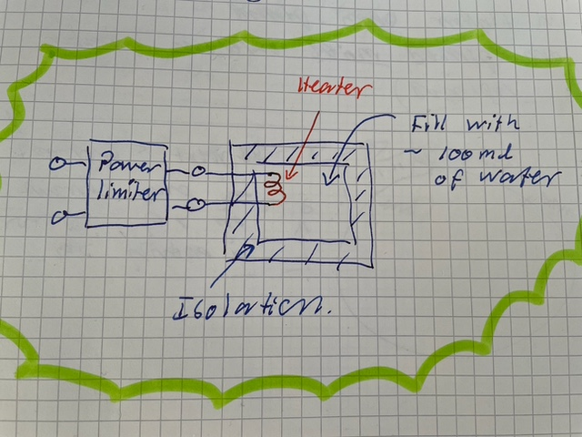
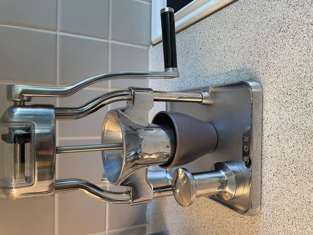
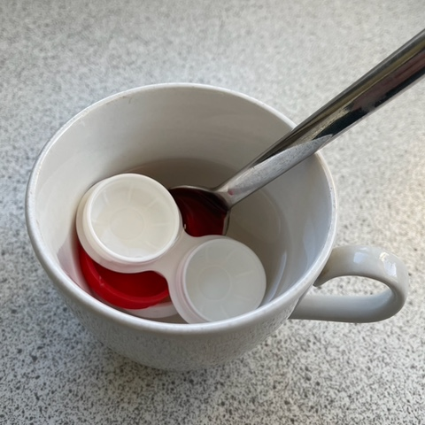

# Todo: Consider to combine a micro (one cup) electric water boiler with some vessel to get a contact lens case heat-steriliser?

```#d7e33081``` *As of 2022-01-14 12:39*

[mail plain/text](mail.txt)


I want tools that compose and saves energy and resources.

==&gt; Also see "[Todo: Build SPC expresso machine](../087f0eef/chime.md)"

1) Consider to design an open hardware micro (one cup) water boiler?

> *The main design goal here is to make an electric water boiler that is aimed for boiling small amount of water really efficient. So I imagine a small isolated chamber with a heating element.*

> *Optionally we can imagine having a power limiter in the input to the heating element to allow hooking up to a manual electric generator and being able to adjust how "heavy" it should be to drive the hater?*



==&gt; Consider to make the electrical input compatible with say power tool batteries?

==&gt; Consider to make the electrical input composable with some form of manually driven electrical generator?

> *The basic idea here is to imagine a way to connect say a hand cranked electric generator (a mechanism similar to my hand-cranked coffee grinder)?*

> *To heat 100ml of water from 20 to 100 degrees celsius would require 4,18 kJ /kg\*grade \* 0,1 kg \* 80 degrees = 33 kJ.*

> *If we imagine a cranking force of 50 N (like lifting 5 kg), a turn of radius 2\*pi\*0,3m and one turn a second we can generate 50N \* 1,9m / s = almost 100 W.*

> *To generate 33 kJ I would have to crank 100W for 330 seconds or 5 minutes and 30 seconds!*

> *Hm... that is quite a workout!!*

>   
> *An example of a hand-cranking mechanism on my coffee grinder*

2) Consider to design a steriliser chamber for boiling water where we can put a contact lens case to heat-sterilise?

>   
> *Example of heat-sterilising a lens case in water boiled in the micro wave. *

...


