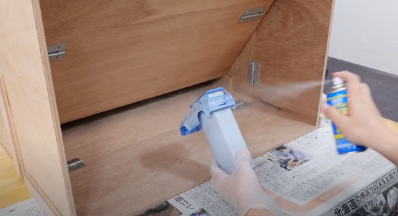
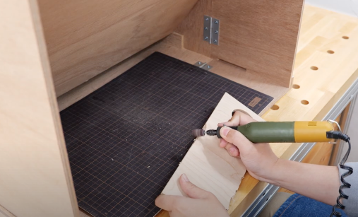
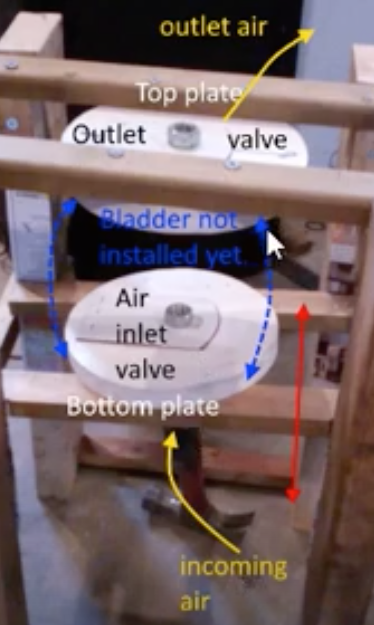

# Todo: Consider a foldable (or stove-away) "paint booth" and "dust booth" inspired by youtube video "Make a foldable painting booth!" and my own idea of "three phase bellows"?

```#d9072549``` *As of 2020-11-17 18:42*

[mail plain/text](mail.txt)


I want to have a compact in-apartment workbench for wood working and painting without having dust and paint be spread around the apartment.

==&gt; Also see "[Todo: Maker Space Spray Gun - Consider the Graco cordless airless spray gun and similar to buy and use for my indoor paint boot?](../db5a8082/chime.md)"

==&gt; Also see "[Todo: DIY Vacuum - Consider to use a EDF (Electric Ducted Fan) brushless unit as the "impeller" unit to get efficient air suction?](../adc05dd4/chime.md)"

==&gt; Also see "[Todo: Dust Extraction - Consider my Oneida Dust Extractor Cyclone requires a minimum air flow of 24 litres per second?](../b64b8e98/chime.md)"

==&gt; Also see "[Todo: Consider a DIY micro controlled (Arduino) Powered Air Purifying Respirator (PAPR)?](../28a8555c/chime.md)"

==&gt; Also see "[Todo: Consider an ultrasonic based fluid flow sensor (e.g., for measuring the airflow of my indoor shed dust extraction system)?](../8d889b3f/chime.md)"

1) Consider to be inspired by youtube video "Make a foldable painting booth!" (<https://youtu.be/3J6s1o6RNNk> )?

>   
> *The "foldable painting booth" with a slit for air suction to capture spray paint*

>   
> *The "foldable painting booth" air suction slit captures also dust*

2) Consider a DIY suction system based on bellows?

> *The basic idea here is to design a bladder based bellows air pump from say the inner tubings of a tire like a wheel barrow tire. And then create two air flap valves and a motor to drive an air stream by creating an up-and-down motion on the bladder.*

> *With three of these bellows working out of sync we should effectively be able to create an air flow with the same shape as three phase rectified current.*

==&gt; Consider youtube video "How to make a bellows - air pump DIY" (<https://youtu.be/oNM3MDqkSXY> )?

>   
> *An example of the principle design of a bladder based bellows*

...


