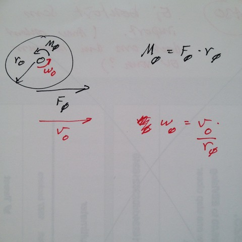
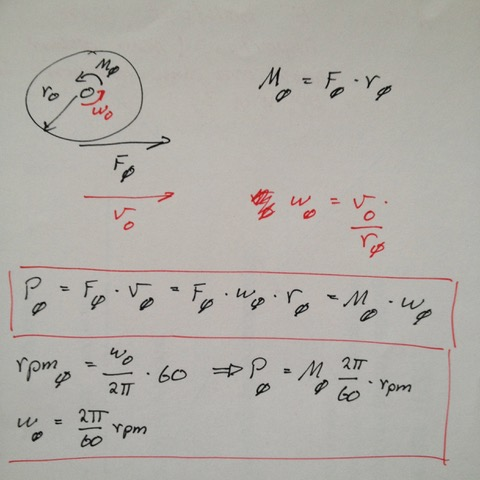

# Todo: Consider the requirements on a motor for my Table Saw power feeder?

```#d93391cf``` *As of 2018-09-19 22:58*

[mail plain/text](mail.txt)


It seems it is time to actually decide on the requirements on the motor to drive my Table Saw power feeder design?

1) Consider the relations between Feed force, Feed drive wheel torque, drive speed and drive wheel annual speed?



==&gt; Consider a drive force of 5 Kg = 1…5 Kg = 10 …50N?

Wheel Torque = F \* r = {10…50N} \* 37,5 mm = 375 mNm … 1875 mNm

==&gt; Consider a drive speed of between 3 cm/s and 10 cm/s?

Wheel rps (rotation per second) = drive speed / drive wheel circumference = {0,03…0,1 m/s} / 0,2355 m = 0,13 … 0,42 rps

Wheel rpm /rotation per minute) = rps \* 60 seconds/minute = {7,8 … 25,5} rpm

==&gt; Consider power consumption?

Drive Power (watts) = Drive Speed \* Drive Force J/s = 10N \* 0,03 m/s … 50N \* 0,1 m/s = 0,3W … 5W

2) Consider to use Ger Boxes?

==&gt; Consider RS-online gear boxes (<https://se.rs-online.com/web/c/automation-control-gear/electric-motors-motor-controllers-peripherals/gearboxes/?sort-by=P_breakPrice1&sort-order=asc&pn=1>)?

==&gt; Consider <https://se.rs-online.com/web/p/gearboxes/0336438/>


==&gt; Consider <https://se.rs-online.com/web/p/gearboxes/0336438/>


NOTE: The gear boxes seems to be rated for speed and torque?

==&gt; **Consider what trade off between cheaper (low torque high speed) motor and high ratio (high torque low speed) gear box?**

2) Consider to use a design with belt drives?

==&gt; Consider RS-online drive belts (<https://se.rs-online.com/web/c/pneumatics-hydraulics-power-transmission/power-transmission-belts/>)?

==&gt; There seems to be drive and V-belts, Round belts, Timing Belts and Twist Link Belts?


==&gt; Consider RS-online Pulleys (<https://se.rs-online.com/web/c/pneumatics-hydraulics-power-transmission/power-transmission-pulleys/>)?

==&gt; There seems to be “Timing Belt” and “Wedge and Vee” belt pulleys (for timing belts and Round/V belts)?

2) Consider direct wheel drive motor?

==&gt; Easy - Then the motor must provide the requirements of the drive wheel?

Motor Torque = 375 mNm … 1875 mNm

Motor Speed = 7,8 … 25,5 rpm

Motor Power = Torque &#91;Nm&#93; \* Rad / s = Torque \* 2pi \* rps = Torque \* 2pi \* rpm/60 = **Torque \* rpm \* 0,1** = roughly {0,3W … 5W}



==&gt; Consider available motors from RS-Online (<https://se.rs-online.com/web/c/automation-control-gear/electric-motors-motor-controllers-peripherals/dc-geared-motors/>)

Hm… We have two variables Torque and speed (How do we select a motor)?

==&gt; Consider motors with torque 0,375 … 0,5 Nm?

==&gt; Consider <https://se.rs-online.com/web/p/dc-geared-motors/9211458/>


==&gt; Consider <https://se.rs-online.com/web/p/dc-geared-motors/1784670/>


==&gt; Consider motors with torque 0,6 … 1,5 Nm?

==&gt; Consider <https://se.rs-online.com/web/p/dc-geared-motors/1784670/>


==&gt; Consider <https://se.rs-online.com/web/p/dc-geared-motors/7736781/>


==&gt; **It seems obvious that direct drive motors will be expensive?**

3) Consider direct drive stepper motors?

==&gt; Consider the wikipedia page on stepper motors (<https://en.wikipedia.org/wiki/Stepper_motor>)?

==&gt; It seems the running torque of a stepper motor is roughly the holding torque minus 2 times the detent torque (<https://www.motioncontroltips.com/faq-whats-the-difference-between-detent-torque-and-holding-torque/>)?

> “Once the motor is moving, the torque available at low speeds equals the holding torque minus two times the detent torque (because the motor has to work against the detent torque)."

==&gt; Consider rs-online stepper motors (<https://se.rs-online.com/web/c/automation-control-gear/electric-motors-motor-controllers-peripherals/stepper-motors/>)?

==&gt; Consider direct drive with holding torque 0,4 … 2 Nm?

==&gt; Consider <https://se.rs-online.com/web/p/stepper-motors/7983637/>


==&gt; Consider <https://se.rs-online.com/web/p/stepper-motors/1366716/> ?


==&gt; Consider <https://se.rs-online.com/web/p/stepper-motors/8787667/>

==&gt; **It seems the downside of using stepper motors is that we need a more complicated and expensive driver?**

3) Consider belt drive design motors?

==&gt; Consider a belt drive with a 1:4 kogg ratio?

…

…

Consider to continue this research and select and buy some motors and components to make a prototype power feeder for my table saw?


