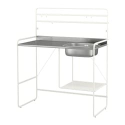

# Todo: Indoor Painting - Consider to make a stainless steel mini sink into a paint tool cleaning station?

```#d94e387f``` *As of 2019-05-02 17:49*

[mail plain/text](mail.txt)


It seems I may for cheap be able to use IKEA SUNNERSTA mini sink as a washup station for my paint tools?

==&gt; Also see "[Todo: Consider I still suck at handling paint (how my test run of pouring paint from and to the paint bucket and cleaning the tools revealed many shortcomings in skill, tools and work space)?](../4244383c/chime.md)"

1) Consider IKEA FYNDIG stainless steel zink (<https://www.ikea.com/se/sv/catalog/products/S59158003/> )?


*FYNDIG **Inbyggnadsdiskho 46x40 cm, rostfritt stål, 399 kr (inklusive LILLVIKEN vattenlås)*

==&gt; Consider to mount it in a Bauhaus steel sheet (


2) Consider IKEA Kungsfors (<https://www.ikea.com/se/sv/catalog/products/80334924/> )?


*Kungsfors 60x40 cm kitchen utility cart*

==&gt; Consider the FYNDIG Inbyggnadsdiskho 46x40 cm does not actually fit (the cart is 40 cm outside)

==&gt; Consider if I can use IKEA koncis ovenware as a sink (<https://www.ikea.com/se/sv/catalog/products/90099054/> )?


89 SEK *Koncis stainless steel ovenware Storlek Längd: 34 cm Bredd: 24 cm Höjd: 5.5 cm*

3) Consider IKEA SUNNERSTA mini sink for 1000 SEK (<https://www.ikea.com/se/sv/catalog/products/90302079/> )?

==&gt; Note that the bench is of some composite material (Not steel)?

> *So it is actually only the zink itself I want?*



*IKEA Sunnersta Bredd: 112 cm, Djup: 56 cm, Höjd: 139 cm mini sink (<https://www.ikea.com/se/sv/catalog/products/90302079/> ) *

==&gt; Consider I also need the sink plug or the complete plumbing under the sink?


==&gt; Consider I can cover the back and the floor with plastic (to protect the surroundings from paint spills)?

==&gt; Consider where I can place it to be able to use it as a wash up station for paint tools?

==&gt; It fits against the stove in the bedroom but then in protrudes to much for me to get to paint the alcove at the side of the stove.

==&gt; Consider I can add a piece of standard soil pipe to have the waste water go into an underneath container?

...


