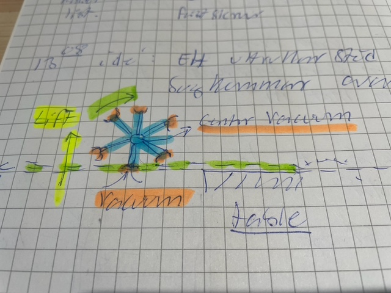

# Todo: Consider a rotating "suction cup lifting" output feeder for a table saw, band saw of router table?

```#da0ddec5``` *As of 2024-04-09 13:13*

[mail plain/text](mail.txt)


1) Consider the basic idea for an out feeder that keeps the material that leaves the tool surface from dropping to the floor using some suction cup based mechanism?

> *So, the basic idea is ot use a lifting mechanism instead of e.g., supporting rollers or some other support from underneath.*

> *I imagine we can attach to the material using vacuum and suction cups?*

> *Only, I need the mechanism to roll along the material as it is fed through the too and out of the table surface.*

> *So can we design a wheel-like thingy with suction cups on the rim that attach and release from the material as it rolls underneath it?*

> 

...


