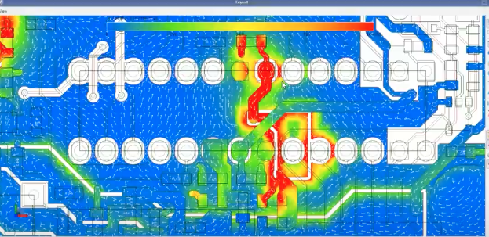

# Todo: Consider "What Every Oscilloscope User Needs To Know About Transmission Lines" by Teledyne Lecroy?

```#da3311a6``` *As of 2020-10-13 12:02*

[mail plain/text](mail.txt)


I want to build my electronics lab and start doing electronics projects again with an Oscilloscope and thus this understanding of transmission lines seems valuable :)

1) Consider youtube video "What Every PCB Designer Should Know - Return Current Path (with Eric Bogatin)" (<https://youtu.be/icRzEZF3eZo?t=390> )?

>   
> *Simulation of AC current path on a PCB as shown in youtube video at (<https://youtu.be/icRzEZF3eZo?t=390> )*

2) Consider the Article "What Every Oscilloscope User Needs to Know About Transmission Lines" by Teledyne Lecroy (<https://go.teledynelecroy.com/l/48392/2018-09-24/73zyf6> )?

==&gt; Consider the Webinar Recording "What Every Oscilloscope User Needs To Know About Transmission Lines" (<https://go.teledynelecroy.com/l/48392/2018-10-12/75pkxs> )?

...


