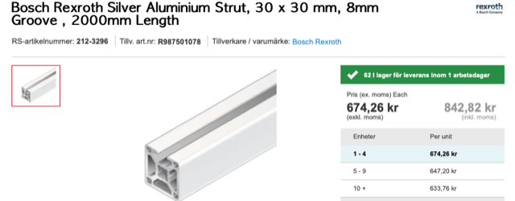

# Todo: Consider the "Bosch Rexroth Silver Aluminium Strut, 30 x 30 mm, 8mm Groove , 2000mm Length" as T-slot fastener for my compact living sliding workspace wall?

```#db1d329b``` *As of 2022-07-05 23:03*

[mail plain/text](mail.txt)


I want some standard way to fasten tools, gigs and "stuff" to my compact living sliding workspace wall.

1) Consider the 30x30 mm 8mm T-slot extruded aluminium profile from Bosch Rexroth as sold by RS-online (<https://se.rs-online.com/web/p/products/2123296/> )?



...


