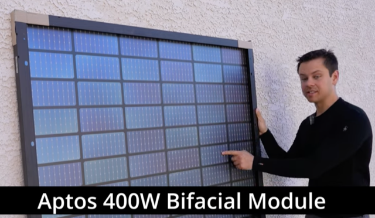
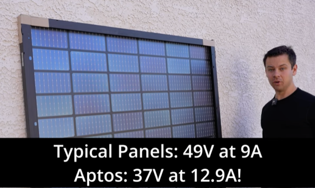
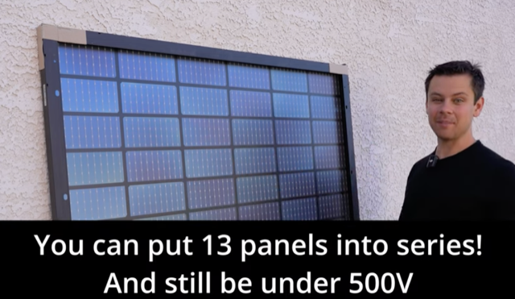
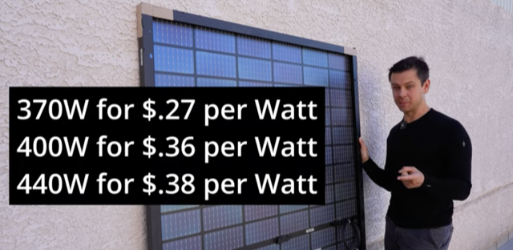
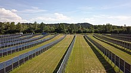

# Todo: Consider to delve into the American Aptos bifacial solar panels recommended by DIY Solar Power with Will Prowse  youtube channel

```#db2a52aa``` *As of 2024-06-05 20:22*

[mail plain/text](mail.txt)


I want solar panels on my house build and need to educate myself on the physics and product availability for a good purchase in Sweden.

1) Consider the bifacial Aptos solar panels recommended by XXX in youtube video "My Favorite Offgrid Solar Panel for 2024!" (<https://youtu.be/v33nbi7gKcY> )?









2) Consider the wikipedia article on Bifacial solar cells (<https://en.wikipedia.org/wiki/Bifacial_solar_cells> )?

> *My quick understanding is that bifacial can produce more power from incoming reflections to the bask side of the panel. For this to happen the panel needs to be mounted on a surface that reflects sufficient light to make a difference.*

> *Maybe a second solar panel behind the first one may reflect to the back side of the first one in direct sun light? As may happen if mounted on a flat surface angled up to the sun?*

> *The article refers to vertically mounted solar cells in east-west orientation to pick up sunlight front or back as the sun moves over the sky.*

>   
> [Vertical solar panels](https://en.wikipedia.org/wiki/Solar_panel#Vertical_bifacial_solar_array), east to west orientation, with bifacial modules near [Donaueschingen, Germany](https://en.wikipedia.org/wiki/Donaueschingen).[&#91;1&#93;](https://en.wikipedia.org/wiki/Bifacial_solar_cells#cite_note-1)  
> See also: [Agrovoltaics](https://en.wikipedia.org/wiki/Agrovoltaics)

...


