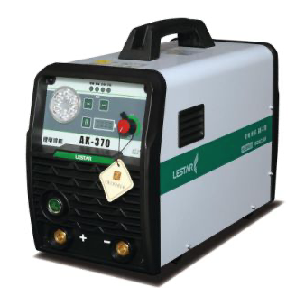
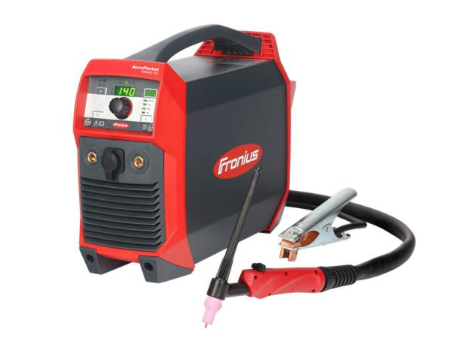

# Todo: Consider to follow up on Chinese Battery Stick Welder that may soon be available on Amazon?

```#dbc14305``` *As of 2021-10-27 23:24*

[mail plain/text](mail.txt)


==&gt; Also see "Todo: Welding in apartment - Consider to implement a Battery Bank to provide the current required by a Welder (to be able to use low current mains)?"

1) Consider this youtube video "Li-ion Battery Powered Welder, Battery Powered Stick Welder, Cordless Inverter Welder, MMA Welder" promoting this startup in china (<https://youtu.be/9naUKgBEwbw> )?

==&gt; It seems I can contact [sales@bingotools.biz](mailto:sales@bingotools.biz) for a quote for a single machine?

2) This welder seems to sell to vendors in quantity of 30 or more (<https://www.made-in-china.com/showroom/bingotools02/product-detailcSkmGOgMHuhJ/China-Rechargeable-Li-ion-Battery-Powered-Cordless-Welder-150A.html> )?



3) Consider to compare with Fronius AccuPocket (<https://www.fronius.com/en/welding-technology/products/manual-welding/tig/accupocket-tig/accupocket-tig/accupocket-150-tig> )?



...


