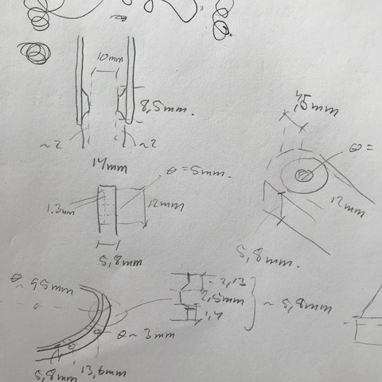
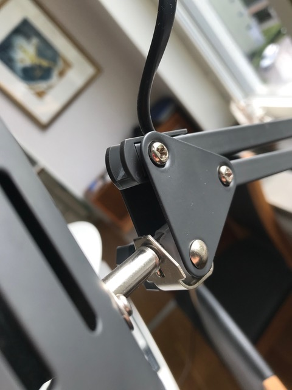
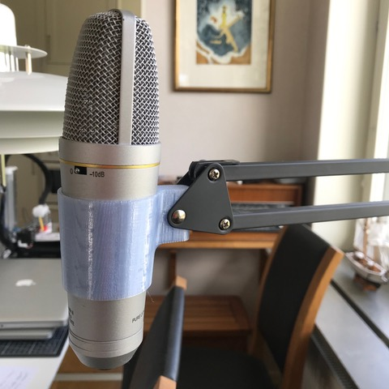

# Todo: CAD - Consider I sometimes prefer to design using "subtractive" thinking (like for my IKEA lamp arm microphone holder attachment design)?

```#dc75ba87``` *As of 2019-07-23 14:44*

[mail plain/text](mail.txt)


I discovered when I started designing the microphone holder attachment that in this case i preferred thinking "subtractively".

1) Consider the measurements I made as basis for the design?



2) Consider how I found it more natural to start with a block of material and then subtract from it to have it fit the lamp arm?

> *Hm... As it turned out I went with a design using a whole plastic holder for the microphone. So I ended up using a combination of an additive and subtractive design process after all.*

> *Still, I really do NOT like having to work in an absolute coordinate system. The origin of the absolute coordinate system is just in the way all the time. It is not natural to have to imagine ho everything is in relation to a fixed point. Each part relates to the other parts and nothing is in fact fixated in space. So I still want to be able to use a CAD tool without having to relate to a fixed point in space!*



...


