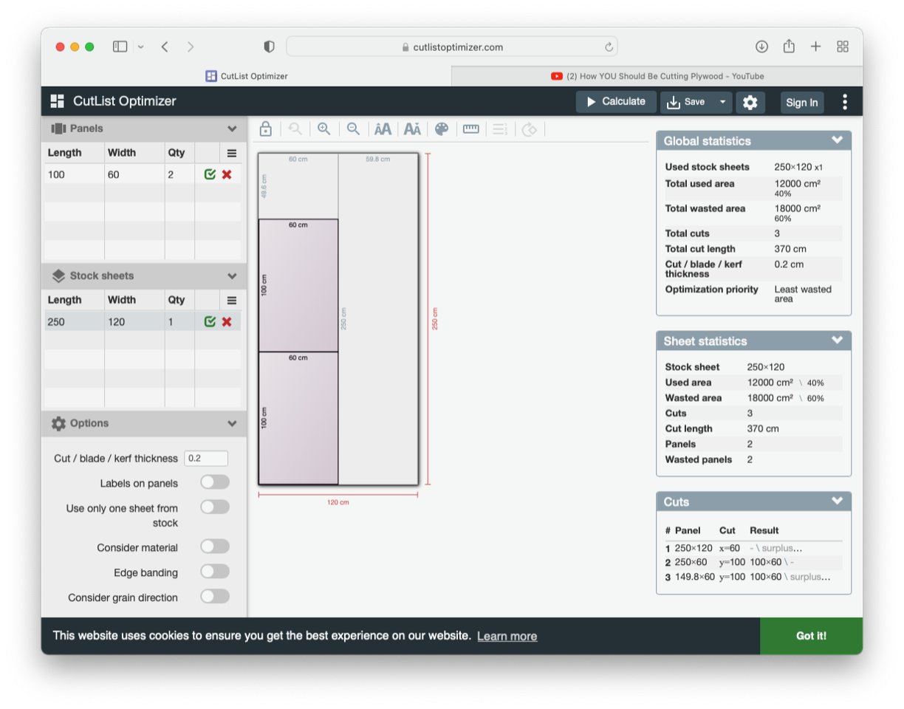
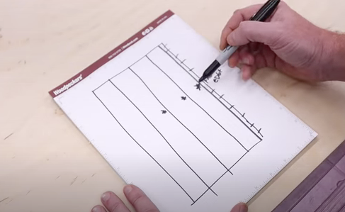

# Todo: Consider to study and use the web application (service) "Cut Optimizer" to help with cutting down sheets when I build stuff (and optionally be inspired to program my own open source app to optimise cuts)?

```#dca83519``` *As of 2022-08-28 11:15*

[mail plain/text](mail.txt)


I like to perform build tasks in a way so I reduce errors, enhance confidence and reduce time wasted to scratch my head.

==&gt; Also see "Todo: Consider to extend existing CAM tools with a option to "automate" or "instruct" how to build something using a human actor (in effect a "Human movement G-Code generator")?"

1) The "Cut Optimizer" seems to live here on the web (<https://www.cutlistoptimizer.com> )?

==&gt; It seems you define your stock sheets and your panels to cut and the app does the rest?



2) Consider this youtube video "How YOU Should Be Cutting Plywood" referring to the "Cut Optimizer" and that shows a way to reason about cutting with high accuracy (<https://youtu.be/X0r_rkXtSrw> )?

> *Basically he seems to stress to always propagate a "reference edge" as you move forward in your cutting?*

> *First he removes the factory edge with the track saw and creates the first straight and smooth (worked) reference edge,*

> *Then he rip cuts the stock sheet for panels with the same width, each time treating the new cut as a reference edge on the new panel strip.*

> 

...


