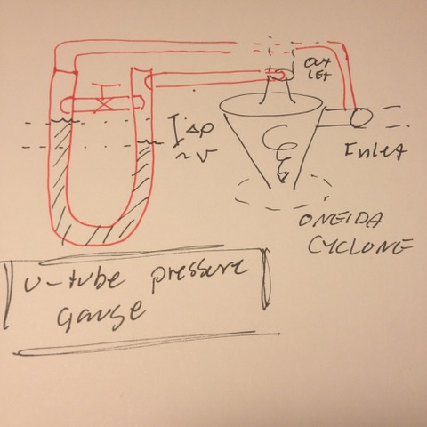

# Todo: Consider to design and build a U-tube pressure gauge to measure sufficient flow through my Oneida dust cyclone (&gt; 24 l/m)

```#dd0946a0``` *As of 2018-12-05 18:35*

[mail plain/text](mail.txt)


It seems I should be able to at least measure the pressure drop over the Oneida cyclone and from there figure out how I can calibrate it to show sufficient or to low flow?

==&gt; Also see “[Todo: Dust Extraction - Consider my Oneida Dust Extractor Cyclone requires a minimum air flow of 24 litres per second?](../b64b8e98/chime.md)”

1) Consider a “simple” U-tube pressure gauge?



2) Consider if I should buy or try?

==&gt; Consider to buy plexiglass tubes and bend myself?

==&gt; Consider to buy a glass or plastic U-tube (where)?

…

3) Consider ways to calibrate my manometer with a scale in l/m?

==&gt; Consider I do NOT know the flow resistance of the Oneida cyclone?

==&gt; Consider I do NOT know the air flow of any of my vacuum?

==&gt; Consider I can build something with a Known air flow drag (A known (pressure drop) / (air flow) value)?

…

4) Consider pressure drop compressible fluids in pipes?

==&gt; It seems (pressure drop) x v^k is constant (<https://www.pipeflowcalculations.com/pipe-valve-fitting-flow/compressible-gas-flow.php>)?

==&gt; This should mean that the flow velocity raised to a fixed exponent (to accommodate e.g., friction generated heat)?

> “Adiabatic compressible flow is the flow where no heat is transferred to or from pipe like in short, perfectly insulated pipe. The heat which is created due to flow friction is added to the flow and that amount of energy is actually acceptable. For adiabatic compressible flow is:

> 

> where is:

  
> *p* - pressure; *V* - volume; *γ* - isentropic coefficient;"

==&gt; BUT if the temperature drop i negligible the exponent converges to one and pressure drop times flow is constant.

> “Isothermal compressible flow is the flow at constant temperature. Isothermal compressible flow often more closer to fact in piping transportation systems like in natural gas lines.

> 

> where is:

  
> *p* - pressure; *V* - volume;"

4) Consider the Darcy–Weisbach equation ([https://en.wikipedia.org/wiki/Darcy–Weisbach_equation](https://en.wikipedia.org/wiki/Darcy%E2%80%93Weisbach_equation))?

**NO - The ****Darcy–Weisbach ****equation works only for incompressible fluids (e.g., not air)!**

…

Consider to delve into this idea of building a simple U-tube pressure manometer to indicate sufficient flow through my oneida dust extraction cyclone?


