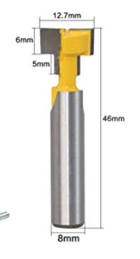
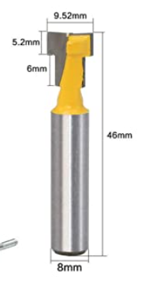

# Todo: Consider T-slot (T-track) cut router bits for designs and builds in wood where T-slot fastening could be an option?

```#dd12aa4b``` *As of 2022-08-05 12:54*

[mail plain/text](mail.txt)


I stumbled on a youtube video showing how to use T-slot cutting router bits to create T-slots in wood for wood cutting jig designs.

==&gt; Also see "[Todo: Consider what aluminium profiles and T-tracks that fits Festool "standard" clamps (for DIY workbench builds)?](../cd4a0f49/chime.md)"

==&gt; Also see "[Todo: Consider the "Bosch Rexroth Silver Aluminium Strut, 30 x 30 mm, 8mm Groove , 2000mm Length" as T-track (T-slot) fastener for my compact living sliding workspace wall?](../32fc493f/chime.md)"

==&gt; Also see "[Todo: Consider a roof moulding with T-slot that can act as fastener and support for floor resting shelves consoles or sides?](../04c484c6/chime.md)"

==&gt; Also see "[Todo: Consider a T-slot 10mm wide, 5mm deep with 6mm groove would fit a "standard" M6 hex bolt head or nut?](../c4df6861/chime.md)"

==&gt; Also see "[Todo: Consider to build a table saw rip fence using a threaded rod in an Incra T-slot?](../bf959e20/chime.md)"

1) This seems to be the youtube video “DIY T-Tracks For Amazing Jigs & Tools” by Eric Sorensen (<https://www.youtube.com/watch?v=nqI5nhj05Ys>)?


2) consider the Amazon links to the router bits that Eric Rorensen used in his “DIY T-Tracks For Amazing Jigs & Tools” youtube video?

NOTE: These bits are imperial (and I need metric sized shanks)?

==&gt; Consider this 55 x 35 mm T-slot router bit ([https://www.amazon.com/Eyech-Carbide-Straight-Milling-Woodworking/dp/B07H96LL98/ref=sr_1_1?ie=UTF8&qid=1544285546&sr=8-1&keywords=Eyech+1%2F4+Inch+Shank+Straight+T+Slot+Router+Bit+Carbide+Wood+Milling](https://www.amazon.com/Eyech-Carbide-Straight-Milling-Woodworking/dp/B07H96LL98/ref=sr_1_1?ie=UTF8&qid=1544285546&sr=8-1&keywords=Eyech+1/4+Inch+Shank+Straight+T+Slot+Router+Bit+Carbide+Wood+Milling))?


==&gt; Consider these yellow T-slot router bit pair ([https://www.amazon.com/Akozon-Yellow-Cutting-Woodworking-Milling/dp/B07F5CJTTR/ref=sr_1_fkmr0_1?ie=UTF8&qid=1544285613&sr=8-1-fkmr0&keywords=Akozon+Yellow+T-Slot+Cutter+Router+Bit+for+3%2F8%27%27+%26+1%2F2%27%27+Cutting+Edge+1%2F4%27%27+Shank+Set+of+2pcs](https://www.amazon.com/Akozon-Yellow-Cutting-Woodworking-Milling/dp/B07F5CJTTR/ref=sr_1_fkmr0_1?ie=UTF8&qid=1544285613&sr=8-1-fkmr0&keywords=Akozon+Yellow+T-Slot+Cutter+Router+Bit+for+3/8%27%27+&+1/2%27%27+Cutting+Edge+1/4%27%27+Shank+Set+of+2pcs))?


…

…

Consider to remember this option of routing T-slots in wood for fastening using hex-bolts and “standard” T-slot attachments to designs and build I may want to make?

3) Consider a T-slot that accepts a "standard" M6 bolt head?

==&gt; Also see "[Todo: Consider a T-slot 10mm wide, 5mm deep with 6mm groove would fit a "standard" M6 hex bolt head or nut?](../c4df6861/chime.md)"


*My measurements of a standard M6 bolt head*

> *It seems the body of the slot needs to be 10 mm (locked head) or 12 mm (rotating head) wide and 5 mm high?*

> *And the throat of course 6 mm wide and deep enough to handle the clamping force?*

4) Consider a T-slot that accepts a festool clamp?

==&gt; Also see "[Todo: Consider what aluminium profiles and T-tracks that fits Festool "standard" clamps (for DIY workbench builds)?](../cd4a0f49/chime.md)"

> *It seems the body of the slot needs to be 12 mm wide and 7,5 mm high (4040 V-slot aluminium extrusion measurement)?*

> *And the throat 7 mm wide and 4,5 mm deep **(4040 V-slot aluminium extrusion measurement)?*

5) Consider what router bits I imagine I can use to route a T-track that mimics the T-slot of a 4040 aluminium extrusion (and thus accepts both a M6 bolt and festool-like clamps)?

> *I imagine I can route an 8 mm rabbit and then a 5 x 12 mm slot at a depth of 5 mm?*

==&gt; I ordered thes router bits to try out (Amazon <https://www.amazon.se/dp/B07NQ4TF16?psc=1&smid=A1BU3KIV5EXKYL&ref_=chk_typ_imgToDp> )





...


