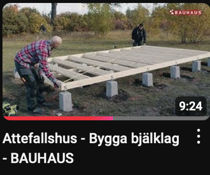
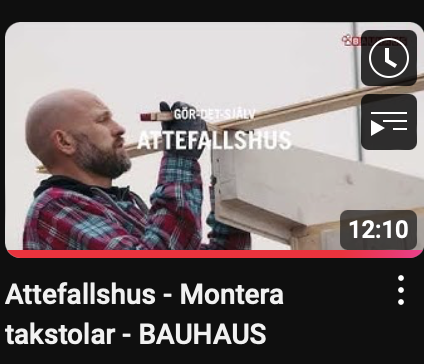
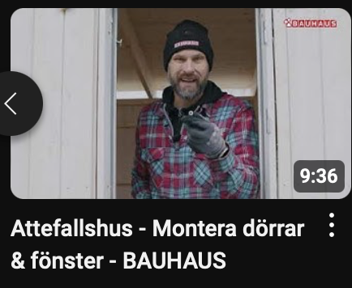

# Todo: Consider to study kit-build of the Bauhaus "ATTEFALLSHUS VIBOSTUGAN NJUTA FUNKIS"?

```#de3eb8c6``` *As of 2025-01-19 22:43*

[mail plain/text](mail.txt)


I want to build my own house and possibly in my own 'prefab' parts for one-man-build.

1) Consider to study the kit "ATTEFALLSHUS VIBOSTUGAN NJUTA FUNKIS" from Bauhaus (<https://www.bauhaus.se/attefallshus-vibostugan-njuta-funkis-20-4#pc_selection=1309753=1407979&1310161=1407981&1310163=1407983&1310165=1407985&1310169=1407989> )?


2) Consider the youtube series about building the "VIBOSTUGAN" from Bauhaus ()?



<https://www.youtube.com/watch?v=UwMtYUzOon8&t=302s>



<https://www.youtube.com/watch?v=Y1Kmk_fSx2o>



<https://www.youtube.com/watch?v=g3zLPxTbAjE>

...

...


