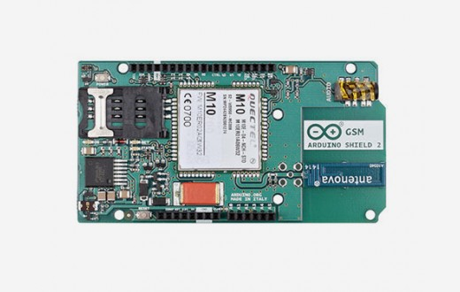
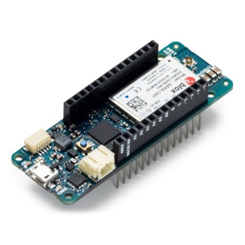
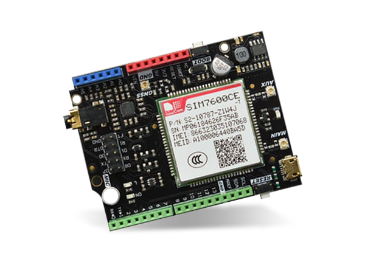
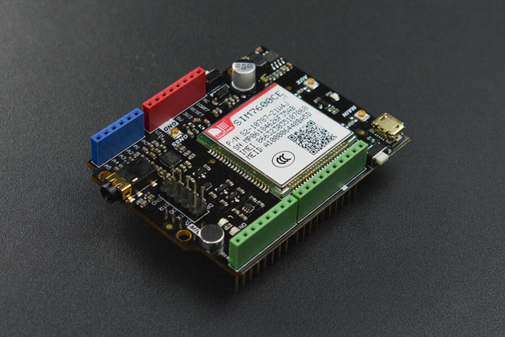
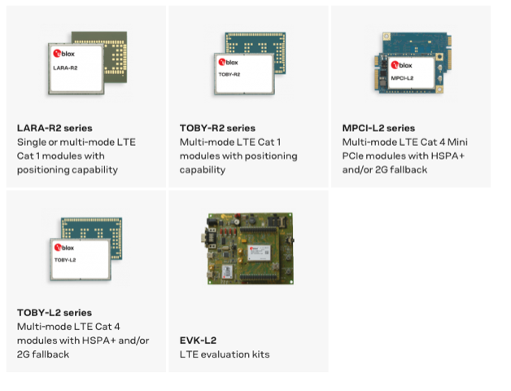
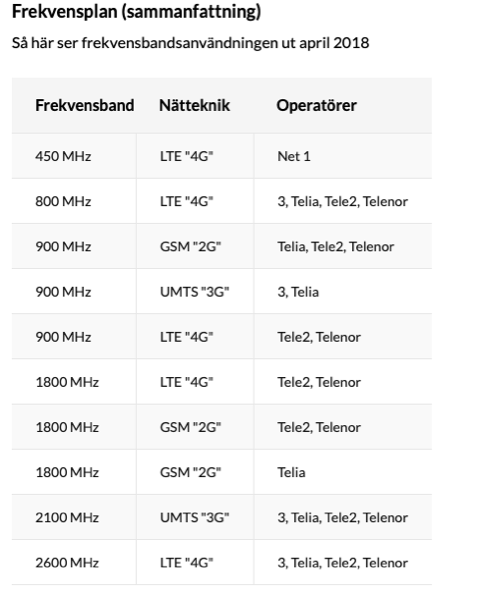

# Todo: DIY Mobile Phone - Consider a 4G (LTE) Module like the SIM7100 as a base for an open source and hardware cell phone design?

```#df108e46``` *As of 2020-10-02 13:03*

[mail plain/text](mail.txt)


I like the idea of putting together my own modular cell phone solution and the SIM7100 or simmular 4G Modules may be the way to get started?

==&gt; Also see "Todo: DIY Mobile Phone - Consider to follow up on MegaPhone, the FPGA and mini-PCIe cellular modem paired Commodore C64 compatible open source mobile phone?"

==&gt; Also see "Todo: Consider to replace all my web-connections with one 4G mobile broadband?"

==&gt; Also see "Todo: Consider to learn about the Mobile Modem APN settings and its relevance to Swedbank Mobile Connection for test?"

==&gt; Also see "Todo: Could a small effective mobile router "puck" be the next evolutionary step in smartphone and pad branch trajectory?"

1) Consider DIY Projects to make Voice Calls using a DIY GSM System?

==&gt; Consider this Arduino GSM Project "Make Voice Call" from Last revision 2018/08/23 (<https://www.arduino.cc/en/Tutorial/LibraryExamples/GSMExamplesMakeVoiceCall> )?

>   
> *Arduino (outdated) 2G GSM (GPRS) Module*

2) Consider 4G Modules to use for my DIY Cell Phone prototype?

==&gt; Consider the "" From Swedish [kjell.com](http://kjell.com) (<https://www.kjell.com/se/produkter/el-verktyg/arduino/utvecklingskort/arduino-mkr-gsm-1400-utvecklingskort-p87191?gclid=CjwKCAjwn9v7BRBqEiwAbq1Ey8WOivG0S9eFXtf-qqTBnLjXebSqTs5bmojNI4Q0ujIwYdQl8Ri7HhoCRngQAvD_BwE&gclsrc=aw.ds> )?

>   
> *The "Arduino MKR GSM 1400 Utvecklingskort" from Swedish [kjell.com](http://kjell.com) (1300 SEK inc. VAT)*

> *It seems the Arduino site has better documentation on this shield (*[*https://store.arduino.cc/arduino-mkr-gsm-1400-1415](https://store.arduino.cc/arduino-mkr-gsm-1400-1415) )?*

> *"**GSM/3G board to get your products online worldwide in seconds.**"*

> *==&gt; The Arduino MKR GSM 1400 seems to use the "**u-blox SARA-U201**" radio module (*  
> [*https://content.arduino.cc/assets/Arduino_SARA-U2_DataSheet_%28UBX-13005287%29.pdf](<https://content.arduino.cc/assets/Arduino_SARA-U2_DataSheet_(UBX-13005287).pdf>) **)*

==&gt; Consider the "DFRobot SIM7600CE-T 4G(LTE) Arduino Shield" (<https://www.mouser.se/new/dfrobot/dfrobot-sim7600ce-t-4glte-arduino-shield/> )?

>   
> *DFRobot SIM7600CE-T 4G(LTE) Arduino Shield*

> *Q: Does this module work with Swedish Operators?*

> *A: Todo...*

==&gt; Consider the "SIM7600CE-T 4G(LTE) Shield for Arduino" (<https://www.dfrobot.com/product-1834.html> )?

>   
> *The SIM7600CE-T 4G(LTE) Shield for Arduino*

3) Consider the u-blox cellular modules AT command specification (<https://www.u-blox.com/en/docs/UBX-13002752> )?

==&gt; It seems we can understand u-blox module capabilities from their naming scheme?

> *"**Modules: lists all the modules that support the command. The modules are grouped in rows by cellularstandard **(i.e. *

> *L for LTE high data rate (Cat 3 and above)*  
> *, R for LTE low data rate (Cat 1 and below)*  
> *, U for UMTS/HSPA, G for GSM/GPRS*  
> *, N for NB-IoT (LTE Cat NB1 / LTE Cat NB2)).*

> *In each row the modulesare grouped by: *

> *form factor (i.e. **SARA, LISA), *  
> *platform technology (e.g. SARA-G), *  
> *platform generation(e.g. SARA-G3), *  
> *product name (e.g. SARA-G350) *  
> *and ordering code (e.g. SARA-G350-00S).**"*

==&gt; It seems u-blox provides modules for EMEA (Europe, Middle Eat, Africa) 4G networks (<https://www.u-blox.com/en/product-search/field_product_category/cellular-153/field_product_region/EMEA/field_product_tech/lte-159> )?

>   
> *It seems u-blox LTE modules supports only up to LTE Category 4 (Cat 4)?*

> *TOBY-L210 LTE/HSPA+/GSM module for Europe/Asia; Cat 4; B1, B3, B5, B7, B8, B20 (**Cat 4 (150 Mbit/s DL, 50 Mbit/s UL)*

4) Consider the 3GPP organisation site for cell phone network standards ()?

==&gt; It seems LTE defines different categories that specifies upload and download bitrate capacit (<https://www.3gpp.org/keywords-acronyms/1612-ue-cat> )?

> Category information is used to allow the eNB to communicate effectively with all the UEs connected to it. The ue-Category defines a combined uplink and downlink capability as specified in 3GPP [TS36.306](https://www.3gpp.org/DynaReport/36306.htm).

- DL-SCH = Downlink shared channel
- UL-SCH = Uplink shared channel
- TTI = Transmission Time Interval

> **Downlink physical layer parameter values set by the field ue-Category (36.306 table 4.1-1):**

> UE Category

> Maximum number of DL-SCH transport block bits received within a TTI (Note 1)

> Maximum number of bits of a DL-SCH transport block received within a TTI

> Total number of soft channel bits

> Maximum number of supported layers for spatial multiplexing in DL

> Category 1

> 10296

> 10296

> 250368

> 1

> Category 2

> 51024

> 51024

> 1237248

> 2

> Category 3

> 102048

> 75376

> 1237248

> 2

> Category 4

> 150752

> 75376

> 1827072

> 2

> Category 5

> 299552

> 149776

> 3667200

> 4

> Category 6

> 301504

> 149776 (4 layers, 64QAM)

> 75376 (2 layers, 64QAM)

> 3654144

> 2 or 4

> Category 7

> 301504

> 149776 (4 layers, 64QAM)

> 75376 (2 layers, 64QAM)

> 3654144

> 2 or 4

> Category 8

> 2998560

> 299856

> 35982720

> 8

> Category 9

> 452256

> 149776 (4 layers, 64QAM)

> 75376 (2 layers, 64QAM)

> 5481216

> 2 or 4

> Category 10

> 452256

> 149776 (4 layers, 64QAM)

> 75376 (2 layers, 64QAM)

> 5481216

> 2 or 4

> Category 11

> 603008

> 149776 (4 layers, 64QAM)

> 195816 (4 layers, 256QAM)

> 75376 (2 layers, 64QAM)

> 97896 (2 layers, 256QAM)

> 7308288

> 2 or 4

> Category 12

> 603008

> 149776 (4 layers, 64QAM)

> 195816 (4 layers, 256QAM)

> 75376 (2 layers, 64QAM)

> 97896 (2 layers, 256QAM)

> 7308288

> 2 or 4

> NOTE 1: In carrier aggregation operation, the DL-SCH processing capability can be shared by the UE with that of MCH received from a serving cell. If the total eNB scheduling for DL-SCH and an MCH in one serving cell at a given TTI is larger than the defined processing capability, the prioritization between DL-SCH and MCH is left up to UE implementation.

> **Uplink physical layer parameter values set by the field ue-Category (****36.306 table 4.1-2)**:

> UE Category

> Maximum number of UL-SCH transport block bits transmitted within a TTI

> Maximum number of bits of an UL-SCH transport block transmitted within a TTI

> Support for 64QAM in UL

> Category 1

> 5160

> 5160

> No

> Category 2

> 25456

> 25456

> No

> Category 3

> 51024

> 51024

> No

> Category 4

> 51024

> 51024

> No

> Category 5

> 75376

> 75376

> Yes

> Category 6

> 51024

> 51024

> No

> Category 7

> 102048

> 51024

> No

> Category 8

> 1497760

> 149776

> Yes

> Category 9

> 51024

> 51024

> No

> Category 10

> 102048

> 51024

> No

> Category 11

> 51024

> 51024

> No

> Category 12

> 102048

> 51024

> No

2) Consider the wikipedia article on LTE "LTE (telecommunication)" (<https://en.wikipedia.org/wiki/LTE_(telecommunication)> )?

==&gt; It seems 4G is LTE -TDD ro LTE-FDD

> *"...**Long-Term Evolution (LTE) is a standard for wireless broadband communication for mobile devices and data terminals, based on the GSM/EDGE and UMTS/HSPA technologies. **"*

> *"&#91;**one of the two mobile data transmission technologies of the Long-Term Evolution (LTE) technology standard**&#93;...**Long-Term Evolution Time-Division Duplex (LTE-TDD), also referred to as TDD LTE, is a 4G telecommunications technology... **the other being Long-Term Evolution Frequency-Division Duplex (LTE-FDD).**"*

Note: It seems the LTE-FDD is the technology I worked with at Ericsson around 2000 that my boss called "Noise Modulation"?

> *"**The LTE standard supports only packet switching with its all-IP network.**"*

3) Consider the Wikipedia article on 4G (<https://en.wikipedia.org/wiki/4G> )?

> *"I**n March 1998 , the International Telecommunications Union-Radio communications sector (ITU-R) specified a set of requirements for 4G standards, named the International Mobile Telecommunications Advanced (IMT-Advanced) specification,...**"*

> *"...**An IMT-Advanced cellular system must fulfill the following requirements:&#91;4&#93;*

> *• Be based on an all-IP packet switched network.  
> *  
> *• Have peak data rates of up to approximately 100 Mbit/s for high mobility such as mobile access and up to approximately 1 Gbit/s for low mobility such as nomadic/local wireless access.&#91;1&#93;  
> *  
> *• Be able to dynamically share and use the network resources to support more simultaneous users per cell.  
> *  
> *• Use scalable channel bandwidths of 5–20 MHz, optionally up to 40 MHz.&#91;1&#93;&#91;5&#93;  
> *  
> *• Have peak link spectral efficiency of 15 bit/s·Hz in the downlink, and 6.75 bit/s·Hz in the up link (meaning that 1 Gbit/s in the downlink should be possible over less than 67 MHz bandwidth).  
> *  
> *• System spectral efficiency is, in indoor cases, 3 bit/s·Hz·cell for downlink and 2.25 bit/s·Hz·cell for up link.&#91;1&#93;  
> *  
> *• Smooth handovers across heterogeneous networks.  
> *

> *In September 2009, the technology proposals were submitted to the International Telecommunication Union (ITU) as 4G candidates.&#91;6&#93; Basically all proposals are based on two technologies:

> *  
> *• LTE Advanced standardized by the 3GPP  
> *  
> *• 802.16m standardized by the IEEE"*

==&gt; It seems 4G is an "All IP Communication System" so voice over IP must be used?

> *"...a 4G system does not support traditional circuit-switched telephony service, but instead relies on all-Internet Protocol (IP) based communication such as IP telephony."*

4) Consider the wikipedia article on "Voice Over LTE" (<https://en.wikipedia.org/wiki/Voice_over_LTE> )?

> *"...**It is based on the IP Multimedia Subsystem(IMS) network, with specific profiles for control and media planes of voice service on the LTE wireless broadband service defined by GSMA in PRD IR.92.&#91;1&#93; This approach results in the voice service (control and media planes) being delivered as data flows within the LTE data bearer,...**"*

> *"...* *the recommended speech codec for VoLTE is Adaptive Multi-Rate Wideband (AMR-WB), also known as HD Voice. This codec is mandated in 3GPP networks that support 16 kHz sampling.**"*

5) Consider this Swedish Article on the 4G standards in Sweden (<https://www.kjell.com/se/kunskap/hur-funkar-det/mobilt/mobil-kommunikation/mobilnaten> )?

==&gt; It seems to build my own modbile phone I should support "Voice Over LTE"?

> *"Till skillnad från UMTS-nätet är LTE-nätet helt IP-baserat, även när det gäller rösttrafik. Tekniken för att ringa vanliga samtal över LTE-nätet kallas för Volte (Voice Over LTE). För att kunna utnyttja funktionen krävs stöd i mobilen. De flesta mobilerna från 2016 och senare har stödet. Det krävs dessutom att operatören har lagt till stöd för Volte på den exakta mobilmodellen. Se på din operatörs webbsida om din mobilmodell stödjer Volte-samtal."*

> *"&#91;Google Translate&#93; **Unlike the UMTS network, the LTE network is completely IP-based, even when it comes to voice traffic. The technology for making ordinary calls over the LTE network is called Volte (Voice Over LTE). To be able to use the function, support is required in the mobile phone. "Most mobiles from 2016 and later have the support. It is also required that the operator has added Volte support to the exact mobile model. Check your operator's website if your mobile model supports Volte calls."*  
> *"*

==&gt; It seems in Sweden 4G uses 450 MHz, 800 MHz, 900 MHz, 1800 MHz and 2600 MHz (Operator dependent)

>   
> *In Sweden 4G uses 450 MHz, 800 MHz, 900 MHz, 1800 MHz and 2600 MHz (Operator dependent)*

...


