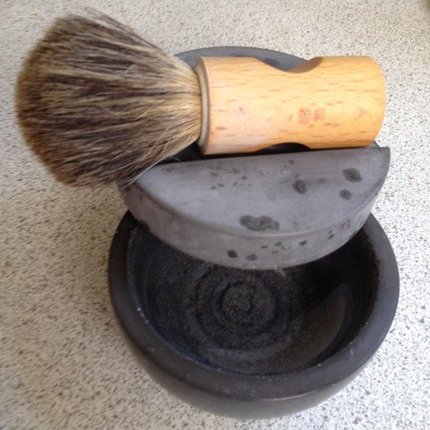

# Todo: Consider to make the indoor shed opening "brushes" by hand as indicating by Swedish traditional crafts?

```#df648d20``` *As of 2018-06-02 17:59*

[mail plain/text](mail.txt)


It seems we may be able to actually make the indoor shed “opening brushes” by hand as they craftsmen did in the past?

1) Consider horse tail hair from Bergdala Spinnhus (<http://www.bergdalaspinnhus.com/shop.html>)?

**180602 - I bought 100g (175 SEK) to see what I can use it for and how much “brush” I can make from it?**

1)Consider this Swedish site where they sell hand made brushes made from animal, plant and synthetic fibers (<https://www.irishantverk.se/sv/borstar>)?

==&gt; Consider to order two 130 cm brushes fro my indoor shed from “Iris Hantverk”?

==&gt; Consider to buy raw materials (fibers) from Iris Hantverk?

NOTE: It seems I need to visit their store in Stockholm (E.g., Kungsgatan 55 , close to Vetekatten)


==&gt; Consider to also buy their shaving soap?


NOTE: I already have a good enough cup and brush?



…

2) YES! They seem to sell the materials (fibers) to make brushes (<https://www.irishantverk.se/sv/borstmaterial>)?


… and more...

3) NO! They only sell to companies and minimum order is 3000 SEK :(


4) YES! They seem to sell over counter to private persons in Stockholm :)


…

Consider to delve into this idea of actually manufacturing the indoor shed opening-brushes by hand using animal or plant fibres?

...


