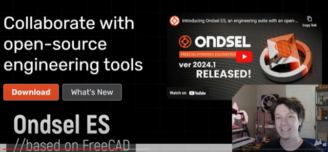
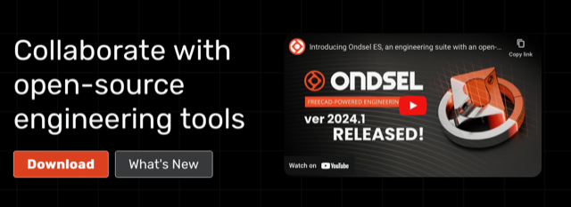

# Todo: Consider youtube video "BEST FREE CAD / 3D Modelling software 2024 - I tested them all!" with a survey of free 3D software for 3D printing?

```#dfc1de90``` *As of 2024-02-28 10:57*

[mail plain/text](mail.txt)


I want an offline easy to use 3D CAD software to use for designing things to 3D print.

1) Consider youtube video "BEST FREE CAD / 3D Modelling software 2024 - I tested them all!" (<https://youtu.be/J--QVhGheP4> )?

==&gt; At around 15:00 he seems to recommend Freecad offspring "Ondsel ES" made by a company (<https://youtu.be/J--QVhGheP4?t=900> )?



2) It seems "Ondsel ES" lives here on the web (<https://ondsel.com> )?



...


